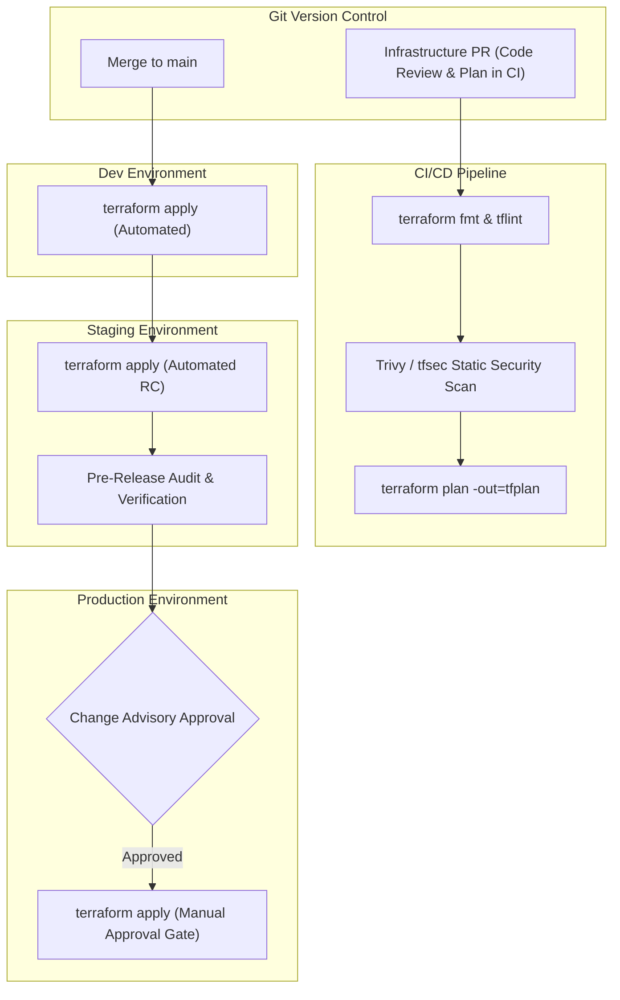

# KELVIN Infrastructure as Code (IaC) Operational Guide

**Document Control**

| Field | Value |
| :--- | :--- |
| **Status** | Approved — Operational Standard |
| **Milestone** | Phase 5 — Production Hardening, Deployment & Release (`P5-02`) |
| **Parent Roadmap** | [KELVIN Engineering Roadmap](../ISSUE-02_ENGINEERING_ROADMAP.md) |
| **Parent Issue** | Issue #358 (`P5-02`) |
| **Architecture Reference** | [`docs/architecture/PRODUCTION_DEPLOYMENT_ARCHITECTURE.md`](../architecture/PRODUCTION_DEPLOYMENT_ARCHITECTURE.md) |
| **Review Cadence** | Quarterly |
| **Classification** | Internal — Operational Standard |

---

## 1. Overview & Tooling Baseline

KELVIN infrastructure is declared declaratively via **Terraform >= 1.7.0** (or **OpenTofu >= 1.6.0**), guaranteeing that all environments (Development, Staging, and Production) are fully reproducible, auditable, and version-controlled.

### Core Tenets
- **Immutable Infrastructure:** Server state is never modified in-place; application deployments roll out new container tasks via blue/green or canary deployments.
- **Least-Privilege IAM Roles:** Application pods, worker orchestrators, and scanner runtimes carry dedicated IAM service roles with strictly bounded permission boundaries.
- **Independent Remote State:** Each environment utilizes a dedicated, encrypted S3 bucket and DynamoDB lock table for remote state storage.

---

## 2. Environment Provisioning & Promotion Workflow



---

## 3. Provisioning Step-by-Step

### 3.1 Prerequisites
- AWS CLI configured with federated SSO credentials.
- Terraform >= 1.7.0 installed.
- Appropriate AWS IAM permissions (`KelvinInfraDeployerRole`).

### 3.2 Initialize and Deploy Staging
```bash
cd infra/terraform/environments/staging
terraform init
cp terraform.tfvars.example terraform.tfvars
# Update variables if required
terraform plan -out=staging.tfplan
terraform apply staging.tfplan
```

### 3.3 Initialize and Deploy Production
```bash
cd infra/terraform/environments/prod
terraform init
cp terraform.tfvars.example terraform.tfvars
terraform plan -out=prod.tfplan
# Review plan with Platform Architecture & Security Lead
terraform apply prod.tfplan
```

---

## 4. Controlled Destruction and Recreation Policy

> [!CAUTION]
> Production data stores (PostgreSQL and Evidence S3 buckets) have `deletion_protection = true` enabled by default. Under no circumstances should `terraform destroy` be executed on production environments without executive authorization and verified cold backups.

### Safe Tear-Down Procedure (Dev / Ephemeral Staging)
1. Verify target workspace is strictly `dev` or non-production:
   ```bash
   terraform workspace show
   ```
2. Disable deletion protection override in terraform vars if tearing down temporary load test environments.
3. Run planned destroy:
   ```bash
   terraform plan -destroy -out=destroy.tfplan
   terraform apply destroy.tfplan
   ```

---

## 5. Security & Secret Governance

1. **Zero Repository Secrets:** No passwords, private keys, or API tokens are allowed in `.tf` or `.tfvars` files. Pre-commit hooks and CI security checks block any commits with secret signatures.
2. **Dynamic Generation:** Database passwords and symmetric encryption keys are generated randomly and stored directly in AWS Secrets Manager and KMS.
3. **Audit Trail:** All Terraform state modifications and AWS API calls are logged to AWS CloudTrail with immutable S3 multi-region logging.
