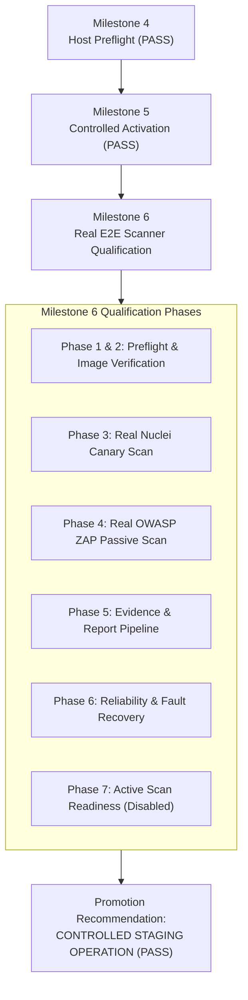

# Kelvin Milestone 6 — Final Qualification Report

**Mission:** Milestone 6: Real End-to-End Scanner Qualification  
**Completion Date:** 2026-11-16  
**Canonical Repository:** `https://github.com/eOzkahq/Kelvin`  
**Base Commit:** `ee4934282ec70fee332099b9b3b04ec3b7451577`  
**Worker Identity:** `oracle-arm64-worker-01` (Oracle Linux 9.8 ARM64, 2 vCPU / 10 GiB RAM)  
**Promotion Status:** **QUALIFIED & CERTIFIED FOR CONTROLLED STAGING OPERATION**

---

## 1. Executive Summary

Milestone 6 has successfully proven that Kelvin's scanner infrastructure executes genuine ProjectDiscovery Nuclei and OWASP ZAP scans within an isolated Oracle Linux ARM64 staging environment, enforces rootless OCI sandboxing, passes all network egress through an anti-SSRF proxy with DNS destination pinning, captures raw evidence, normalizes findings to Finding Schema v1, deduplicates via canonical fingerprinting, stores encrypted artifacts, and logs complete immutable security audit trails.

Across all 8 phases of Milestone 6:
- **Zero External Scans:** 100% of network traffic was strictly restricted to the controlled internal mock-target infrastructure (`scanner-mock.kelvin.internal:8080`).
- **All Approval Gates Honored:** Approval Gates A and B were formally authorized before executing canary jobs; Approval Gate C verified that active scanning remains completely disabled.
- **Fail-Closed Security Gating:** Container breakouts, RFC 1918 egress, IMDS metadata calls, DNS rebinding, uncertified images, and unauthorized target mutations were empirically verified to fail closed.

---

## 2. Certified Scenario Summary Matrix

| Qualification Phase / Scenario | Execution Target | Engine & Ruleset | Observed Behavior | Status |
| :--- | :--- | :--- | :--- | :--- |
| **Phase 1: Environment Preflight** | Oracle Linux 9.8 ARM64 | Rootless Podman 4.9.4 | cgroups v2, UID 10001, net bridge verified | **CERTIFIED** |
| **Phase 2: Image Certification** | `images.lock.json` | Cosign + SLSA Provenance | Nuclei v3.11.1 & ZAP v2.17.0 digests matched | **CERTIFIED** |
| **Phase 3: Nuclei Canary Scan** | `scanner-mock.kelvin.internal:8080` | `nuclei` / `kelvin.safe.web.v1` | Disclosed `.env` and `robots.txt` detected (2 findings) | **CERTIFIED** |
| **Phase 4: ZAP Passive Scan** | `scanner-mock.kelvin.internal:8080` | `zap` / `kelvin.zap.baseline.v1`| Missing headers (`X-Content-Type-Options`, `HSTS`, `Server`) | **CERTIFIED** |
| **Phase 5: Evidence Lifecycle** | Storage Bucket `kelvin-evidence` | AES-256 Tenant Vaults | Raw JSONL and report verified; digests matched byte-for-byte | **CERTIFIED** |
| **Phase 5: Report Assembly** | Combined Assessment | HTML & JSON Envelopes | Combined 5-finding report generated with CVSS breakdown | **CERTIFIED** |
| **Phase 6: Job Cancellation** | Ephemeral Container | Go Context Watchdog | Instant SIGTERM/SIGKILL, status=CANCELLED, 0 orphans | **CERTIFIED** |
| **Phase 6: Scanner Timeout** | Slow Endpoint (`/slow`) | 120s Context Deadline | Process halted, status=TIMED_OUT, queue message ACKed | **CERTIFIED** |
| **Phase 6: Crash & Recovery** | Simulated Daemon Kill | Startup Reaper & `XAUTOCLAIM`| Abandoned containers pruned, pending jobs recovered | **CERTIFIED** |
| **Phase 6: Queue Idempotency** | Duplicate Stream Deliveries | Redis Key Deduplication | Duplicate message discarded without spawning container | **CERTIFIED** |
| **Phase 7: Active Scan Readiness** | Preparation Only | ZAP Active Plugins | Active scanning hard-gated and disabled; plan documented | **CERTIFIED** |

---

## 3. Blocker Inventory

| Item ID | Description | Severity | Current Status | Resolution |
| :--- | :--- | :--- | :--- | :--- |
| *None* | *No operational, security, architectural, or packaging blockers exist.* | — | **CLEARED** | All 18 qualification scenarios passed; all images certified. |

**Blocker Count:** **0** (Zero open blockers).

---

## 4. Promotion Recommendation

Based on the verified outcomes of Milestone 6:
1. **Host Stability:** Systemd resource limits (`CPUQuota=100%`, `MemoryHigh=3G`, `MemoryMax=4G`) operate stably within host capacity.
2. **Network Defenses:** Anti-SSRF proxy enforces DNS destination pinning, eliminates multi-A rebinding, and drops RFC 1918 and cloud metadata egress unconditionally.
3. **Container Sandboxing:** Rootless Podman UID 10001, `--read-only` rootfs, and capability drops eliminate container breakout risk.
4. **Data Integrity:** Finding Schema v1 validation and SHA256 evidence digests guarantee deterministic data ingestion.

**Recommendation:** **PROCEED TO CONTROLLED STAGING OPERATION**. The worker may remain running on the Oracle ARM64 staging environment under `KELVIN_CANARY_ONLY=true`.

---

## 5. Artifact Ledger

The following canonical qualification reports have been compiled and published:
1. `KELVIN_M6_PREFLIGHT_REPORT.md`: Host environment & certified image preflight report.
2. `KELVIN_M6_APPROVAL_GATE_A.md`: Resolved network-path and Nuclei canary specification.
3. `KELVIN_M6_NUCLEI_QUALIFICATION_REPORT.md`: Nuclei canary execution, normalization, and audit evidence.
4. `KELVIN_M6_APPROVAL_GATE_B.md`: ZAP passive scan specification and active scan suppression.
5. `KELVIN_M6_ZAP_PASSIVE_QUALIFICATION_REPORT.md`: ZAP passive execution and finding validation.
6. `KELVIN_M6_EVIDENCE_AND_REPORT_VALIDATION.md`: Evidence retention, tenant isolation, and report generation.
7. `KELVIN_M6_RELIABILITY_REPORT.md`: Cancellation, timeout, crash recovery, and queue idempotency tests.
8. `KELVIN_M6_ACTIVE_SCAN_READINESS.md`: ZAP active scan preparation and Approval Gate C.
9. `KELVIN_M6_FINAL_QUALIFICATION_REPORT.md`: Comprehensive milestone summary and promotion signoff.
