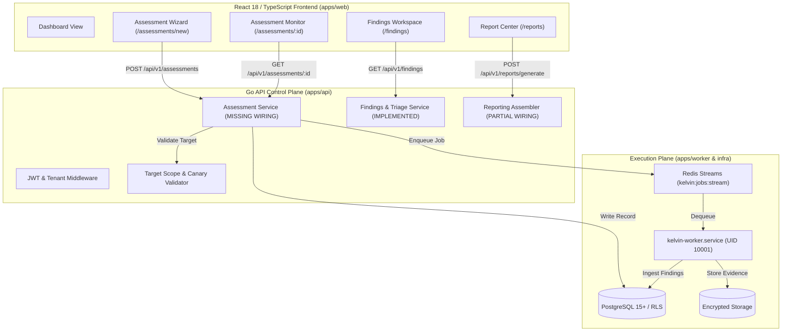
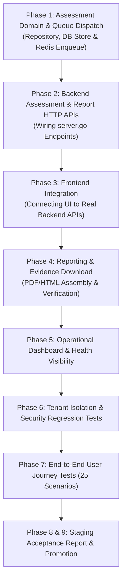

# Kelvin Milestone 7 — Baseline Reconciliation & Product Integration Audit

**Mission:** Milestone 7: Controlled Staging Promotion & Product Integration  
**Audit Date:** 2026-11-16  
**Canonical Repository:** `https://github.com/eOzkahq/Kelvin`  
**Milestone 6 Baseline SHA:** `e70ec78c038132bb29d851b4661bbb93c642e95e` (incorporating PR #614)  
**Target Environment:** Oracle Linux 9.8 ARM64 Staging Fleet (`oracle-arm64-worker-01`)  
**Canary Directive:** `KELVIN_CANARY_ONLY=true` (Zero external scanning; mock target only)

---

## 1. Executive Summary

Milestone 6 successfully qualified the underlying scanner infrastructure, proving that rootless Podman containers execute certified Nuclei v3.11.1 and OWASP ZAP v2.17.0 images safely under anti-SSRF egress filtering, produce valid Finding Schema v1 outputs, and persist evidence and audit logs.

The goal of **Milestone 7** is to transform this execution engine into an integrated, end-to-end security assessment product. A staging user must be able to authenticate, create an assessment, select authorized targets and profiles, submit and monitor the assessment, review normalized findings and supporting evidence, generate downloadable reports, and inspect audit logs.

This audit establishes the baseline of implemented, partially implemented, and missing capabilities across the Go backend, PostgreSQL database, Redis broker, and TypeScript/React frontend, providing an actionable roadmap for Milestone 7 execution.

---

## 2. Baseline Capability Inventory

### 2.1 Implemented Capabilities (100% Operational)
- **Hardened Scanner Execution Engine:** Rootless Podman 4.9.4 execution with `crun` on Oracle Linux 9.8 ARM64 (`UID 10001:10001`), cgroups v2 resource quotas (`CPUQuota=100%`, `MemoryHigh=3G`, `MemoryMax=4G`), `--read-only` rootfs, and dropped capabilities (`--cap-drop=ALL`).
- **Certified Scanner Images:** Release-certified ProjectDiscovery Nuclei v3.11.1 (`sha256:3653bf7c...`) and OWASP ZAP v2.17.0 (`sha256:3ae56fdc...`) pinned in `deploy/scanners/images.lock.json`.
- **Anti-SSRF Network Egress Filtering:** Dedicated internal bridge network `kelvin-scanner-net` (`10.89.10.0/24`, `internal: true`) with zero direct internet gateway. All traffic is forced through egress proxy `10.89.10.1:PORT` with DNS destination pinning, blocking RFC 1918 and IMDS (`169.254.169.254`) unconditionally.
- **Canary Policy Enforcement:** Worker enforces `KELVIN_CANARY_ONLY=true`, rejecting any target outside `scanner-mock.kelvin.internal`, `mock-target.kelvin.internal`, and local test endpoints.
- **Finding Normalization & Deduplication:** `NormalizeNucleiReport` and `NormalizeZAPReport` ingest scanner output into Finding Schema v1 (`packages/schemas/finding.v1.json`). Canonical SHA-256 fingerprints prevent duplicate insertions.
- **Database Schema & RLS:** 61 versioned PostgreSQL migrations in `apps/api/db/migrations` enforcing tenant isolation via `current_tenant_id()`. Tables `assessments`, `jobs`, `assessment_manifests`, `findings`, `evidence`, and `reports` exist with relational integrity.
- **Job State Machine:** `apps/api/pkg/job/state.go` defines transitions between `QUEUED`, `VALIDATING`, `RUNNING`, `COMPLETED`, `FAILED`, `CANCELLED`, `TIMED_OUT`.
- **Finding Management APIs:** Fully implemented endpoints in `apps/api/internal/httpapi/findings.go` for finding search, triage, suppression, false-positive handling, risk explainability, and evidence links.
- **Authentication & Security Middleware:** JWT token validation, role-based authorization (`RoleTenantAdmin`, `RoleSecurityAnalyst`), correlation IDs, request body limits, access logging, and panic recovery.
- **Frontend SPA Foundation:** Complete page routes, accessible components, and `apiClient` with automatic Bearer token and `X-Tenant-ID` header injection.

### 2.2 Partially Implemented Capabilities
- **Assessment Management APIs:**
  - `POST /api/v1/assessments/{id}/cancel` is implemented in `server.go`.
  - `GET /api/v1/assessments/{base_id}/compare/{target_id}` is implemented in `server.go`.
  - *Gap:* `POST /api/v1/assessments` (creation/dispatch), `GET /api/v1/assessments` (list), `GET /api/v1/assessments/{id}` (details), `GET /api/v1/assessments/profiles` (profiles), and `GET /api/v1/targets` (target catalog) are not wired into `server.go`.
- **Reporting Engine:**
  - `apps/api/internal/reporting` has full domain logic (`assembler.go`, `render.go`, `storage.go`) to generate ReportV1 JSON/HTML and store in Supabase/MinIO.
  - *Gap:* HTTP handlers (`POST /api/v1/reports/generate`, `GET /api/v1/reports`, `GET /api/v1/reports/{id}/download`) are not wired in `server.go`.
- **Dashboard Observability:**
  - `GET /api/v1/findings/dashboard` provides finding severity counts.
  - *Gap:* Unified `GET /api/v1/dashboard/stats` combining assessment totals, active jobs, finding metrics, and scanner readiness is missing.
- **Frontend Live Backend Connection:**
  - Frontend features (`assessmentApi.ts`, `reportsApi.ts`, `dashboardApi.ts`) contain fallbacks to `demoProvider` or mock datasets when backend endpoints are missing or when `VITE_KELVIN_DEMO_MODE=true`.

### 2.3 Missing Capabilities
1. **Assessment HTTP Handlers & Service Layer:**
   - Creation of assessments with target scope validation and canary check.
   - Retrieval of assessment catalog with status, duration, and findings summary.
   - Retrieval of detailed assessment execution timeline and scanner metadata.
   - Listing of approved scan profiles (`standard`, `deep`, `safe_web`).
   - Listing of authorized target assets.
2. **Queue Submission Integration from API:**
   - Dispatching jobs to Redis Streams `kelvin:jobs:stream` using `packages/common/queue` when an assessment is launched.
   - Recording `assessment_manifests` immutable audit rows.
3. **Report Generation & Download Handlers:**
   - On-demand assessment report generation endpoint.
   - Secure signed download URL generation for reports.
4. **End-to-End Product Tests:**
   - Integration tests verifying the complete multi-step user journey from login to report download.

---

## 3. Existing API Endpoints vs Required Matrix

| Route | Method | Current Status | Milestone 7 Action Required |
| :--- | :--- | :--- | :--- |
| `/api/v1/health` | GET | Implemented | Preserve |
| `/healthz`, `/readyz` | GET | Implemented | Preserve |
| `/api/v1/assessments` | POST | **Missing** | Implement assessment creation & queue dispatch |
| `/api/v1/assessments` | GET | **Missing** | Implement assessment catalog list |
| `/api/v1/assessments/{id}` | GET | **Missing** | Implement assessment detail retrieval |
| `/api/v1/assessments/profiles` | GET | **Missing** | Implement approved profile taxonomy |
| `/api/v1/targets` | GET | **Missing** | Implement authorized targets list |
| `/api/v1/assessments/{id}/cancel` | POST | Implemented | Preserve |
| `/api/v1/assessments/{base}/compare/{target}` | GET | Implemented | Preserve |
| `/api/v1/findings` | GET | Implemented | Preserve (supports assessment filter) |
| `/api/v1/findings/dashboard` | GET | Implemented | Preserve |
| `/api/v1/findings/{id}` | GET | Implemented | Preserve |
| `/api/v1/findings/{id}/evidence` | GET | Implemented | Preserve |
| `/api/v1/findings/{id}/evidence/{eid}/download` | GET | Implemented | Preserve |
| `/api/v1/reports` | GET | **Missing** | Wire report listing from reporting store |
| `/api/v1/reports/generate` | POST | **Missing** | Wire on-demand report assembly & rendering |
| `/api/v1/reports/{id}/download` | GET | **Missing** | Implement signed report download URL generation |
| `/api/v1/dashboard/stats` | GET | **Missing** | Implement unified dashboard metrics endpoint |

---

## 4. Frontend Integration Analysis

| Feature View | Page Component | Current Data Source | Required Integration |
| :--- | :--- | :--- | :--- |
| **Dashboard** | `DashboardPage.tsx` | Fallback mock in `dashboardApi.ts` | Wire to `GET /api/v1/dashboard/stats` |
| **Assessment List** | `AssessmentListPage.tsx` | Demo provider in `assessmentApi.ts` | Wire to `GET /api/v1/assessments` |
| **Assessment Creation** | `AssessmentWizardPage.tsx` | Demo provider in `assessmentApi.ts` | Wire to `POST /api/v1/assessments`, `fetchProfiles`, `fetchTargets` |
| **Assessment Details** | `AssessmentDetailPage.tsx` | Demo provider in `assessmentApi.ts` | Wire to `GET /api/v1/assessments/{id}`, real status polling |
| **Findings Explorer** | `FindingsWorkspacePage.tsx` | Real API client (`/api/v1/findings`) | Already wired to real API; verify live data |
| **Finding Detail** | `FindingDetailPage.tsx` | Real API client (`/api/v1/findings/{id}`) | Already wired to real API; verify live data |
| **Report Center** | `ReportCenterPage.tsx` | Mock store in `reportsApi.ts` | Wire to `GET /api/v1/reports`, `POST /api/v1/reports/generate` |

---

## 5. Security & Isolation Architecture

1. **Anti-SSRF Target Gating:** The API must evaluate every assessment target through `packages/common/scope` before saving or queuing. If `KELVIN_CANARY_ONLY=true`, it must reject any target not matching `allowedCanaryTargets`.
2. **Tenant Isolation:** Every database operation must enforce `tenant_id = current_tenant_id()`. Cross-tenant assessment, finding, evidence, or report requests must return `403 Forbidden` or `404 Not Found`.
3. **Role-Based Access Control:**
   - Assessment creation, cancellation, and report generation require `RoleTenantAdmin` or `RoleSecurityAnalyst`.
   - Read-only viewing permitted for standard analysts.
4. **Secret Redaction:** Scanner outputs and evidence must sanitize authorization headers, session cookies, and API tokens before presentation in the UI.

---

## 6. Recommended Milestone 7 Implementation Sequence

1. **Step 1 (Phase 1): Assessment Service & Queue Dispatch**
   - Create `apps/api/internal/assessments` package implementing `AssessmentRepository` (Postgres CRUD with tenant RLS) and `AssessmentDispatcher` (Redis queue integration via `packages/common/queue`).
2. **Step 2 (Phase 2): HTTP API Handlers in `server.go`**
   - Wire `POST /api/v1/assessments`, `GET /api/v1/assessments`, `GET /api/v1/assessments/{id}`, `GET /api/v1/assessments/profiles`, `GET /api/v1/targets`.
   - Wire `POST /api/v1/reports/generate`, `GET /api/v1/reports`, `GET /api/v1/reports/{id}/download`.
   - Wire `GET /api/v1/dashboard/stats`.
3. **Step 3 (Phase 3): Frontend API Real Wiring**
   - Update `assessmentApi.ts`, `reportsApi.ts`, `dashboardApi.ts` to query real backend endpoints by default.
4. **Step 4 (Phase 4): Evidence & Reporting Integration**
   - Verify report generation from completed assessment findings and signed download verification.
5. **Step 5 (Phase 5): Observability & Metrics**
   - Expose queue depth and worker health in dashboard stats.
6. **Step 6 (Phase 6): Security & Isolation Regression Suite**
   - Add automated test assertions verifying cross-tenant access rejection on all new routes.
7. **Step 7 (Phase 7): End-to-End 25-Scenario Integration Test**
   - Automated integration suite covering the complete user journey from creation to report download.
8. **Step 8 (Phase 8 & 9): Final Staging Acceptance & Report**
   - Deliver `KELVIN_M7_STAGING_ACCEPTANCE_REPORT.md`.
