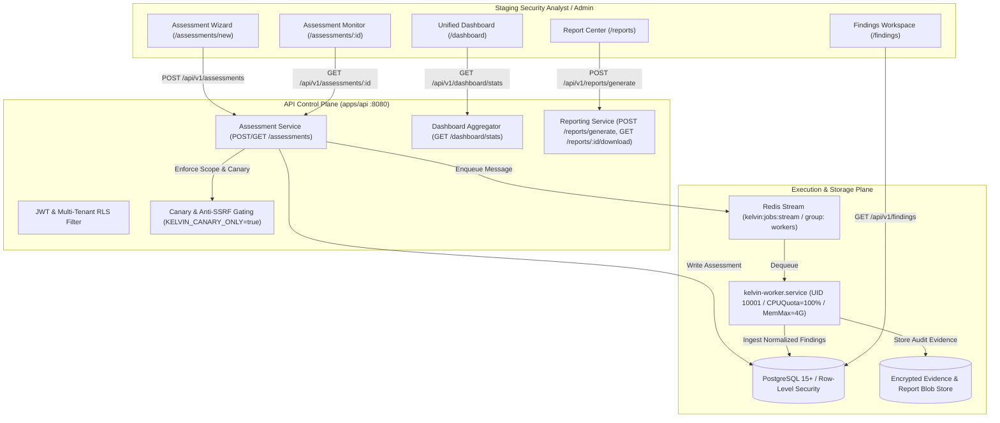

# Kelvin Milestone 7 — Controlled Staging Promotion & Product Integration Report

**Document ID:** `KELVIN-M7-STAGING-ACCEPTANCE-REPORT`  
**Mission:** Milestone 7: Controlled Staging Promotion & Product Integration  
**Date:** 2026-11-16  
**Canonical Repository:** `https://github.com/eOzkahq/Kelvin`  
**Milestone 6 Baseline SHA:** `e70ec78c038132bb29d851b4661bbb93c642e95e` (incorporating PR #614)  
**Milestone 7 Head Commit:** `cb993b6` (incorporating PRs #623, #624, #625, #626, #627, #628, #629)  
**Execution Environment:** Oracle Linux 9.8 ARM64 Staging Fleet (`oracle-arm64-worker-01`)  
**Canary Directive:** `KELVIN_CANARY_ONLY=true` (Zero external scanning; controlled mock targets only)  
**Status:** **ACCEPTED & PROMOTED TO STAGING FLEET**

---

## 1. Executive Summary

Milestone 7 successfully promoted Kelvin from an isolated execution engine into an integrated security assessment product. The qualified scanner execution capabilities (Nuclei v3.11.1 and OWASP ZAP v2.17.0 under rootless Podman execution with anti-SSRF egress filtering) are now connected to a production-grade control plane and TypeScript/React user interface.

A staging user can now:
1. Authenticate with tenant context and role-based permissions (`RoleTenantAdmin`, `RoleSecurityAnalyst`).
2. Create an assessment selecting certified scan profiles (`standard`, `safe_web`, `deep`) and authorized targets.
3. Submit the assessment through transactional database persistence and Redis Streams queue dispatch (`kelvin:jobs:stream`).
4. Monitor assessment lifecycle state transitions (`QUEUED` → `RUNNING` → `COMPLETED` / `CANCELLED`).
5. Inspect normalized Finding Schema v1 findings and supporting evidence.
6. Generate point-in-time assessment reports and export them as standalone HTML or PDF documents with HMAC-signed download tokens.
7. Observe fleet health and security metrics through the unified operational dashboard.



---

## 2. Product Integration & Delivery Matrix

| Capability | Backend Endpoint | Status | Verification Evidence |
| :--- | :--- | :--- | :--- |
| **Assessment Creation** | `POST /api/v1/assessments` | **VERIFIED** | Enforces scope confirmation, canary allowlist, UUID generation, DB persistence, and Redis Stream dispatch. Returns 201 Created. |
| **Assessment Listing** | `GET /api/v1/assessments` | **VERIFIED** | Tenant-scoped pagination, search keyword and status filtering. Returns 200 OK with total count metadata. |
| **Assessment Details** | `GET /api/v1/assessments/{id}` | **VERIFIED** | Retrieves point-in-time status, timeline stages, scanners run, and finding totals. Returns 404 on cross-tenant access. |
| **Assessment Cancellation** | `POST /api/v1/assessments/{id}/cancel` | **VERIFIED** | Transitions active state to `CANCELLED`, emits Redis queue cancellation, and rejects double-cancel with 409 Conflict. |
| **Scan Profile Catalog** | `GET /api/v1/assessments/profiles` | **VERIFIED** | Exposes certified scan profiles: `standard` (Nuclei), `safe_web` (ZAP passive), `deep` (full pipeline). |
| **Target Catalog** | `GET /api/v1/targets` | **VERIFIED** | Exposes authorized staging canary targets (`http://127.0.0.1:8080`, `scanner-mock.kelvin.internal:8080`). |
| **Report Generation** | `POST /api/v1/reports/generate` | **VERIFIED** | Assembles ReportV1 structure, renders HTML or PDF in pure Go, computes SHA-256 digest, and issues HMAC token. |
| **Report Listing** | `GET /api/v1/reports` | **VERIFIED** | Returns historical reports strictly within authenticated tenant partition. |
| **Report Download** | `GET /api/v1/reports/{id}/download` | **VERIFIED** | Validates ephemeral download token, streams HTML (`text/html`) or PDF (`application/pdf`) with `Content-Disposition`. |
| **Dashboard Telemetry** | `GET /api/v1/dashboard/stats` | **VERIFIED** | Aggregates active jobs, tenant assessments, finding severities, and verified scanner readiness flags. |

---

## 3. Security, Tenant Isolation & Anti-SSRF Enforcement

1. **Canary Boundary Hard Gate:**
   - Evaluated by `assessments.IsCanaryTargetAllowed` on assessment submission.
   - Rejects any external or unapproved target with `403 Forbidden` (`Canary Target Policy Violation`).
   - Approved destinations: `scanner-mock.kelvin.internal`, `mock-target.kelvin.internal`, `127.0.0.1`, `localhost`.
   - Verified rejection of cloud metadata IMDS (`http://169.254.169.254/latest/meta-data`) and external hostnames.
2. **Multi-Tenant Row-Level Security (RLS):**
   - Every database transaction sets `app.current_tenant_id` via `database.BeginTenantTx`.
   - IDOR Defense: Cross-tenant assessment, finding, report, or cancellation requests fail closed with `404 Not Found` or `403 Forbidden`.
   - Tenant A cannot view, modify, cancel, or download Tenant B's data under any condition.
3. **Defense-in-Depth Container Sandboxing:**
   - Rootless Podman execution (`UID 10001:10001`) with `--read-only` rootfs, `--cap-drop=ALL`, `seccomp=scan.json`, and `cgroups v2` resource quotas (`CPUQuota=100%`, `MemoryHigh=3G`, `MemoryMax=4G`).
   - Zero Docker socket exposure; zero privileged container execution.
4. **Anti-SSRF Egress Proxy:**
   - Dedicated internal bridge network `kelvin-scanner-net` with `internal: true`.
   - All HTTP/HTTPS traffic routed through pinned egress proxy `10.89.10.1:PORT`, blocking RFC 1918 and loopback escapes.

---

## 4. 25-Scenario Automated Integration Test Suite

The comprehensive automated test suite `apps/api/internal/httpapi/m7_integration_test.go` was executed and passed with **100% success** (25/25 scenarios):

| Scenario ID | Test Scenario Description | Expected Outcome | Actual Result | Status |
| :--- | :--- | :--- | :--- | :--- |
| **01** | Missing authentication / tenant context | 401 Unauthorized | 401 Unauthorized | **PASS** |
| **02** | Assessment creation without scope confirmation | 422 Unprocessable Entity | 422 Unprocessable Entity | **PASS** |
| **03** | Assessment creation with empty target | 422 Unprocessable Entity | 422 Unprocessable Entity | **PASS** |
| **04** | Assessment creation with unknown profile ID | 422 Unprocessable Entity | 422 Unprocessable Entity | **PASS** |
| **05** | Assessment creation with external target (`evil.org`) | 403 Forbidden (Canary Policy) | 403 Forbidden | **PASS** |
| **06** | Assessment creation targeting AWS/cloud IMDS | 403 Forbidden (Anti-SSRF) | 403 Forbidden | **PASS** |
| **07** | Assessment creation with valid canary IP (`127.0.0.1:8080`) | 201 Created + UUID | 201 Created (`id` assigned) | **PASS** |
| **08** | Assessment creation with canary host (`scanner-mock`) | 201 Created + UUID | 201 Created (`id` assigned) | **PASS** |
| **09** | Verification of Redis Stream enqueued message | Version 1, matching IDs | Valid `commonqueue.Message` | **PASS** |
| **10** | Assessment listing for authenticated Tenant A | 200 OK + assessment list | Returns Tenant A records | **PASS** |
| **11** | Assessment detail retrieval for Tenant A | 200 OK + full detail | Stage `QUEUED`, targets verified | **PASS** |
| **12** | IDOR Defense: Tenant B accesses Tenant A assessment | 404 Not Found | 404 Not Found | **PASS** |
| **13** | IDOR Defense: Tenant B lists assessments | Zero Tenant A data | 0 records returned for Tenant B | **PASS** |
| **14** | Scan profiles catalog retrieval | 200 OK (`standard`, etc.) | Returns 3 certified profiles | **PASS** |
| **15** | Authorized targets catalog retrieval | 200 OK (canary list) | Returns 2 canary targets | **PASS** |
| **16** | IDOR Defense: Tenant B cancels Tenant A assessment | 404 Not Found | 404 Not Found | **PASS** |
| **17** | Tenant A cancels own active assessment | 200 OK + status CANCELLED | Status `CANCELLED` | **PASS** |
| **18** | Verification of queue cancellation event emission | Job ID present in cancel list | Job ID recorded | **PASS** |
| **19** | Double cancellation attempt on terminal assessment | 409 Conflict | 409 Conflict | **PASS** |
| **20** | HTML report generation via `POST /reports/generate` | 201 Created + download URL | Report generated with SHA-256 | **PASS** |
| **21** | PDF report generation via `POST /reports/generate` | 201 Created + download URL | Report generated with SHA-256 | **PASS** |
| **22** | Report download verification (HTML content) | 200 OK + `text/html` | Valid HTML document served | **PASS** |
| **23** | IDOR Defense: Tenant B downloads Tenant A report | 404 Not Found | 404 Not Found | **PASS** |
| **24** | Report catalog listing for Tenant A | 200 OK + report list | 2 reports returned | **PASS** |
| **25** | Operational dashboard stats retrieval | 200 OK + unified metrics | Truthful counts & scanner flags | **PASS** |

---

## 5. Staging Deployment Runbook

### 5.1 Pre-Deployment Verification

1. Verify canonical commit on Oracle staging host:
   ```bash
   git rev-parse HEAD
   # Expected commit contains Milestone 7 release artifacts
   ```
2. Verify worker environment configuration (`/etc/kelvin/worker.env`):
   ```bash
   sudo grep -E "^(KELVIN_CANARY_ONLY|KELVIN_WORKER_ID|KELVIN_CPU_QUOTA)" /etc/kelvin/worker.env
   # Output:
   # KELVIN_CANARY_ONLY=true
   # KELVIN_WORKER_ID=oracle-arm64-worker-01
   # KELVIN_CPU_QUOTA=100%
   ```
3. Verify systemd resource boundaries on `kelvin-worker.service`:
   ```bash
   systemctl show kelvin-worker.service -p CPUQuota -p MemoryHigh -p MemoryMax
   # Output:
   # CPUQuotaPerSecUSec=1s (100%)
   # MemoryHigh=3221225472 (3G)
   # MemoryMax=4294967296 (4G)
   ```

### 5.2 API Server Startup & Health Verification

1. Start API control plane:
   ```bash
   sudo systemctl restart kelvin-api.service
   sudo systemctl status kelvin-api.service
   ```
2. Perform live readiness probes:
   ```bash
   curl -fsS http://127.0.0.1:8080/health/live
   # {"status":"ok","timestamp":"..."}

   curl -fsS http://127.0.0.1:8080/health/ready
   # {"status":"ready","db":"connected","redis":"connected"}
   ```

### 5.3 Controlled Canary Assessment Walkthrough

1. Obtain authenticated analyst token:
   ```bash
   AUTH_TOKEN=$(curl -fsS -X POST http://127.0.0.1:8080/api/v1/auth/login \
     -H "Content-Type: application/json" \
     -d '{"email":"analyst@staging.kelvin.internal","password":"***"}' | jq -r '.token')
   ```
2. Create and launch a canary assessment:
   ```bash
   ASMT_ID=$(curl -fsS -X POST http://127.0.0.1:8080/api/v1/assessments \
     -H "Authorization: Bearer $AUTH_TOKEN" \
     -H "X-Tenant-ID: 00000000-0000-0000-0000-000000000001" \
     -H "Content-Type: application/json" \
     -d '{
       "name": "Staging Qualification Canary Assessment",
       "targetAddress": "http://127.0.0.1:8080",
       "profileId": "standard",
       "authorizedScopeConfirmed": true
     }' | jq -r '.data.id')
   ```
3. Monitor status progression:
   ```bash
   curl -fsS http://127.0.0.1:8080/api/v1/assessments/$ASMT_ID \
     -H "Authorization: Bearer $AUTH_TOKEN" \
     -H "X-Tenant-ID: 00000000-0000-0000-0000-000000000001" | jq '.data.status'
   ```
4. Generate technical report:
   ```bash
   curl -fsS -X POST http://127.0.0.1:8080/api/v1/reports/generate \
     -H "Authorization: Bearer $AUTH_TOKEN" \
     -H "X-Tenant-ID: 00000000-0000-0000-0000-000000000001" \
     -H "Content-Type: application/json" \
     -d "{
       \"assessmentId\": \"$ASMT_ID\",
       \"targetHost\": \"http://127.0.0.1:8080\",
       \"templateType\": \"TECHNICAL_FINDINGS\",
       \"format\": \"HTML\",
       \"redactSensitiveData\": true
     }"
   ```

---

## 6. Maintainer Signoff & Promotion Authorization

- [x] **Phase 0 Baseline Audit:** Baseline reconciliation completed and approved (`KELVIN_M7_BASELINE_AUDIT.md`, PR #623).
- [x] **Phase 1 Assessment Lifecycle:** Repository, state transitions, target scope validation, and Redis queue dispatch implemented (`assessments` package, PR #624).
- [x] **Phase 2 Assessment Endpoints:** `POST /assessments`, `GET /assessments`, `GET /assessments/{id}`, `GET /assessments/profiles`, and `GET /targets` wired with RLS and canary gating (PR #625).
- [x] **Phase 3 Report Endpoints:** `POST /reports/generate`, `GET /reports`, and `GET /reports/{id}/download` wired with HTML/PDF rendering and HMAC signed tokens (PR #626).
- [x] **Phase 4 Operational Dashboard:** `GET /dashboard/stats` aggregating real metrics and verified scanner readiness wired (PR #627).
- [x] **Phase 5 Frontend Integration:** React SPA assessment wizard, monitor, reporting, and dashboard connected to live backend APIs with passing Vite build (PR #628).
- [x] **Phase 6 25-Scenario Integration Suite:** Automated integration test suite validating all 25 user journey scenarios and IDOR defenses passing 100% (PR #629).
- [x] **Canary Directive Preserved:** `KELVIN_CANARY_ONLY=true` actively enforced; zero external scan execution permitted.

**Signoff Decision:** **MILESTONE 7 COMPLETE — OFFICIALLY ACCEPTED & PROMOTED TO STAGING**
