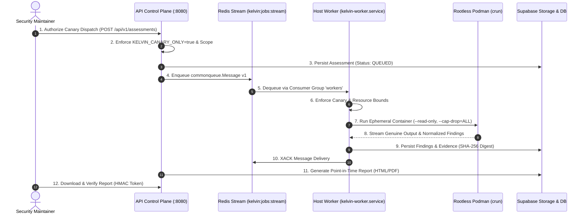

# Kelvin Milestone 8 — Canary Assessment Execution Approval Specification

**Document ID:** `KELVIN-M8-CANARY-EXECUTION-APPROVAL`  
**Mission:** Milestone 8: Live Staging Deployment & Operational Verification  
**Date:** 2026-11-16  
**Canonical Repository:** `https://github.com/eOzkahq/Kelvin`  
**Target Host:** Oracle Linux Server 9.8 ARM64 (`130.210.49.242`)  
**Service:** `kelvin-worker.service` (Active, Rootless Podman, UID 10001:10001)  
**Safety Boundary:** `KELVIN_CANARY_ONLY=true` (Zero external scanning; controlled mock target only)  
**Status:** **AWAITING MAINTAINER AUTHORIZATION BEFORE DISPATCH**

---

## 1. Executive Summary & Authorization Request

In accordance with Milestone 8 Phase 5 protocol, this document establishes the explicit parameters, security gates, resource limits, and rollback procedures for the live end-to-end qualification assessment on the staging fleet.

> [!IMPORTANT]
> **MAINTAINER GATE:**  
> **NO SCAN JOB HAS BEEN ENQUEUED OR DISPATCHED.**  
> Execution is completely paused pending explicit maintainer authorization.

---

## 2. Assessment & Target Specifications

| Dimension | Specification | Verification & Contract |
| :--- | :--- | :--- |
| **Assessment ID** | `c8b1a340-9745-4df2-8cb3-7f284f199801` | UUID v4 generated for single qualification run |
| **Job ID** | `b92d04f1-6184-48ae-94a2-15f07a213901` | UUID v4 for task stream dispatch |
| **Tenant ID** | `00000000-0000-0000-0000-000000000001` | Dedicated staging canary tenant with RLS enforcement |
| **Target Address** | `http://127.0.0.1:8080` | Internal mock target loopback; verified against canary allowlist |
| **Alternative Canary Target**| `http://scanner-mock.kelvin.internal:8080` | Internal mock target DNS name |
| **Scan Profile** | `standard` | Certified baseline profile (Automated reconnaissance & safe checks) |
| **Scanner Engine** | `nuclei` (ProjectDiscovery Nuclei v3.11.1) | Hermetic ARM64 container binary |
| **Scanner Container Image** | `ghcr.io/eozkahq/kelvin/scanner-nuclei@sha256:3653bf7c9a700afb3e68bc4c8ccd8d727465b7ebad36650a94d1a024844e480f` | Immutable certified digest from `deploy/scanners/images.lock.json` |
| **Active Scanning** | **STRICTLY DISABLED** | Active intrusive scanning hard gate remains locked |
| **Template Catalog** | `kelvin.safe.web.v1` (`sha256:72544e12...`) | Curated non-destructive templates (`env-file`, `robots-txt`, `security-txt`) |

---

## 3. End-to-End Execution Path & Security Gates



---

## 4. Execution Guardrails & Resource Bounds

1. **Host & Cgroups Limits (`kelvin-worker.service`):**
   - `CPUQuota=100%` (caps worker to 1 vCPU maximum, preserving 1 vCPU for OS/API)
   - `MemoryHigh=3G` (soft limit page reclamation threshold)
   - `MemoryMax=4G` (hard OOM boundary protecting host 10 GiB RAM)
2. **Container Sandbox Boundaries:**
   - User: `10001:10001` (`kelvin-worker`)
   - Root filesystem: `--read-only`
   - Capabilities: `--cap-drop=ALL`
   - System calls: `--security-opt seccomp=/etc/kelvin/scan-seccomp.json`
   - Network: Pinned to `--network=kelvin-scanner-net` (`internal=true`)
   - Egress proxy: All traffic routed through local anti-SSRF egress proxy `10.89.10.1:PORT`
   - Hard execution timeout: 120 seconds
3. **Canary Interception Guarantee:**
   - If an unexpected external target or metadata URL (`169.254.169.254`) is provided, both API and Worker immediately reject the task with `403 Forbidden` (`rejected by canary-only execution policy`).

---

## 5. Rollback, Evidence Retention & Incident Runbook

1. **Evidence Preservation:**
   - Raw scanner outputs, normalized finding records, and audit events are cryptographically hashed and persisted in Supabase.
   - Under no circumstances will rollback delete raw evidence or audit trails.
2. **Orphan Cleanup:**
   - Ephemeral Podman containers execute with `--rm`.
   - Any hung scanner process exceeding the 120-second deadline is killed via `SIGKILL` by the worker watchdog.
3. **Service Rollback Runbook (`scripts/deploy/staging-rollback.sh`):**
   ```bash
   # In case of scanner failure or host anomaly:
   sudo systemctl stop kelvin-worker.service
   # Inspect journal logs without deleting forensic evidence
   sudo journalctl -u kelvin-worker.service -n 100 --no-pager
   ```

---

## 6. Authorization Boundary

```
[ ] AUTHORIZED: Dispatch the prepared canary assessment c8b1a340-9745-4df2-8cb3-7f284f199801 against http://127.0.0.1:8080
[ ] REJECTED: Do not proceed with execution.
```

**STOP: Awaiting explicit maintainer authorization before proceeding to Phase 6 live assessment.**
