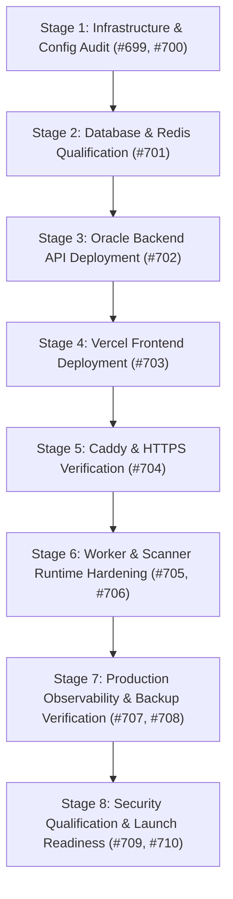

# KELVIN — Milestone M9.8 Production Deployment Plan
## Production Deployment, Infrastructure Verification, Staging Qualification & Launch Readiness

**Status:** ACTIVE DEPLOYMENT  
**Canonical Repository:** `https://github.com/eOzkahq/Kelvin`  
**Target Canonical Commit:** `54288c9` (or latest `main`)  
**Deployment Target Environment:** Production / Staging Hybrid (Oracle Cloud ARM64 + Vercel + Supabase + Upstash)  
**Date:** Wednesday, November 18, 2026

---

## 1. Primary Objectives & Invariant Governance

This document establishes the authoritative execution plan for deploying Kelvin Milestone M9 (M9.1 through M9.7) to production and achieving full operational launch readiness.

### Strict Safety Invariants:
1. **Human Approval Gates:**
   - Worker activation for live production targets requires separate explicit human sign-off.
   - Public/custom target scanning is forbidden until isolated qualification is approved.
   - Zero unreviewed or destructive database migrations.
   - Zero secret exposure in logs, commands, or documentation.
2. **Canary & Scope Lockdown:**
   - `KELVIN_CANARY_ONLY=true` locked in `/etc/kelvin/staging.env`.
   - `kelvin-worker.service` strictly managed and isolated.
3. **Rollback Preservation:**
   - Existing known-good container images (`kelvin-api:rollback-auth-m8`, `kelvin-api:staging`) must be preserved prior to new deployments.

---

## 2. Infrastructure Inventory & Topology

| Component | Target Host / Provider | Hostname / Identifier | Role |
| :--- | :--- | :--- | :--- |
| **API Backend** | Oracle Cloud ARM64 (`opc`) | `130.210.49.242` / `api.eozka.com` | Go REST API (`kelvin-staging-api`) |
| **Ingress & TLS** | Oracle Cloud ARM64 | `api.eozka.com` (Caddy) | TLS termination, HTTP/2 & HTTP/3, reverse proxy |
| **Frontend** | Vercel (`e-ozka/kelvin`) | `https://kelvin-orpin.vercel.app` | React 19 + TypeScript SPA |
| **Database** | Supabase Managed | PostgreSQL 15 | Multi-tenant persistence, Row Level Security |
| **Broker / Queue** | Upstash Redis | Redis Streams | Assessment job queue, distributed leases, heartbeats |
| **Worker Service** | Oracle Cloud ARM64 | `kelvin-worker.service` | Sandboxed scanner execution daemon |
| **Scanner Sandbox**| Oracle Cloud ARM64 | Rootless Podman + crun | Container isolation, cgroups v2, network namespace |
| **Egress Proxy** | Oracle Cloud ARM64 | Kelvin Egress Proxy | Outbound network filtering, anti-SSRF, port restriction |

---

## 3. Staged Deployment Execution Workflow

### Stage 1: Infrastructure & Configuration Audit
- Reconcile canonical repository state against deployed versions.
- Verify Oracle host resources (CPU, RAM, disk, podman/crun availability).
- Validate environment files without secret exposure.

### Stage 2: Database & Redis Production Qualification
- Verify Supabase PostgreSQL connectivity and active schema version.
- Validate Upstash Redis Streams connectivity, consumer groups, and lease engines.

### Stage 3: Backend API Deployment
- Pull canonical `main` at `/opt/kelvin` on Oracle host.
- Build hardened ARM64 container image tagged `kelvin-api:m9.8-<sha>`.
- Perform zero-downtime container replacement with automatic health verification.

### Stage 4: Frontend Deployment
- Validate Vercel Git integration pointing to canonical `main`.
- Verify production environment variables (`VITE_API_BASE_URL=https://api.eozka.com/api/v1`).
- Verify production build bundle and test live routes.

### Stage 5: Ingress, Caddy & CORS Verification
- Inspect Caddy reverse proxy routing.
- Verify TLS certificate validity, HTTP/2/3 negotiation, and strict CORS preflight handling.

### Stage 6: Worker Deployment & Scanner Sandbox Hardening
- Compile native worker binary on Oracle ARM64 host.
- Verify systemd service unit security configuration.
- Verify scanner container images (Nmap, Nuclei, ZAP) and locked catalogs.

### Stage 7: Production Observability & Backup Verification
- Verify Prometheus metrics endpoints, structured logs, and correlation IDs.
- Verify point-in-time database backup policies and rollback procedures.

### Stage 8: Security Qualification & Final Launch Readiness
- Validate SSRF protection, scope containment, credential scrubbing, and report generation contract.
- Author final production launch readiness qualification report.
