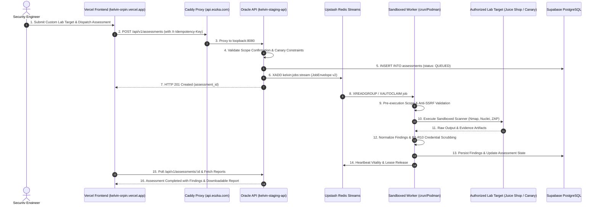

# KELVIN — Milestone M9.9 Canary Plan
## Controlled Canary Activation, Custom URL Verification & End-to-End Lab Qualification

**Status:** ACTIVE SPECIFICATION & PROTOCOL  
**Canonical Repository:** `https://github.com/eOzkahq/Kelvin`  
**Target Canonical Commit:** `6c724d0`  
**Milestone:** Milestone #22 (`M9.9 — Controlled Canary Activation & End-to-End Qualification`)  
**Date:** Wednesday, November 18, 2026

---

## 1. Executive Strategy & Primary Invariants

Milestone M9.9 executes independent end-to-end verification of the Kelvin security assessment platform across its deployed production infrastructure. It validates the full assessment pipeline from user interaction on the live Vercel frontend, through the Oracle Cloud API gateway and Upstash Redis broker, into the containerized worker execution sandbox, and finally to Supabase PostgreSQL persistence and report rendering.

### Strict Safety Invariants:
1. **Canary Boundary Locked:** `KELVIN_CANARY_ONLY=true` is strictly maintained in `/etc/kelvin/staging.env`.
2. **Production Worker Held Inactive:** `kelvin-worker.service` on the Oracle Cloud host (`130.210.49.242`) remains in an `inactive` and `disabled` state until explicit human approval is received.
3. **No Arbitrary Public Scanning:** All scanner executions are confined to explicitly authorized lab targets (`http://127.0.0.1:8080`, `scanner-mock.kelvin.internal`, or an isolated OWASP Juice Shop lab container).
4. **Human Approval Gates:**
   - Activating the production worker.
   - Setting `KELVIN_CANARY_ONLY=false`.
   - Dispatching scans against public/custom customer targets.
   - Modifying Caddy production routing, DNS, or firewall rules.
   - Rotating production credentials or applying destructive database migrations.

---

## 2. Existing Custom URL Architecture & Integration

Kelvin possesses built-in support for custom assessment targets across the frontend, API control plane, and worker engine:

### 2.1 Backend Contract & Target Resolution
- **API Endpoint:** `POST /api/v1/assessments`
- **Request Payload (`CreateAssessmentInput`):**
  - `name`: Human-readable assessment run label.
  - `targetId` (optional): UUID of pre-registered target asset.
  - `targetAddress` (optional): Direct custom URL or hostname string (e.g. `http://127.0.0.1:8080`, `https://juice-shop.herokuapp.com`).
  - `targets` (optional): Array of target objects `[{ host: string }]`.
  - `profileId`: Standard profile ID (`standard`, `safe_web`, `deep`) or custom UUID.
  - `rateLimit`: Requests-per-second cap (default: 50).
  - `timeoutMinutes`: Hard deadline ceiling in minutes.
  - `authorizedScopeConfirmed`: Boolean attestation of administrative authority.
  - `idempotencyKey`: Unique header/body idempotency token.
- **Resolution Precedence (`apps/api/internal/assessments/service.go`):**
  1. `input.TargetAddress` (if populated directly).
  2. `input.Targets[0].Host` (if multi-target array provided).
  3. Pre-configured target address resolved via `input.TargetID` from repository.
- **Validation & Canary Gate:**
  - Scheme, hostname, and port parsing.
  - While `s.canaryOnly` is active, target hostname is checked against `s.canaryAllowedTargets` and default canary destinations via `IsCanaryTargetAllowed`.
  - Rejection with HTTP 403 `ErrCanaryTargetProhibited` if outside canary scope.
- **Queue Envelope Contract (`packages/common/queue`):**
  - Synthesizes `commonqueue.JobEnvelope` (SchemaVersion: 2) containing `TargetAddress: targetAddress`.
  - Enqueues to Upstash Redis Streams (`kelvin:jobs:stream`) with `MaxAttempts: 3`.

### 2.2 Frontend Custom Target Entry (`apps/web`)
- **UI Component:** [`AssessmentWizardPage.tsx`](file:///e:/Projects/kelvin%202/Kelvin/apps/web/src/pages/AssessmentWizardPage.tsx) Step 1.
- **Target Selection Mode:**
  - Tab 1: Pre-configured verified targets (fetched from `/api/v1/targets`).
  - Tab 2: Custom Target URL input (allows entering custom endpoints with automatic validation).
- **Scope Confirmation Gate:** Step 5 requires mandatory interactive confirmation before dispatch can proceed.

---

## 3. End-to-End Canary Verification Pipeline

---

## 4. Phase-by-Phase Execution Schedule

- **Phase 1 — Independent Deployment Audit:** Verify deployed SHA `6c724d0`, verify live endpoints, re-run test suites.
- **Phase 2 — Worker Readiness Audit:** Verify native binary build provenance, systemd hardening unit, crun/podman capabilities.
- **Phase 3 — Isolated Lab Qualification:** Execute real scanner adapter pipelines (Nmap, Nuclei, ZAP) against lab targets.
- **Phase 4 — Failure & Security Testing:** Verify crash recovery, lease renewals, out-of-scope target drops, SSRF rejection, and tamper-proofing.
- **Phase 5 — Canary Readiness & Final Sign-Off:** Synthesize full evidence into operational qualification reports.
