# KELVIN Production Capacity and Performance Optimization Specification

**Document Control**

| Field | Value |
| :--- | :--- |
| **Status** | Approved — Production Engineering Specification |
| **Milestone** | Phase 5 — Production Hardening, Deployment & Release (`P5-17`) |
| **Parent Roadmap** | [KELVIN Engineering Roadmap](../ISSUE-02_ENGINEERING_ROADMAP.md) |
| **Parent Issue** | Issue #373 (`P5-17`) |
| **Benchmark Reference** | [`docs/performance/LOAD_STRESS_AND_SOAK_TEST_REPORT.md`](LOAD_STRESS_AND_SOAK_TEST_REPORT.md) |
| **Review Cadence** | Bi-annual |
| **Classification** | Internal — Enterprise Capacity Standard |

---

## 1. Executive Summary & Optimization Outcomes

Following empirical analysis from the Phase 5 load and stress tests (Issue #372 / `P5-16`), this specification details the architectural optimizations, database indexing improvements, and verified capacity baselines for KELVIN production deployments.

### Key Optimization Highlights
1. **Database Indexing (`Migration 000060`):** Compound B-Tree indexes on `findings (organization_id, severity, status, created_at DESC)` reduced p99 findings search latency from 198ms to **44ms** (a 77% latency reduction).
2. **Go Runtime Tuning:** Setting `GOMEMLIMIT=85%` and optimizing buffer allocations eliminated garbage collection pauses during large PDF report rendering.
3. **Capacity Baseline & Scaling Ceilings:** Formally bounded capacity tiers preventing noisy-neighbor starvation and runaway cloud infrastructure costs.

---

## 2. Production Sizing & Capacity Baselines

```mermaid
flowchart LR
    subgraph Small ["Small Enterprise Tier"]
        S_Tenants["Up to 10 Organizations"]
        S_Assets["Up to 2,500 Targets"]
        S_Concurrency["Max 10 Concurrent Scans"]
        S_Nodes["API: 3 Pods / Workers: 4 Pods"]
    end

    subgraph Medium ["Medium Enterprise Tier"]
        M_Tenants["Up to 100 Organizations"]
        M_Assets["Up to 25,000 Targets"]
        M_Concurrency["Max 50 Concurrent Scans"]
        M_Nodes["API: 6 Pods / Workers: 16 Pods"]
    end

    subgraph Large ["Large Enterprise Tier"]
        L_Tenants["Up to 500 Organizations"]
        L_Assets["Up to 100,000 Targets"]
        L_Concurrency["Max 200 Concurrent Scans"]
        L_Nodes["API: 12-24 Pods / Workers: 32 Pods"]
    end

    Small --> Medium --> Large
```

### Capacity Tier Matrix

| Metric / Parameter | Small Tier | Medium Tier (Default Production) | Large Enterprise Tier |
| :--- | :--- | :--- | :--- |
| **Max Active Organizations** | 10 | 100 | 500 |
| **Target Assets Tracked** | 2,500 | 25,000 | 100,000+ |
| **Max Concurrent Scans** | 10 | 50 | 200 |
| **Peak Ingestion Rate** | 2,000 findings / min | 10,000 findings / min | 40,000 findings / min |
| **API Replica Allocation** | 3 (Fixed) | 4–12 (Autoscaled) | 12–24 (Autoscaled) |
| **Worker Runner Nodes** | 4 Pods | 16 Pods | 32 Pods |
| **PostgreSQL RDS Size** | `db.t4g.large` | `db.r6g.xlarge` (Multi-AZ) | `db.r6g.4xlarge` (Multi-AZ) |
| **PgBouncer Pool Size** | 40 backend connections | 80 backend connections | 160 backend connections |
| **Redis Broker Size** | `cache.t4g.medium` | `cache.r6g.large` (3-Node HA) | `cache.r6g.2xlarge` (Clustered) |

---

## 3. Known Scalability Ceilings & Guardrails

KELVIN explicitly rejects claims of "unbounded infinite scaling" and enforces the following architectural guardrails:
1. **Single Assessment Target Cap:** Maximum 1,000 URLs/hosts per single scan manifest. Larger scopes must be partitioned across scheduled batches.
2. **Hard Rate Limit:** 100 requests/sec per API key to protect control plane availability.
3. **Queue Lease Expiry:** Ephemeral scanner runs capped at 120 minutes maximum execution time before automatic termination.
