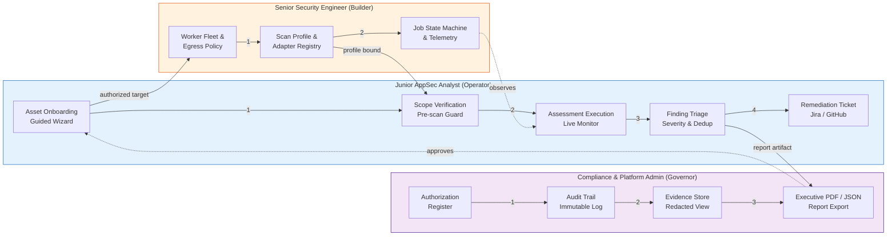

# Kelvin Security Platform — User Personas & Journey Maps

**Document Control**

| Field | Value |
| :--- | :--- |
| **Status** | Baseline — Peer-Reviewed |
| **Milestone** | Phase 1 — Foundation & Core Architecture (`P1-02`) |
| **Depends On** | `docs/PRODUCT_VISION.md` (`P1-01`) |
| **Owner** | Product Design / UX Engineering |
| **Review Cadence** | Quarterly, and at every phase gate |
| **Related Docs** | `docs/PRODUCT_VISION.md`, `docs/ARCHITECTURE_AND_FEATURES.md`, `docs/MVP_AND_PHASE_BIFURCATION.md`, `docs/ROADMAP.md` |
| **Classification** | Internal — Stakeholder Source of Truth |

---

## 1. Executive Summary

Kelvin serves three distinct user personas across the authorized security assessment lifecycle: the **Junior AppSec Analyst** (Operator), the **Senior Security Engineer** (Builder), and the **Compliance & Platform Administrator** (Governor). Each persona has a different technical proficiency, a different set of operational goals, and a different tolerance for UI complexity.

This document defines those personas, maps their end-to-end journeys, specifies step-by-step core workflows (asset onboarding, scope verification, scan-profile selection, assessment execution, finding triage, remediation tracking, and audit reporting), and codifies baseline accessibility (WCAG 2.1 AA) and responsive usability standards. It is the single source of truth for frontend handoffs and prevents the inconsistent UX and fragmented state management described in the issue.

---

## 2. User Personas

Each persona below defines technical proficiency, operational goals, primary tools within Kelvin, and the views they primarily consume.

### 2.1 Persona 1 — Junior AppSec Analyst (Operator)

| Attribute | Detail |
| :--- | :--- |
| **Role** | Junior Application Security Analyst |
| **Technical proficiency** | Foundational. Comfortable with web dashboards, CSV/JSON exports, and basic vulnerability concepts (CWE, severity). Limited CLI experience. |
| **Primary goal** | Onboard assets, launch scoped assessments, triage normalized findings, and produce remediation tickets without touching raw scanner output. |
| **Primary Kelvin views** | Dashboard home, Asset Inventory, Scope Verification, Assessment Monitor, Findings Matrix, Remediation Tracker, Report Export. |
| **Pain points Kelvin solves** | Overwhelming raw scanner logs; duplicate findings across tools; no clear "what do I fix first" prioritization; no guided scope guardrail. |
| **Success looks like** | A finding is triaged to a Jira/GitHub ticket in under 10 minutes; no out-of-scope target is ever scanned; reports are exportable with one click. |

**Key needs:** Guided onboarding wizard, clear preconditions and validation errors before a scan starts, deduplicated findings with severity ranking, one-click remediation ticket creation, keyboard-navigable UI.

### 2.2 Persona 2 — Senior Security Engineer (Builder)

| Attribute | Detail |
| :--- | :--- |
| **Role** | Senior Security / Platform Engineer |
| **Technical proficiency** | Advanced. Comfortable with CLI, YAML/JSON configuration, scanner adapters, containerized workers, and API integration. |
| **Primary goal** | Configure and maintain sandboxed worker fleets, define scan profiles and egress policies, integrate scanner adapters via the worker protocol, and tune deduplication/normalization rules. |
| **Primary Kelvin views** | Worker Fleet Management, Scan Profile Builder, Adapter Registry, Egress Policy Editor, Job State Machine, Audit Log Stream, API Keys & Webhooks. |
| **Pain points Kelvin solves** | Fragmented scanner sprawl; workers with unfettered egress; no normalized schema across scanner outputs; no observability into job state transitions. |
| **Success looks like** | A new scanner adapter is registered and dispatching jobs within a day; egress policy blocks metadata IPs by default; every job state transition is logged and queryable. |

**Key needs:** Granular execution controls, worker sandbox and egress configuration, adapter protocol documentation, real-time job telemetry, API-first design for scripting and CI/CD integration.

### 2.3 Persona 3 — Compliance & Platform Administrator (Governor)

| Attribute | Detail |
| :--- | :--- |
| **Role** | Compliance Officer / Platform Administrator |
| **Technical proficiency** | Moderate. Comfortable with dashboards, PDF/JSON reports, audit trails, RBAC, and SSO/OIDC concepts. Not a hands-on scanner operator. |
| **Primary goal** | Verify every assessment ran only within authorized scope, confirm authorization records exist for all targets, validate evidence redaction, and export compliance-grade reports for internal or external audits. |
| **Primary Kelvin views** | Tenant & RBAC Administration, Audit Trail, Authorization Register, Evidence Store (redacted), Executive Dashboard, Compliance Report Export. |
| **Pain points Kelvin solves** | No auditable record of what was scanned and by whom; unredacted credentials in evidence; reports not traceable to authorized assessments; no SOC2/ISO 27001 evidence ready out of the box. |
| **Success looks like** | Complete, tamper-evident audit trail for every assessment lifecycle event; zero unredacted credentials persisted; executive report generated from a single authorized assessment. |

**Key needs:** Immutable audit logging, authorization register, RBAC/SSO integration, redacted evidence store, executive vs. technical report views, retention and export controls.

---

## 3. End-to-End Journey Map

The flowchart below represents the shared core journey that all three personas traverse, with persona-specific entry and exit points:



**Journey stages (shared):**
1. **Asset Onboarding & Scope Verification** — Analyst registers a target; Scope Guard validates it against RFC 1918 / loopback / link-local / cloud-metadata blocklists and ownership verification (DNS TXT or HTTP challenge). Admin pre-approves via the Authorization Register.
2. **Scan Profile Selection** — Engineer-defined profiles (low-impact passive, standard automated, authorized deep) are bound to the assessment.
3. **Assessment Execution** — Job Orchestrator dispatches to sandboxed workers; Analyst monitors live telemetry; Engineer observes job state-machine transitions.
4. **Finding Triage** — Normalized Vulnerability Matrix deduplicates findings by fingerprint; Analyst ranks by severity/confidence and suppresses duplicates.
5. **Remediation & Reporting** — Analyst creates remediation tickets; Admin exports executive PDF/JSON and reviews the immutable audit trail.

---

## 4. Core Workflows

Every workflow below explicitly defines **preconditions**, **user actions**, **system validations**, and **expected outcomes**. These are the contract for frontend implementation and QA.

### 4.1 Workflow W1 — Asset Onboarding

**Persona:** Junior AppSec Analyst (with Compliance Admin approval for new domains)

| Step | Detail |
| :--- | :--- |
| **Preconditions** | User is authenticated with `analyst` or `admin` role; target domain/IP is not already in scope for the tenant. |
| **User actions** | 1. Open Asset Onboarding wizard.<br>2. Enter target hostname, IP range, or CIDR.<br>3. Select asset type (web application, network segment, cloud workload).<br>4. Submit ownership verification (DNS TXT record or HTTP challenge file).<br>5. Request scope approval. |
| **System validations** | 1. Target format validated (hostname/IP/CIDR).<br>2. Scope Guard rejects RFC 1918, loopback (`127.0.0.0/8`), link-local (`169.254.0.0/16`), and cloud-metadata (`169.254.169.254`) targets.<br>3. DNS rebinding and redirect-destination checks pass.<br>4. Ownership verification token confirmed.<br>5. Duplicate asset check prevents re-registration. |
| **Expected outcomes** | Asset record created with `verified` status; appears in Asset Inventory; authorized for assessment subject to Admin approval in the Authorization Register. |
| **Error states** | `422 Scope Violation` for prohibited targets; `409 Conflict` for duplicate assets; `403 Forbidden` if user lacks `asset:create` permission. |

### 4.2 Workflow W2 — Scope Verification (Pre-scan Guard)

**Persona:** Junior AppSec Analyst (trigger); System (automatic enforcement)

| Step | Detail |
| :--- | :--- |
| **Preconditions** | Asset exists and is verified; assessment requested with at least one target. |
| **User actions** | 1. Select targets for a new assessment.<br>2. Submit assessment for scope validation. |
| **System validations** | 1. All targets resolve to allow-listed, non-prohibited IPs.<br>2. Each target has a current ownership verification on file.<br>3. No target falls within the tenant's prohibited-destination list.<br>4. Authorization Register contains an active approval for the assessed organization/domain. |
| **Expected outcomes** | If valid: assessment transitions to `QUEUED` and Job ID is returned to the user.<br>If invalid: assessment rejected with `422 Scope Violation` and a human-readable reason; no job is queued; audit log records the rejection. |
| **Error states** | Scope violation details surfaced inline in the UI; user may correct target list and resubmit. |

### 4.3 Workflow W3 — Scan Profile Selection & Assessment Execution

**Persona:** Junior AppSec Analyst (selects profile); Senior Security Engineer (defines profiles); System (dispatches)

| Step | Detail |
| :--- | :--- |
| **Preconditions** | Scope verification passed; at least one scan profile exists (low-impact / standard / deep). |
| **User actions** | 1. Choose scan profile for the assessment.<br>2. Set optional execution budget (timeout, max hosts, intensity).<br>3. Launch assessment.<br>4. Monitor live telemetry (job status, worker node, findings streamed in real time). |
| **System validations** | 1. Selected profile is active and available to the tenant.<br>2. Execution budget within tenant policy limits.<br>3. Worker node assigned from sandboxed fleet with egress policy applied.<br>4. Job state machine transitions deterministically: `QUEUED` → `ValidatingScope` → `RUNNING` → `COMPLETED`/`FAILED`/`TimedOut`/`Cancelled`. |
| **Expected outcomes** | Job dispatched to worker; live status streamed over WebSocket; findings stream into the Normalized Vulnerability Matrix as they are produced. |
| **Error states** | Job timeout → `TimedOut`; worker crash → `FAILED` with adapter error; user abort → `Cancelled`; all transitions recorded in audit log. |

### 4.4 Workflow W4 — Finding Triage & Remediation

**Persona:** Junior AppSec Analyst (triage); Senior Security Engineer (tuning)

| Step | Detail |
| :--- | :--- |
| **Preconditions** | Assessment `COMPLETED`; findings present in the Normalized Vulnerability Matrix. |
| **User actions** | 1. Open Findings Matrix for the assessment.<br>2. Filter/sort by severity, confidence, CWE, affected target.<br>3. Review deduplicated finding (single fingerprint across scanner runs).<br>4. Accept, suppress (false positive), or assign to remediation.<br>5. Create remediation ticket (Jira / GitHub Issues) with finding payload. |
| **System validations** | 1. Finding belongs to the user's tenant/project (row-level isolation).<br>2. Fingerprint dedup applied (asset + endpoint + vulnerability type).<br>3. Evidence redaction applied (credentials, tokens, keys stripped before display).<br>4. Remediation ticket creation requires `finding:remediate` permission. |
| **Expected outcomes** | Finding status updated (`open` / `suppressed` / `remediated`); remediation ticket linked; audit log records triage decision and ticket reference. |
| **Error states** | `403 Forbidden` if user lacks permission to modify a finding; suppressed findings excluded from executive reports unless overridden by Admin. |

### 4.5 Workflow W5 — Audit Reporting & Compliance Export

**Persona:** Compliance & Platform Administrator

| Step | Detail |
| :--- | :--- |
| **Preconditions** | One or more completed assessments with audit-trail entries; Admin role with `report:export` permission. |
| **User actions** | 1. Open Executive Dashboard.<br>2. Select assessment(s) and date range.<br>3. Choose report format (executive PDF, technical JSON, or both).<br>4. Generate and download report.<br>5. Review Audit Trail for the selected assessments (init, approvals, target additions, exports). |
| **System validations** | 1. Report scoped only to authorized assessments in the tenant.<br>2. Evidence payloads redacted before inclusion.<br>3. Download generates an audit-trail entry (`report:export`).<br>4. Report is cryptographically tied to the source assessment ID for non-repudiation. |
| **Expected outcomes** | Executive PDF + technical JSON downloaded; audit-trail entry recorded; report traceable to authorized assessment(s). |
| **Error states** | `403 Forbidden` if no authorized assessments in range; `404` if no findings/evidence exist for selection. |

---

## 5. Dashboard View Hierarchies & Information Architecture

### 5.1 Top-Level Navigation (Role-Scoped)

| Section | Junior AppSec Analyst | Senior Security Engineer | Compliance & Platform Admin |
| :--- | :--- | :--- | :--- |
| Home / Executive Dashboard | ✓ (summary view) | ✓ (health view) | ✓ (compliance summary) |
| Asset Inventory | ✓ | ✓ (manage) | ✓ (read-only) |
| Scope Verification | ✓ | ✓ (policy) | ✓ (audit) |
| Assessment Monitor | ✓ (own jobs) | ✓ (all jobs) | ✓ (read-only) |
| Findings Matrix | ✓ (triage) | ✓ (tune dedup) | ✓ (read-only) |
| Remediation Tracker | ✓ (create tickets) | ✓ (review) | ✓ (read-only) |
| Worker Fleet | ✗ | ✓ (manage) | ✗ |
| Scan Profile Builder | ✗ | ✓ (manage) | ✗ |
| Adapter Registry | ✗ | ✓ (manage) | ✗ |
| Egress Policy Editor | ✗ | ✓ (manage) | ✗ |
| Audit Trail | ✓ (own) | ✓ (all) | ✓ (manage/export) |
| Authorization Register | ✗ | ✗ | ✓ (manage) |
| Evidence Store (redacted) | ✓ (own findings) | ✓ (all) | ✓ (manage) |
| Report Export | ✓ (technical) | ✓ (technical) | ✓ (executive + technical) |
| API Keys & Webhooks | ✗ | ✓ | ✓ |
| RBAC / SSO Administration | ✗ | ✗ | ✓ |

### 5.2 View Hierarchy (Information Architecture)

```
Dashboard (Home)
├─ Assessment Overview (KPIs: active jobs, findings by severity, overdue remediation)
│
├─ Asset Inventory
│  ├─ Asset List (table: target, type, verified, last assessed)
│  └─ Asset Detail (target, scope status, ownership evidence, assessment history)
│
├─ Assessments
│  ├─ Create Assessment (wizard: targets → profile → budget → launch)
│  ├─ Assessment List (table: job ID, status, targets, profile, created at)
│  └─ Assessment Detail (live telemetry, state-machine history, worker node)
│
├─ Findings
│  ├─ Findings Matrix (table: fingerprint, severity, confidence, CWE, target, status)
│  ├─ Finding Detail (evidence redacted, raw payload, remediation guidance)
│  └─ Remediation Tracker (ticket status, SLA, assignee)
│
├─ Reports
│  ├─ Executive Report (PDF, summary, trends, compliance posture)
│  ├─ Technical Report (JSON/PDF, full findings, evidence references)
│  └─ Report History (downloads, audit-trail references)
│
└─ Administration (role-gated)
   ├─ Worker Fleet (nodes, health, egress policies)
   ├─ Scan Profiles (low-impact / standard / deep)
   ├─ Adapter Registry (scanner adapters, capabilities)
   ├─ Audit Trail (immutable log, export)
   ├─ Authorization Register (approved domains/orgs)
   ├─ RBAC & SSO (roles, OIDC/SAML connectors)
   └─ API Keys & Webhooks
```

### 5.3 Core Interactive User Actions

| Action | Trigger | Affected View | Persona |
| :--- | :--- | :--- | :--- |
| Onboard asset | "Add Asset" button | Asset Inventory → wizard | Analyst, Admin |
| Verify scope | "Run Scope Check" | Scope Verification | Analyst |
| Launch assessment | "Start Assessment" | Assessments → Create | Analyst |
| Cancel assessment | "Abort Job" | Assessment Detail | Analyst, Engineer |
| Triage finding | "Accept / Suppress / Remediate" | Findings Matrix | Analyst |
| Create ticket | "Create Jira/GitHub Ticket" | Finding Detail | Analyst |
| Export report | "Download PDF/JSON" | Reports | Admin, Analyst (technical) |
| Review audit log | "Open Audit Trail" | Administration → Audit Trail | Admin, Engineer |
| Configure egress | "Edit Egress Policy" | Administration → Worker Fleet | Engineer |
| Register adapter | "Add Scanner Adapter" | Administration → Adapter Registry | Engineer |

---

## 6. Usability & Accessibility Standards

### 6.1 Accessibility (WCAG 2.1 AA)

| Standard | Requirement | Verification |
| :--- | :--- | :--- |
| **1.4.3 Contrast (Minimum)** | Text and UI components maintain ≥ 4.5:1 contrast ratio (normal text) / ≥ 3:1 (large text). | Automated contrast audit in CI; design tokens locked. |
| **1.4.4 Resize Text** | Content scales to 200% without loss of function or horizontal scrolling. | QA zoom test at 200% browser zoom. |
| **1.4.10 Reflow** | Content reflows on 320px-equivalent viewport; no loss of information. | Responsive breakpoint testing (320–1440px). |
| **2.1.1 Keyboard** | All functionality operable via keyboard (no mouse/trap). | Keyboard-only navigation test of every workflow. |
| **2.1.2 No Keyboard Trap** | Focus never trapped in modals, dropdowns, or wizard steps. | Focus-order audit; ESC closes modals. |
| **2.4.7 Focus Visible** | Visible focus indicator on all interactive elements. | CSS `:focus-visible` enforcement; design token. |
| **2.4.6 Headings & Labels** | Clear, descriptive headings and form labels. | Semantic HTML audit; label association. |
| **3.3.2 Labels or Instructions** | Every input has a visible label or inline instruction. | Form audit; placeholder never used as sole label. |
| **3.3.3 Error Suggestion** | Validation errors identify the field and suggest a fix. | Error-message pattern standard; inline + summary. |
| **4.1.2 Name, Role, Value** | Custom components expose accessible name, role, state. | ARIA audit; screen-reader testing (NVDA/JAWS/VoiceOver). |
| **4.1.3 Status Messages** | Live regions announce status changes (job state, scan progress). | `aria-live` polite/assertive usage standard. |

### 6.2 Keyboard Efficiency

* All core workflows (W1–W5) completable without a mouse.
* Common shortcuts: `Ctrl/Cmd + K` global search, `Esc` close modals, `Tab` logical focus order, `Enter/Space` activate buttons, `g` + letter shortcuts for main navigation (e.g., `g a` → Assets, `g f` → Findings).
* Focus returns to the triggering element after modal dismissal.
* Skip-to-content link at top of every page.

### 6.3 Error Feedback

* Validation errors appear inline adjacent to the field **and** in a top-of-page error summary for forms.
* Error messages use plain language ("Target `169.254.169.254` is prohibited: cloud metadata addresses are not in scope") — never raw exception stack traces.
* Scope violations (`422`) are surfaced before any job is queued, with a corrective path (edit target list → resubmit).
* Job failures (`FAILED`/`TimedOut`) show a retry-or-cancel action and a link to the worker log.

### 6.4 Responsive Usability

* Breakpoints: mobile (≤768px), tablet (769–1024px), desktop (≥1025px).
* Tables on mobile convert to stacked card view; Findings Matrix remains sortable/filterable.
* Modals and wizards are centered, scroll-locked, and dismissible via `Esc` and backdrop click.
* Data density defaults: compact for engineers, comfortable for analysts and auditors (user preference persisted).

---

## 7. Governance & Review

1. **Persona changes require design review.** Adding, removing, or modifying a persona requires sign-off from Product, UX, and Security stakeholders.
2. **Workflow contract.** Every frontend screen must map to a workflow in §4 with defined preconditions, actions, validations, and outcomes. Disconnected screens without a workflow contract are rejected in code review.
3. **Accessibility is a release gate.** No feature ships to `main` without passing WCAG 2.1 AA checks (contrast, keyboard, labels, screen-reader smoke test).
4. **Review cadence.** This document is reviewed quarterly and at every phase gate alongside `docs/PRODUCT_VISION.md`.

---

## 8. Traceability

| Artifact | Reference |
| :--- | :--- |
| Planning reference | `P1-02` |
| Milestone | Phase 1 — Foundation & Core Architecture |
| Blocked by | `P1-01` — `docs/PRODUCT_VISION.md` (Product Vision, Scope and Non-Goals) |
| Product vision | `docs/PRODUCT_VISION.md` |
| System architecture | `docs/ARCHITECTURE_AND_FEATURES.md` |
| MVP & phase bifurcation | `docs/MVP_AND_PHASE_BIFURCATION.md` |
| Engineering roadmap | `docs/ROADMAP.md` |

---

*Kelvin Security Platform — Phase 1 Engineering Backlog*
