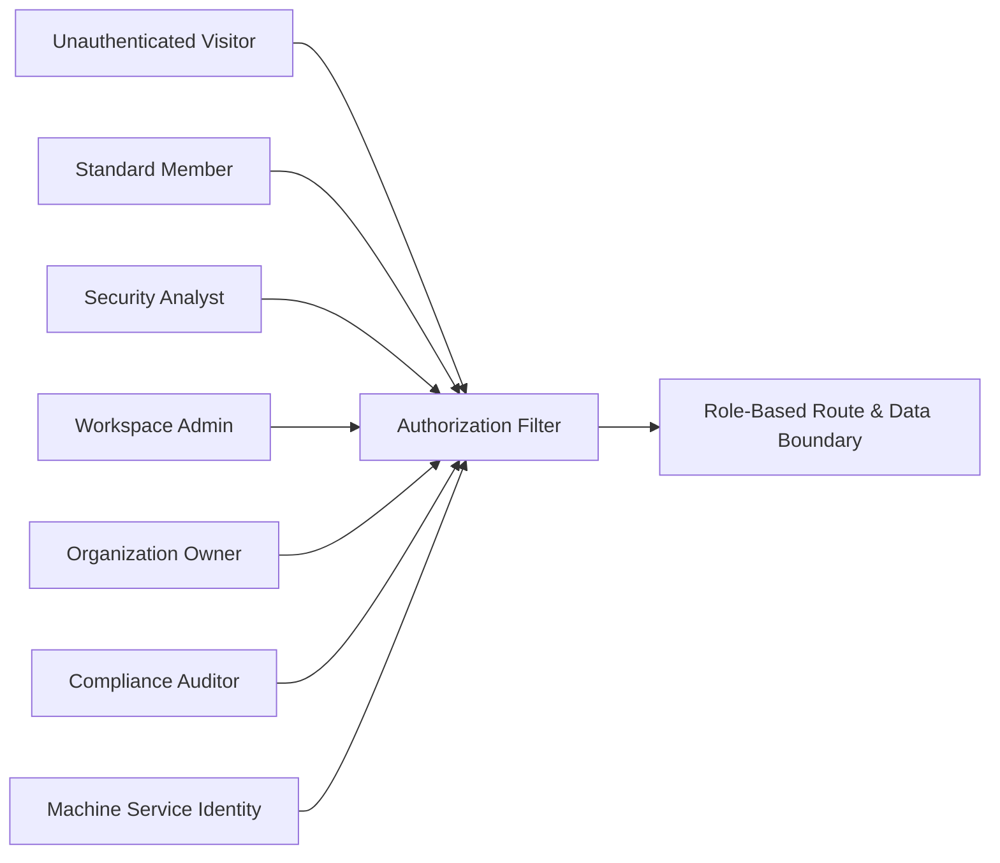

# KELVIN Audit Scope & Target Environment Baseline

## 1. Audit Target Identification

| Attribute | Specification |
|---|---|
| **Platform** | KELVIN Security Assessment Platform |
| **Audit Milestone** | Pre-Phase 5 — Final Audit & Phase Transition (`PRE-P5-01`) |
| **Target Build SHA** | `836b64b3df36cce54f3b255aa0a7972749767222` |
| **Release Candidate** | `v0.1.0-rc1` (Phases 1–4 Cumulative Baseline) |
| **Audit Date** | 2 November 2026 |
| **Testing Environment** | Staging / Local Test Bench (`NODE_ENV=staging`, `PORT=5173`, `API_PORT=8080`) |
| **Lead Auditor** | Kushagra Bhardwaj (Engineering Lead) |
| **Reviewer / CODEOWNER** | Mrinal Prakash (`@MRINALPRAKASHFSD`) |

---

## 2. In-Scope Application Surface

The audit evaluated all frontend user interfaces, backend API gatekeepers, and data boundaries implemented across Phases 1–4:

1. **Public Surface**:
   - Platform health, status, and service availability overview (`/`).
   - Authentication handshakes, session expiration, and error pages (`/auth`, 401, 403, 404).

2. **Core Security Workspaces**:
   - Executive Dashboard with real-time posture indicators (`/dashboard`).
   - Findings Workspace with search, severity triage, SLA tracking, and pagination (`/findings`).
   - Historical Assessment Comparison and regression diff engine (`/compare`).
   - Report Center with HTML preview and PDF export generation (`/reports`).

3. **Enterprise Administration & Governance**:
   - Organization and Workspace hierarchy management (`/api/v1/organizations`, `/api/v1/workspaces`).
   - Identity and Access Management (SAML 2.0, OIDC, SCIM 2.0, RBAC, Sessions).
   - Central Policy Engine, exceptions, and assessment scheduling.
   - Machine identities, API credentials, and signed outbound webhooks.
   - Tamper-evident audit logging, data retention, and export controls.
   - Workload fair-share queueing, rate limiting, and tenant quotas.

---

## 3. Evaluated User Personas

1. **Unauthenticated Visitor**: Checked for forced redirect to auth on protected routes and absence of confidential data leaks.
2. **Standard Member**: Verified basic view access, read-only dashboard permissions, and lack of administrative privilege escalation.
3. **Security Analyst**: Verified finding status transitions, manual risk adjustments, and remediation verification flows.
4. **Workspace Administrator**: Verified scan profile creation, assessment scheduling, and asset grouping.
5. **Organization Owner**: Verified dual-custody risk exception approvals, member invitations, and tenant-level quota views.
6. **Compliance Auditor**: Verified read-only access to immutable audit search, reports, and tamper-evidence certificates.
7. **Machine Service Identity**: Verified OAuth 2.0 client credentials grant, automated scan ingestion, and non-interactive restrictions.

---

## 4. Reference Device and Viewport Matrix

All routes were inspected across the 7 normative viewport classes:

| Class ID | Device Category | Viewport Dimensions | Reference Devices |
|---|---|---|---|
| **VP-01** | Small Phone | 320 × 568 px | iPhone SE (1st gen) |
| **VP-02** | Common Phone | 375 × 667 px / 390 × 844 px | iPhone 12/13/14, Pixel 7 |
| **VP-03** | Large Phone | 414 × 896 px / 428 × 926 px | iPhone 14/15 Pro Max, Galaxy S23 Ultra |
| **VP-04** | Tablet Portrait | 768 × 1024 px | iPad Mini / iPad 10th Gen |
| **VP-05** | Tablet Landscape / Laptop | 1024 × 768 px | iPad Pro 11", Chromebook |
| **VP-06** | Desktop | 1366 × 768 px | Standard Enterprise Workstation |
| **VP-07** | Large Desktop | 1440 × 900 px / 1920 × 1080 px | Full HD & High-DPI Monitors |

---

## 5. Explicit Limitations & Out-of-Scope Items

1. **Independent Penetration Testing**: Full third-party red teaming and grey-box penetration testing are scheduled in **Phase 5** (`P5-18`).
2. **Disaster Recovery Live Cutover**: Multi-region failover and live database restore drills are scheduled in **Phase 5** (`P5-15`).
3. **Cloud Infrastructure Autoscaling**: Live Kubernetes cluster node autoscale tuning is scheduled in **Phase 5** (`P5-03`).
