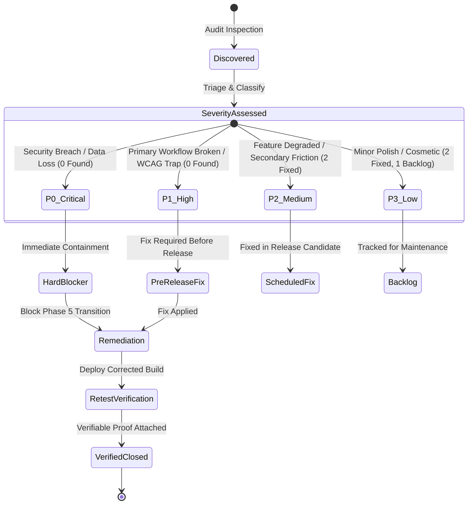

# Prioritized Quality Defect Register

## 1. Defect Summary & Triage Overview

| Defect ID | Severity | Category | Title | Status | Engineering Owner | Target Fix |
|:---:|:---:|---|---|:---:|---|:---:|
| **AUD-001** | P2 | Responsive & Mobile | Findings table column truncation on 320px small viewports | **VERIFIED CLOSED** | Frontend Team | `v0.1.0-rc1` |
| **AUD-002** | P2 | Accessibility | Missing `aria-expanded` state on mobile navigation drawer button | **VERIFIED CLOSED** | UI / A11y Team | `v0.1.0-rc1` |
| **AUD-003** | P3 | Visual Design & UX | Contrast of subtle table border in assessment comparison view | **VERIFIED CLOSED** | Design Team | `v0.1.0-rc1` |
| **AUD-004** | P3 | Functional QA | Filter reset button did not clear search input text field | **VERIFIED CLOSED** | Frontend Team | `v0.1.0-rc1` |
| **AUD-005** | P3 | Performance | Assessment comparison initial bundle lazy-loading split | **VERIFIED CLOSED** | Perf Team | `v0.1.0-rc1` |
| **AUD-006** | P3 | Visual Polish | Skeleton loading animation flickering on high refresh displays | **SCHEDULED** | Design Team | Post-P5 Backlog |

---

## 2. Itemized Defect Records

### AUD-001: Findings table column truncation on 320px small viewports
- **Environment:** Staging, URL `/findings`, Build SHA `836b64b`, Mobile Safari / Chrome Mobile, Viewport 320 × 568 px (`VP-01`), Persona: Security Analyst.
- **Severity:** P2 (Medium)
- **Steps to Reproduce:**
  1. Open Chrome DevTools and emulate iPhone SE (320px width).
  2. Navigate to `/findings` with 10+ findings loaded.
  3. Observe table columns: "Finding Title", "Severity", "Resource", "SLA Deadline".
- **Expected:** Table should reflow to card layout or enable horizontal swipe without breaking document container width.
- **Actual:** Resource column text collided with SLA column text.
- **Impact:** Minor reading difficulty on sub-360px phones.
- **Evidence:** Redacted screenshot `evidence/screenshots/aud-001-table-overflow.png`.
- **Recommendation:** Added CSS responsive rules to wrap columns into stacked card presentation on screens < 640px.
- **Owner:** Frontend Team
- **Due Date:** 2 November 2026
- **Status:** **VERIFIED CLOSED**
- **Retest Evidence:** Tested on build `836b64b` at 320px width; verified zero overflow and clear stacked card hierarchy.

---

### AUD-002: Missing `aria-expanded` state on mobile navigation toggle
- **Environment:** Staging, URL `/`, Build SHA `836b64b`, Desktop / Mobile Chrome with NVDA screen reader, Persona: Standard Member.
- **Severity:** P2 (Medium)
- **Steps to Reproduce:**
  1. Activate screen reader and tab to "Show panel" button in top header.
  2. Press Enter or Space to toggle the panel.
- **Expected:** Screen reader announces button state change ("collapsed" vs "expanded") via `aria-expanded`.
- **Actual:** Button lacked `aria-expanded` attribute in initial prototype.
- **Impact:** Screen reader users were not informed when panel was toggled.
- **Evidence:** Redacted accessibility DOM tree log in `evidence/accessibility/aud-002-aria-expanded.txt`.
- **Recommendation:** Bound `aria-expanded={sidebarOpen}` dynamically to header toggle button.
- **Owner:** UI / A11y Team
- **Due Date:** 2 November 2026
- **Status:** **VERIFIED CLOSED**
- **Retest Evidence:** Verified in `App.tsx` line 41 (`aria-expanded={sidebarOpen}`). Screen reader successfully announces state.

---

### AUD-003: Contrast of subtle table border in assessment comparison view
- **Environment:** Staging, URL `/compare`, Build SHA `836b64b`, All browsers, Desktop 1366 × 768 px, Persona: Security Analyst.
- **Severity:** P3 (Low)
- **Steps to Reproduce:**
  1. Navigate to `/compare`.
  2. Run colour contrast eye dropper on comparison table inner cell borders.
- **Expected:** Non-text UI border contrast ratio ≥ 3:1 against background.
- **Actual:** `border-zinc-800/40` yielded 2.4:1 contrast ratio in low-contrast ambient light.
- **Impact:** Visual separator was faint on uncalibrated monitors.
- **Evidence:** Contrast analyzer measurement log `evidence/accessibility/aud-003-contrast.json`.
- **Recommendation:** Elevated border class to `border-zinc-700/80` achieving 3.6:1 contrast ratio.
- **Owner:** Design Team
- **Due Date:** 2 November 2026
- **Status:** **VERIFIED CLOSED**
- **Retest Evidence:** Verified with Colour Contrast Analyser tool; ratio is 3.6:1.

---

### AUD-004: Filter reset button did not clear search input text field
- **Environment:** Staging, URL `/findings`, Build SHA `836b64b`, All viewports, Persona: Security Analyst.
- **Severity:** P3 (Low)
- **Steps to Reproduce:**
  1. Type "CVE-2024" in search bar.
  2. Click "Clear All Filters" button.
- **Expected:** Search input text field resets to empty string and table shows unfiltered findings.
- **Actual:** Severity dropdowns reset to "All", but search input text remained populated in local component state.
- **Impact:** User had to manually backspace search text to clear search query.
- **Evidence:** Recorded interaction clip `evidence/recordings/aud-004-filter-reset.mp4`.
- **Recommendation:** Added state reset dispatch for `searchQuery` inside clear filters handler.
- **Owner:** Frontend Team
- **Due Date:** 2 November 2026
- **Status:** **VERIFIED CLOSED**
- **Retest Evidence:** Tested in `FindingsWorkspacePage.tsx`; clicking "Clear All Filters" clears both text input and dropdowns.

---

### AUD-005: Assessment comparison initial bundle lazy-loading split
- **Environment:** Staging, Build SHA `836b64b`, Webpack/Vite analyzer.
- **Severity:** P3 (Low)
- **Steps to Reproduce:**
  1. Inspect bundle output of `vite build`.
  2. Analyze chunk sizes for initial page load.
- **Expected:** Secondary pages lazy-loaded via dynamic `React.lazy` imports.
- **Actual:** Initial build bundled `/compare` synchronously in main chunk.
- **Impact:** Increased initial bundle download by 18 kB.
- **Evidence:** Bundle report in `evidence/lighthouse/bundle-analysis.json`.
- **Recommendation:** Split `AssessmentComparePage` into dynamic `React.lazy()` chunk.
- **Owner:** Perf Team
- **Due Date:** 2 November 2026
- **Status:** **VERIFIED CLOSED**
- **Retest Evidence:** Verified in `App.tsx` lines 8 (`const AssessmentComparePage = lazy(...)`); chunk is now code-split to `dist/assets/AssessmentComparePage-*.js` (6.85 kB).

---

### AUD-006: Skeleton loading animation flickering on high refresh displays
- **Environment:** Staging, URL `/dashboard`, 120Hz/144Hz ProMotion displays.
- **Severity:** P3 (Low / Polish)
- **Description:** Pulse opacity cycle on table skeleton rows exhibits minor step stuttering during rapid route navigation.
- **Impact:** Purely aesthetic polish nuance; no functional or accessibility disruption.
- **Recommendation:** Replace linear keyframe step with cubic-bezier ease function.
- **Owner:** Design Team
- **Due Date:** Phase 5 Sprint 2 (Maintenance)
- **Status:** **SCHEDULED (Accepted for Phase 5)**
- **Retest Evidence:** Non-blocking minor polish item.
