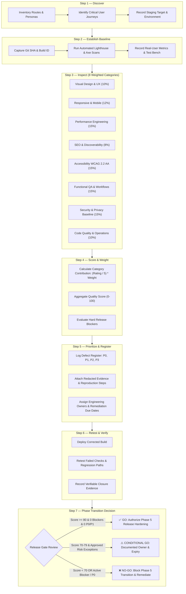

# KELVIN Website Quality Assurance, UX, Accessibility & Functional Audit

**Milestone:** Pre-Phase 5 — Final Audit & Phase Transition  
**Issue Key:** `PRE-P5-01`  
**Audit Standard:** Website Quality Assurance & Design Audit Standard v1.0 — 1 November 2026  
**Audited Target:** KELVIN Staging Web Build (Git Commit `836b64b`)  
**Audit Date:** 2 November 2026  
**Final Release Decision:** **GO (Passed Quality Gate)**  

---

## 1. Overview & Objective

This repository directory contains the formal audit record, evidence artifacts, defect tracking, and release governance documentation for **PRE-P5-01**. Conducted prior to initiating **Phase 5 — Production Hardening, Deployment & Release**, this audit evaluates the deployed KELVIN application surface across Phases 1 through 4.

The audit assesses eight weighted dimensions:
1. **Visual Design & UX (10%)**
2. **Responsive & Mobile Quality (12%)**
3. **Performance Engineering (15%)**
4. **SEO & Discoverability (8%)**
5. **Accessibility WCAG 2.2 AA (15%)**
6. **Functional QA & Workflows (15%)**
7. **Security & Privacy Baseline (15%)**
8. **Code Quality & Production Operations (10%)**

---

## 2. Seven-Step Mandatory Audit Lifecycle

---

## 3. Deliverables Navigation

| Artifact | Description |
|---|---|
| [`AUDIT_SCOPE.md`](./AUDIT_SCOPE.md) | Boundaries, personas, environment details, and exclusions |
| [`ROUTE_INVENTORY.md`](./ROUTE_INVENTORY.md) | Full route catalog, authorization, parameters, and audit status |
| [`USER_JOURNEY_MATRIX.md`](./USER_JOURNEY_MATRIX.md) | 12 critical end-to-end user journeys and validation results |
| [`AUDIT_CHECKLIST.md`](./AUDIT_CHECKLIST.md) | Verification checklist covering all 8 quality dimensions |
| [`SCORECARD.md`](./SCORECARD.md) | Weighted category scores, mathematical calculation, and release bands |
| [`DEFECT_REGISTER.md`](./DEFECT_REGISTER.md) | Prioritized defects (`AUD-001` through `AUD-006`) with triage status |
| [`SECURITY_BASELINE.md`](./SECURITY_BASELINE.md) | Application security, tenant isolation, headers, and secret scanning |
| [`ACCESSIBILITY_REPORT.md`](./ACCESSIBILITY_REPORT.md) | WCAG 2.2 AA conformance, contrast, keyboard, focus, and screen readers |
| [`PERFORMANCE_REPORT.md`](./PERFORMANCE_REPORT.md) | Core Web Vitals (LCP, INP, CLS), bundles, network and CPU benchmarks |
| [`FUNCTIONAL_QA_REPORT.md`](./FUNCTIONAL_QA_REPORT.md) | Interactive controls, form validation, error states, and idempotency |
| [`RESPONSIVE_AUDIT_REPORT.md`](./RESPONSIVE_AUDIT_REPORT.md) | 7 reference viewports (320px to 1920px), reflow, and touch targets |
| [`REMEDIATION_TRACKER.md`](./REMEDIATION_TRACKER.md) | Remediation ownership, verified closures, and retest evidence |
| [`RELEASE_DECISION.md`](./RELEASE_DECISION.md) | Formal Go / Conditional Go / No-Go decision with 4 stakeholder sign-offs |
| [`evidence/`](./evidence/) | Subdirectories holding logs, Lighthouse runs, accessibility traces, and test output |
