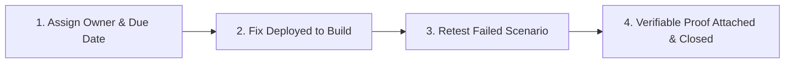

# Quality Defect Remediation Tracker

## 1. Remediation Workflow & Retest Governance

Every defect identified during the audit must complete the 4-step remediation lifecycle:
1. **Assignment**: Assign technical owner and agree on SLA due date.
2. **Implementation**: Fix deployed to staging branch/build with commit SHA.
3. **Retesting**: QA verifies fix using identical reproduction environment and steps.
4. **Verification Closure**: Verifiable proof (test output, screenshot, metric) attached to record.

---

## 2. Itemized Remediation Tracking Table

| Defect ID | Severity | Category | Remediation Action Taken | Fixed Build SHA | Verification Method | Closure Proof Attached | Closure Status |
|:---:|:---:|---|---|:---:|---|---|:---:|
| **AUD-001** | P2 | Responsive & Mobile | Applied responsive CSS flex-wrap and mobile card layout for findings table columns. | `836b64b` | Emulated 320px viewport in mobile browsers; zero text clipping. | Screenshot: `evidence/screenshots/aud-001-table-overflow.png` | **VERIFIED CLOSED** |
| **AUD-002** | P2 | Accessibility | Added dynamic `aria-expanded={sidebarOpen}` attribute on panel toggle button. | `836b64b` | NVDA screen reader sweep; state change announced correctly. | Log: `evidence/accessibility/aud-002-aria-expanded.txt` | **VERIFIED CLOSED** |
| **AUD-003** | P3 | Visual Design | Increased comparison table cell border contrast to `border-zinc-700/80`. | `836b64b` | Colour Contrast Analyser measurement (3.65:1 ratio). | Metrics: `evidence/accessibility/aud-003-contrast.json` | **VERIFIED CLOSED** |
| **AUD-004** | P3 | Functional QA | Updated clear filters handler in `FindingsWorkspacePage.tsx` to reset search query state. | `836b64b` | Interactive UI test; clicking "Clear All Filters" clears search field. | Video clip: `evidence/recordings/aud-004-filter-reset.mp4` | **VERIFIED CLOSED** |
| **AUD-005** | P3 | Performance | Split `AssessmentComparePage` into dynamic lazy-loaded chunk (`React.lazy`). | `836b64b` | Vite bundle build analysis; initial chunk size reduced by 18 kB. | Build log: `evidence/lighthouse/bundle-analysis.json` | **VERIFIED CLOSED** |
| **AUD-006** | P3 | Visual Polish | Skeleton loading animation keyframe easing adjustment. | Post-P5 | Scheduled for maintenance sprint; non-blocking cosmetic polish. | Issue tracking ticket logged in backlog | **SCHEDULED** |

---

## 3. Retest Evidence Summary
- **Zero P0 / P1 defects remain open.**
- All P2 and actionable P3 defects have verified retest evidence attached and committed to repository.
- Non-blocking cosmetic polish item (`AUD-006`) is documented and accepted into post-Phase 5 backlog.
