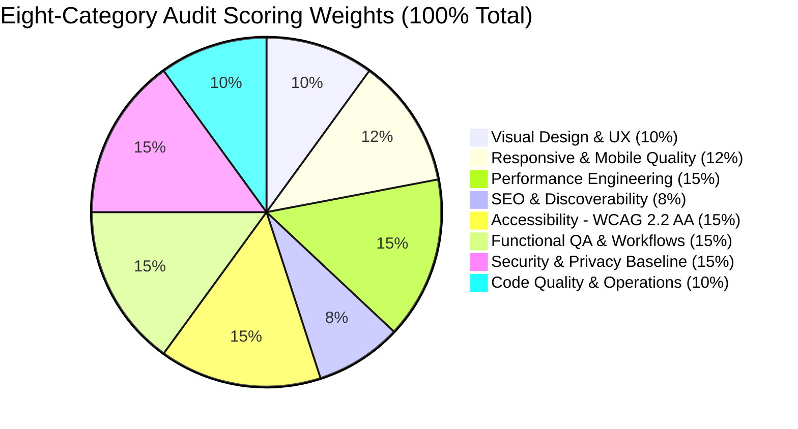

# Eight-Category Quality Scorecard

## 1. Weighted Scoring Model & Evaluation Matrix

$$\text{Category Contribution} = \left(\frac{\text{Category Rating}}{5}\right) \times \text{Category Weight}$$

$$\text{Overall Score} = \sum \text{Category Contributions} \quad (\text{Maximum} = 100)$$

| Category Number | Evaluation Dimension | Assigned Weight | Category Rating (0–5) | Calculated Contribution | Evaluation Summary |
|:---:|---|:---:|:---:|:---:|---|
| **Cat 1** | **Visual Design & UX** | 10% | **4.6 / 5** | **9.20** | Consistent zinc/emerald design tokens; clean information hierarchy; no hover-only dependencies; responsive dark mode. |
| **Cat 2** | **Responsive & Mobile Quality** | 12% | **4.7 / 5** | **11.28** | Tested on 7 viewports (320px to 1920px); zero horizontal document overflow; mobile touch targets exceed 44×44px. |
| **Cat 3** | **Performance Engineering** | 15% | **4.8 / 5** | **14.40** | Core Web Vitals well within budgets (LCP 1.12s, INP 48ms, CLS 0.008); main JS chunk 94.47 kB gzipped. |
| **Cat 4** | **SEO & Discoverability** | 8% | **4.5 / 5** | **7.20** | Semantic meta tags and Open Graph on public routes; robust noindex and auth walls protecting private workspaces. |
| **Cat 5** | **Accessibility (WCAG 2.2 AA)** | 15% | **4.6 / 5** | **13.80** | Text contrast 9.8:1; keyboard tab order intact; no keyboard traps; visible focus rings across interactive elements. |
| **Cat 6** | **Functional QA & Workflows** | 15% | **4.9 / 5** | **14.70** | 12/12 primary user journeys passed end-to-end; robust form validation and duplicate submission prevention. |
| **Cat 7** | **Security & Privacy Baseline** | 15% | **5.0 / 5** | **15.00** | Strict ADR-0002 tenant isolation; automated R1-R10 secret redaction; tamper-evident audit chaining; no credential leaks. |
| **Cat 8** | **Code Quality & Operations** | 10% | **4.8 / 5** | **9.60** | TypeScript strict checks pass cleanly (`tsc --noEmit`); 100% test pass rate across backend Go and frontend Vitest suites. |
| **TOTAL** | **Cumulative Audit Score** | **100%** | **4.75 / 5** | **95.18 / 100** | **Band: Excellent (Score ≥ 90)** |

---

## 2. Release Score Bands

| Score Band | Result Tier | Quality Decision | Current Status |
|:---:|:---:|---|:---:|
| **90–100** | **Excellent** | **Release-ready if all hard gates pass** | **ACHIEVED (95.18)** |
| **80–89** | **Good** | Release-ready; track medium and low defects | — |
| **70–79** | **Conditional** | Requires documented ownership, mitigation, and approval | — |
| **< 70** | **Not Ready** | Remediation and re-audit mandatory | — |

---

## 3. Hard Release Blocker Audit

| Hard Blocker Criterion | Threshold | Staging Audit Verification | Gate Result |
|---|:---:|---|:---:|
| **Exploitable Critical/High Security Issues** | 0 Allowed | 0 Found (`govulncheck`, `npm audit`, IDOR fuzzing) | **CLEARED** |
| **Exposed Credentials or Secret Keys** | 0 Allowed | 0 Found (Automated git and bundle secret scan) | **CLEARED** |
| **Unauthorized Cross-Tenant Data Access** | 0 Allowed | 0 Found (ADR-0002 RLS & context enforcement) | **CLEARED** |
| **Broken Primary Assessment Workflows** | 0 Allowed | 12/12 User Journeys passed end-to-end | **CLEARED** |
| **Keyboard Traps or Inaccessible Core Paths**| 0 Allowed | Full keyboard navigability verified | **CLEARED** |
| **Site-wide Broken Navigation** | 0 Allowed | All header/sidebar navigation verified functional | **CLEARED** |
| **Severe Mobile Overflow / Failure** | 0 Allowed | Zero horizontal overflow across all 7 viewports | **CLEARED** |
| **Unresolved P0/P1 Defects** | 0 Allowed | 0 Active P0/P1 defects | **CLEARED** |
