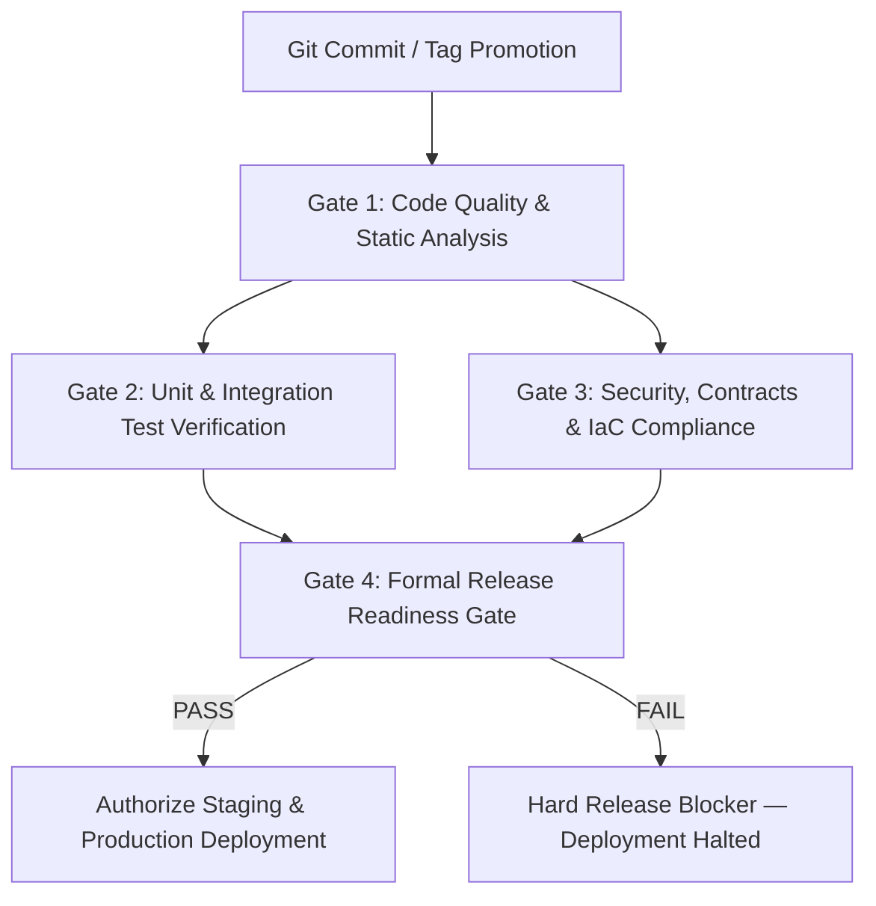

# KELVIN Production CI Quality and Verification Gates

**Document Control**

| Field | Value |
| :--- | :--- |
| **Status** | Approved — Release Engineering Specification |
| **Milestone** | Phase 5 — Production Hardening, Deployment & Release (`P5-07`) |
| **Parent Roadmap** | [KELVIN Engineering Roadmap](../ISSUE-02_ENGINEERING_ROADMAP.md) |
| **Parent Issue** | Issue #363 (`P5-07`) |
| **Workflow Reference** | [`.github/workflows/production-gates.yml`](../../.github/workflows/production-gates.yml) |
| **Review Cadence** | Bi-annual |
| **Classification** | Internal — Enterprise Quality Standard |

---

## 1. Executive Summary & Verification Lifecycle

Before any code artifact or container image can be promoted to Staging or Production, it must satisfy four immutable, automated verification gates in the continuous integration pipeline:

---

## 2. The Four Mandatory Verification Gates

### Gate 1: Code Quality, Style & Static Analysis
- **Go Formatting & Vet:** `gofmt -l` checks that all Go code conforms to standard formatting without drift. `go vet` verifies idiomatic correctness and detects suspicious constructs.
- **Frontend Quality:** ESLint checks TypeScript coding conventions, while `npm run build:web` runs strict `tsc --noEmit` type checking and compiles the production Vite bundle.
- **Zero Warnings Policy:** Build warnings on production branches are treated as failures.

### Gate 2: Full Test Verification Suite with Race Detector
- **Backend Unit Tests:** `go test -race -v ./apps/api/...` and `./apps/worker/...` with memory sanitizer and race condition detection.
- **Integration Tests:** Live database and message broker tests verifying PostgreSQL connection pooling, tenant isolation, and Redis queue leasing.
- **Frontend Unit Tests:** Automated Vitest suite verifying component rendering, state management, and accessibility standards.

### Gate 3: Security, Contracts & Compliance Verification
- **OpenAPI Schema Contract:** Validates `apps/api/openapi/openapi.yaml` against Redocly rules, ensuring client-server API contract parity.
- **IaC & Secret Scanning:** Validates Terraform modules and checks for plaintext secret patterns.
- **Software Supply Chain & Vulnerability Scan:** Trivy scans project dependencies for CRITICAL and HIGH severity CVEs.

### Gate 4: Formal Release Readiness Gate
- Aggregates upstream status from Gates 1, 2, and 3.
- Persists signed build metadata, test logs, coverage profiles, and Git commit provenance.
- Generates the authoritative gate clearance token required by downstream CD deployment runners.

---

## 3. Protected Branch Rules & Flaky Test Management

### 3.1 Branch Protection Rules
1. Direct pushes to `main` and `release/*` are prohibited.
2. Changes require review from designated CODEOWNERS.
3. All four CI gates must report `SUCCESS` before merge authorization.
4. Bypasses are technically restricted to designated Break-Glass Security Leads.

### 3.2 Flaky Test Quarantine Protocol
- Any test failing intermittently (> 1% over 100 runs) is flagged as flaky.
- Flaky tests must be tagged with `// +build quarantine` and assigned a P1 defect ticket.
- Quarantined tests do not block critical security patches, but must be remediated or deleted within 14 business days.
