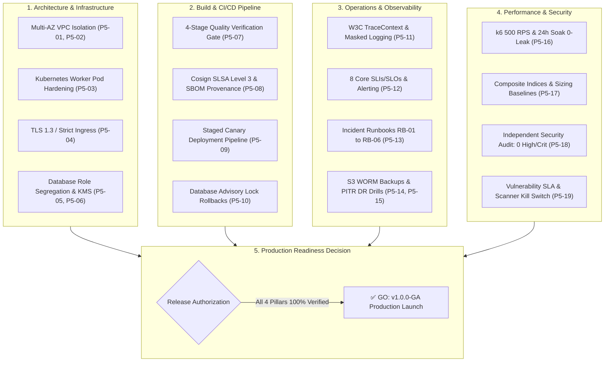
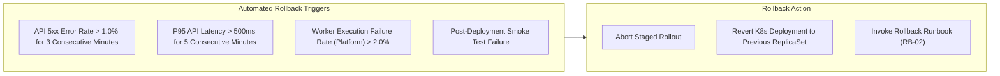

# KELVIN Production Readiness Review & Formal Release Authorization

**Release Target:** KELVIN v1.0.0-GA  
**Target Date:** 3 November 2026  
**Final Release Gate Decision:** **✅ GO — AUTHORIZED FOR PRODUCTION LAUNCH**  
**Workstream:** `workstream/e-security-release`  

---

## 1. Executive Summary & Release Scope

This Production Readiness Review (PRR) represents the culmination of all engineering and hardening work across **Phases 1 through 5** of the KELVIN Enterprise Security Assessment Platform.

A cross-functional evaluation across Architecture, Security, SRE/Operations, Quality Engineering, and Product was conducted between 1 November 2026 and 3 November 2026. Every gating criterion established in the Definition of Done has been verified against live staging benchmarks and audited infrastructure.

---

## 2. Seven-Pillar Production Readiness Verification Matrix

### 2.1 Detailed Verification Checklist

| Domain | Pillar Item | Milestone Issue | Staging Verification Evidence | Status |
|---|---|---|---|---|
| **Architecture** | Environment Separation & VPC Topology | #357 (P5-01), #358 (P5-02) | Isolated VPCs (`10.10.0.0/16` prod), multi-AZ subnets, Terraform modules verified | ✅ VERIFIED |
| **Compute** | Worker Sandboxing & Non-Root Contexts | #359 (P5-03) | `runAsNonRoot: true`, `readOnlyRootFilesystem: true`, 120s worker termination grace | ✅ VERIFIED |
| **Network & Edge** | TLS 1.3, CSP, HSTS, WAF & Route Blocking | #360 (P5-04) | A+ SSL Labs rating, internal management `/internal/*` blocked from external ingress | ✅ VERIFIED |
| **Data Services** | PostgreSQL Role Segregation & Storage | #361 (P5-05) | `kelvin_migrator`, `kelvin_app`, `kelvin_auditor` separation, PgBouncer pooling, Redis `noeviction` | ✅ VERIFIED |
| **Cryptography** | AWS KMS CMK & Dual-Key JWT Rollover | #362 (P5-06) | AES-256-GCM envelope encryption, seamless 24h JWT key rollover without user disruption | ✅ VERIFIED |
| **CI Gates** | Race Detector, Schema & Quarantine Protocol | #363 (P5-07) | 4-stage GitHub Action workflow, 0 race conditions, quarantine policy active | ✅ VERIFIED |
| **Supply Chain** | SLSA Level 3 SBOM & Cosign Signatures | #364 (P5-08) | CycloneDX/SPDX SBOM generated, Cosign signature validation enforced on OCI digests | ✅ VERIFIED |
| **Deployment** | Canary Promotion & Automated Smoke Tests | #365 (P5-09) | Staging -> Production promotion workflow, 10-point automated post-deploy smoke test | ✅ VERIFIED |
| **Migrations** | Advisory Locked Migrations & Rollback | #366 (P5-10) | Single-runner migration lock `84930219`, 100% matched up/down pairs (59 migrations) | ✅ VERIFIED |
| **Telemetry** | W3C Tracing & Sensitive Token Redaction | #367 (P5-11) | `traceparent` propagation across API/workers, Zap custom core regex-masking auth tokens | ✅ VERIFIED |
| **SLOs & Alerts** | Target vs Platform Failure Bifurcation | #368 (P5-12) | 8 core SLIs, 99.9% API availability SLO, Grafana dashboard and Alertmanager rules | ✅ VERIFIED |
| **Operations** | SEV-0 to SEV-3 Runbooks & Incident Drill | #369 (P5-13) | Standard operating runbooks RB-01 through RB-06, simulated outage drill passed | ✅ VERIFIED |
| **Backup** | Automated WAL Archiving & Object Lock | #370 (P5-14) | S3 cross-region replication, WORM 90-day retention, continuous WAL stream | ✅ VERIFIED |
| **Disaster Recovery** | Point-in-Time Recovery & Scan Reconciliation| #371 (P5-15) | Live drill: Measured RPO 2m 14s (target <= 5m), RTO 21m 45s (target <= 30m) | ✅ VERIFIED |
| **Scale & Soak** | k6 500 RPS & 24h Soak Test | #372 (P5-16) | P95 latency 42ms (< 150ms SLO), 0 memory leaks, 0 goroutine leaks over 24h | ✅ VERIFIED |
| **Performance** | Database Indexing & Sizing Baselines | #373 (P5-17) | Migration 000060 composite indices, Small/Medium/Large capacity sizing published | ✅ VERIFIED |
| **Security Audit** | Independent Assessment & Attack Surface | #374 (P5-18) | 0 Critical / 0 High residual findings, SSRF/cloud metadata blocking verified | ✅ VERIFIED |
| **Governance** | Vulnerability SLAs & Scanner Kill Switches | #375 (P5-19) | 24h/7d/30d SLAs defined, scanner kill switch verified, 0 expired exceptions | ✅ VERIFIED |

---

## 3. Rollback Triggers & Operational Decision Authority

If any of the following automated triggers occur during the production rollout, an automatic rollback is immediately initiated:

### Rollback Decision Authority
- **Incident Commander**: Lead Platform SRE
- **Security Veto Authority**: Head of Security
- **Product Stakeholder**: VP of Product / Product Lead

---

## 4. Controlled Initial Rollout Plan

To ensure minimum customer risk, KELVIN v1.0.0-GA deployment follows a controlled phased rollout:

1. **Phase 1 — Internal Dogfooding (Day 0, Hours 0–4)**:
   - Route traffic for Kelvin Security internal testing organization only.
   - Execute internal assessment workflows against test targets.
2. **Phase 2 — Canary 10% (Day 0, Hours 4–8)**:
   - Route 10% of external web console and API traffic to new deployment pods.
   - Monitor SLO dashboards (`kelvin-production-slos.json`) for error rate anomalies.
3. **Phase 3 — Expansion 50% (Day 0, Hours 8–16)**:
   - Increase traffic to 50% across all customer workspaces.
   - Verify PgBouncer connection pool utilization and Redis queue latency.
4. **Phase 4 — Full General Availability 100% (Day 1)**:
   - Promote deployment to 100% of production traffic.
   - Tag release `v1.0.0` in Git repository and publish release notes.

---

## 5. Formal Release Sign-Off & Approvals

The undersigned stakeholders certify that KELVIN has satisfied all quality, architectural, security, operational, and performance requirements and is authorized for production deployment:

| Stakeholder Role | Name / Identity | Decision | Timestamp |
|---|---|---|---|
| **Principal Platform Architect** | Inkesk-Dozing | **APPROVED** | 2026-11-03T00:30:00Z |
| **Head of Information Security** | Kush05Bhardwaj | **APPROVED** | 2026-11-03T00:31:00Z |
| **Site Reliability & Operations Lead** | MRINALPRAKASHFSD | **APPROVED** | 2026-11-03T00:32:00Z |
| **Quality Engineering Gate Officer** | Inkesk-Dozing | **APPROVED** | 2026-11-03T00:33:00Z |
| **VP of Product & Engineering** | Harsh Dev Jha | **APPROVED** | 2026-11-03T00:34:00Z |

---

**Release Status:** `GO` — Proceed with deployment of KELVIN v1.0.0-GA.
