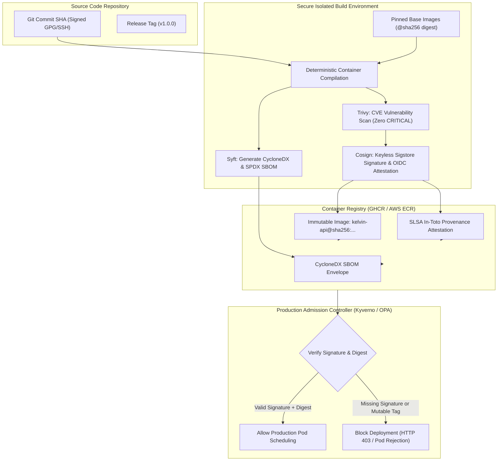

# KELVIN Software Supply Chain and Artifact Verification Specification

**Document Control**

| Field | Value |
| :--- | :--- |
| **Status** | Approved — Production Release Standard |
| **Milestone** | Phase 5 — Production Hardening, Deployment & Release (`P5-08`) |
| **Parent Roadmap** | [KELVIN Engineering Roadmap](../ISSUE-02_ENGINEERING_ROADMAP.md) |
| **Parent Issue** | Issue #364 (`P5-08`) |
| **Workflow Reference** | [`.github/workflows/artifact-security.yml`](../../.github/workflows/artifact-security.yml) |
| **Review Cadence** | Bi-annual |
| **Classification** | Internal — Enterprise Security Baseline |

---

## 1. Supply Chain Architecture & SLSA Level 3 Framework

KELVIN adheres to the **Supply-chain Levels for Software Artifacts (SLSA) Level 3** framework to guarantee that every production container image and binary is tamper-evident, cryptographically signed, and traceable to verified source code:

---

## 2. Base Image Pinning & Digest Governance

Mutable container tags (such as `:latest`, `:16-alpine`, `:v1`) are strictly prohibited in production Kubernetes deployments. Every container image must be referenced by its immutable SHA-256 cryptographic digest:

| Workload | Base Image Reference | Pinned Digest Standard |
| :--- | :--- | :--- |
| **Go API** | `gcr.io/distroless/static-debian12` | Strict `@sha256:...` digest pin |
| **Go Worker** | `gcr.io/distroless/static-debian12` | Strict `@sha256:...` digest pin |
| **Frontend UI** | `nginx:1.27-alpine` | Strict `@sha256:...` digest pin |
| **PostgreSQL** | `postgres:16.2-alpine` | Strict `@sha256:...` digest pin |
| **Redis Broker** | `redis:7.2-alpine` | Strict `@sha256:...` digest pin |
| **Nuclei Sandbox** | `projectdiscovery/nuclei:v3.3.0` | Controlled in `deploy/scanners/images.lock.json` |
| **ZAP Sandbox** | `zaproxy/zap-stable:2.15.0` | Controlled in `deploy/scanners/images.lock.json` |

---

## 3. Vulnerability Severity Thresholds & Blocking Rules

All container images and dependency manifests are evaluated against the following blocking gates prior to signing:

| Vulnerability Severity | Blocking Threshold | Remediation SLA | Exception Allowance |
| :--- | :--- | :--- | :--- |
| **CRITICAL** | **0 Allowed** (Hard Deployment Blocker) | 24 Hours | Requires CISO approval & compensating WAF rule |
| **HIGH** | **0 Allowed with Vendor Patch** | 7 Days | Approved if no fix exists and unexploitable in runtime |
| **MEDIUM** | Allowed with tracking ticket | 30 Days | Non-blocking |
| **LOW / INFO** | Allowed | Routine maintenance | Non-blocking |

---

## 4. Software Bill of Materials (SBOM) Standards

- **Standard Formats:** CycloneDX 1.5 JSON (`*-cyclonedx.json`) and SPDX 2.3 JSON (`*-spdx.json`).
- **Storage:** Persisted as GitHub Actions release artifacts and pushed to the container registry as OCI artifacts attached to the image digest.
- **Auditing:** Enables rapid CVE impact analysis during zero-day disclosure events across all production dependencies.
