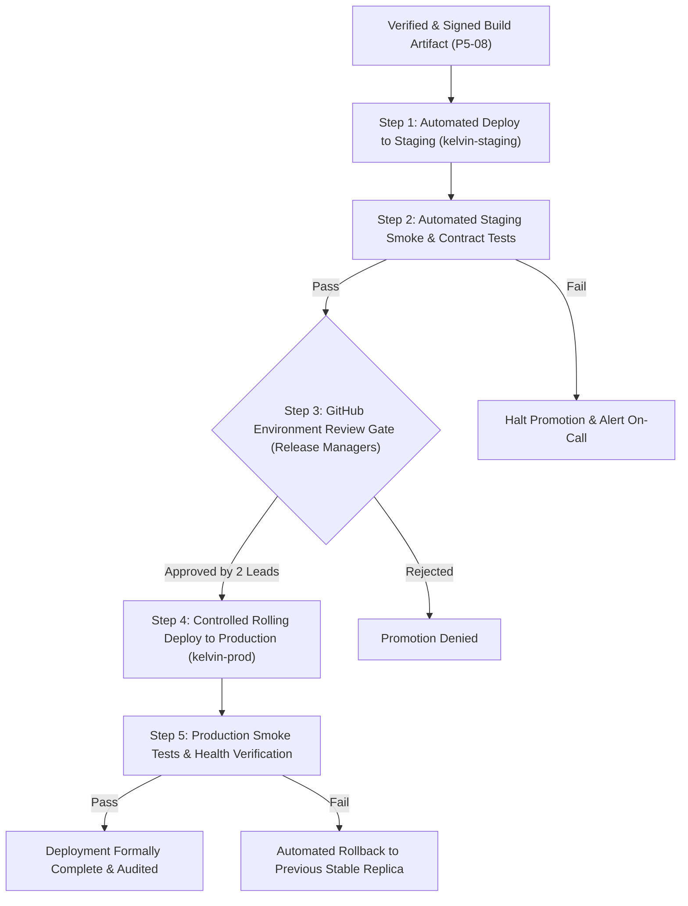

# KELVIN Staged Deployment and Environment Promotion Specification

**Document Control**

| Field | Value |
| :--- | :--- |
| **Status** | Approved — Production Operations Standard |
| **Milestone** | Phase 5 — Production Hardening, Deployment & Release (`P5-09`) |
| **Parent Roadmap** | [KELVIN Engineering Roadmap](../ISSUE-02_ENGINEERING_ROADMAP.md) |
| **Parent Issue** | Issue #365 (`P5-09`) |
| **Workflow Reference** | [`.github/workflows/deploy-promotion.yml`](../../.github/workflows/deploy-promotion.yml) |
| **Review Cadence** | Bi-annual |
| **Classification** | Internal — Enterprise Release Standard |

---

## 1. Staged Promotion Pipeline Architecture

KELVIN enforces a strictly gated, staged environment promotion model. Direct pushes or out-of-band manual deployments to Production are prevented by repository and cloud provider IAM access controls:



---

## 2. Environment Promotion Matrix & Gating Criteria

| Stage | Target Environment | Deployment Mode | Approval Requirement | Required Automated Validation |
| :--- | :--- | :--- | :--- | :--- |
| **1. Development** | `kelvin-dev` | Continuous CD on `main` merge | Automated | Unit tests & static linting |
| **2. Staging** | `kelvin-staging` | Automated on tagged Release Candidate | Automated | Full integration suite & schema validation |
| **3. Production** | `kelvin-prod` | Gated Rolling Update (`maxSurge: 1, maxUnavailable: 0`) | **Manual Approval Required** (2 named CODEOWNERS) | Production Smoke Tests, TLS checks, Probe checks |

---

## 3. Safe Assessment Job Draining During Worker Upgrades

To ensure zero customer scan disruption during production deployments:
1. When a new worker deployment is triggered, Kubernetes issues a `SIGTERM` to existing worker pods.
2. The Go worker daemon immediately unregisters from new Redis queue task leasing.
3. The pod is granted a **120-second termination grace period** (`terminationGracePeriodSeconds: 120`).
4. Any active scanner subprocess is allowed to finish its current target batch and flush normalized results to PostgreSQL before pod termination.
5. If a scan exceeds 120 seconds, the worker watchdog checkpoint safely re-enqueues the uncompleted target partition so the newly scheduled worker pod resumes execution seamlessly.

---

## 4. Automated Post-Deployment Verification & Rollback

- Following any deployment, `scripts/release/smoke-test.sh` verifies:
  1. API Liveness Probe (`/healthz` returns HTTP 200).
  2. API Readiness Probe (`/readyz` verifies PostgreSQL pool & Redis ping).
  3. Frontend SPA Root (HTML payload and asset bundle load correctly).
  4. Security Response Headers (HSTS, CSP, X-Frame-Options).
- If any smoke test step fails after 3 retries (15 seconds), the deployment is marked `FAILED` and Kubernetes automatically executes a rollout undo:
  ```bash
  kubectl rollout undo deployment/prod-kelvin-api -n kelvin-prod
  kubectl rollout undo deployment/prod-kelvin-worker -n kelvin-prod
  ```
