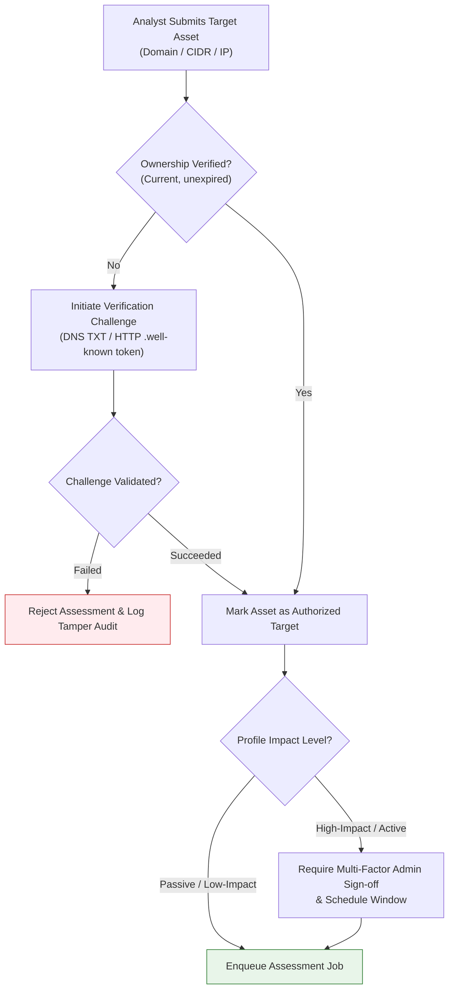

# Kelvin Security Platform — Acceptable Use Policy (AUP)

**Document Control**

| Field | Value |
| :--- | :--- |
| **Status** | Baseline — Peer-Reviewed |
| **Milestone** | Phase 1 — Foundation & Core Architecture (`P1-04`) |
| **Depends On** | `docs/PRODUCT_VISION.md` (`P1-01`), `docs/security/THREAT_MODEL.md` (`P1-03`) |
| **Owner** | Legal & Compliance / Product Security |
| **Review Cadence** | Annually, and upon material legal or regulatory change |
| **Related Docs** | `docs/PRODUCT_VISION.md`, `docs/security/THREAT_MODEL.md`, `docs/ARCHITECTURE_AND_FEATURES.md`, `docs/MVP_AND_PHASE_BIFURCATION.md` |
| **Classification** | Internal — Legally Significant |

---

## 1. Executive Summary

Kelvin is a security assessment and vulnerability management platform designed exclusively for **authorized security assessments**. Execution of automated scans against digital assets without explicit, documented authorization violates international cybersecurity statutes, including the U.S. Computer Fraud and Abuse Act (CFAA, 18 U.S.C. § 1030), the UK Computer Misuse Act 1990, and the EU NIS2 Directive and GDPR.

This Acceptable Use Policy (AUP) establishes the legal and technical boundaries governing permitted testing activities on the Kelvin platform. It defines:

* **Permitted testing activities** — what may be scanned, how, and under what authorization.
* **Asset authorization and verification** — DNS TXT, HTTP `.well-known` token, and signed enterprise agreement mechanisms that prove domain ownership or testing consent.
* **Scope boundaries** — permitted domains, subdomains, CIDR blocks, and excluded URIs.
* **High-impact check gates** — multi-factor admin sign-off and scheduling windows for active vulnerability checks.
* **Evidence handling and responsible disclosure** — chain of custody for critical findings and zero-day evidence.
* **Audit trail retention** — compliance and legal defensibility requirements.

No assessment may execute on Kelvin unless and until every control in this policy is satisfied. Violations of this AUP constitute grounds for immediate account suspension, termination of platform access, and referral to legal counsel.

---

## 2. Scope & Applicability

### 2.1 Who This Policy Applies To

This AUP binds all users of the Kelvin platform, including:

* **Platform administrators** (tenant owners, compliance officers)
* **Security analysts** (assessment operators)
* **Security engineers** (worker fleet and scanner adapter operators)
* **API consumers and CI/CD integrations** (programmatic assessment submission)
* **Third-party scanner adapter developers** (plugin contributors)

### 2.2 What This Policy Covers

All activity originating from or routed through the Kelvin platform, including:

* Target asset submission and scope verification
* Assessment creation, scheduling, and execution
* Scanner worker dispatch and network traffic generation
- Findings collection, normalization, deduplication, and storage
* Report generation and export
* Evidence ingestion, retention, and disclosure

### 2.3 Legal Framework

Kelvin operates under the following governing legal frameworks. Nothing in this AUP permits activity that is unlawful under the applicable jurisdiction of the operator, the target asset, or the platform host.

| Jurisdiction | Governing Instrument | Relevance to Kelvin |
| :--- | :--- | :--- |
| United States | Computer Fraud and Abuse Act, 18 U.S.C. § 1030 | Criminal liability for unauthorized access and network interference |
| United Kingdom | Computer Misuse Act 1990 | Criminal liability for unauthorized computer access and acts impairing operation |
| European Union | NIS2 Directive (EU 2022/2555), GDPR (EU 2016/679) | Cybersecurity obligations, data protection, breach notification |
| Global | Applicable local computer-crime and privacy law | Operator must confirm legality in target and host jurisdictions |

**Operators are responsible for confirming that every assessment is lawful under the laws of (a) the jurisdiction where Kelvin is hosted, (b) the jurisdiction of the asset owner granting authorization, and (c) the jurisdiction of the target asset.** When jurisdictions conflict, the most restrictive interpretation governs.

---

## 3. Permitted vs. Prohibited Testing Activities

### 3.1 Permitted Activities (With Authorization)

The following activities are permitted **only** when the target asset has passed ownership verification (Section 5) and the assessment conforms to the approved scope and profile:

| Activity | Conditions |
| :--- | :--- |
| Passive service discovery (banner grab, DNS enumeration) | Verified target; low-impact profile only |
| Non-intrusive vulnerability scanning (version detection, missing-patch checks) | Verified target; standard or deep profile with admin sign-off if high-impact |
| Authenticated application scanning (with supplied test credentials) | Verified target; credentials scoped to test accounts only |
| Passive network reconnaissance (WHOIS, certificate transparency, public DNS) | Verified target; no traffic to target host required |
| Web application passive analysis (headers, cookies, TLS configuration) | Verified target; no form submission or parameter fuzzing without authorization |

### 3.2 Strictly Prohibited Activities

The following activities are **prohibited under all circumstances** on the Kelvin platform. This list is absolute and may not be relaxed without a formal, documented amendment to this AUP approved by Legal, Product, Engineering, and Security stakeholders.

| # | Prohibited Activity | Legal & Operational Rationale |
|:--|:---|:---|
| **PA-01** | Scanning targets without explicit, revocable authorization from the asset owner | Violates CFAA, UK Computer Misuse Act, NIS2; unauthorized access is criminal regardless of intent |
| **PA-02** | Unconstrained DDoS, arbitrary port flooding, or amplification attacks | Network interference; violates acceptable-use policies of transit providers and cloud hosts |
| **PA-03** | Automated weaponized payload dropping or exploitation | Offensive cyber operation; may violate export controls and intrusion-software regulations |
| **PA-04** | Unauthenticated public scanning service open to arbitrary third-party targets | Cannot establish chain of custody; converts platform into unauthorized reconnaissance service |
| **PA-05** | Scanning of healthcare, financial, emergency-services, or critical-infrastructure systems without written authorization | Heightened statutory penalties; risk of collateral service disruption and harm to public safety |
| **PA-06** | Scanning that knowingly targets fragile, deprecated, or production-critical systems without a scheduled maintenance window | Risk of accidental denial-of-service, database corruption, or service disruption |
| **PA-07** | Use of Kelvin as an open proxy or relay to internal/cloud-metadata services (SSRF) | Unauthorized pivoting; exfiltration of instance credentials; abuse of cloud provider terms |

These prohibitions align with and reinforce the Strict Non-Goals defined in `docs/PRODUCT_VISION.md` (B1–B4) and mitigations in `docs/security/THREAT_MODEL.md` (T-06, T-07, T-13, T-14).

---

## 4. Authorization Model

Every assessment on Kelvin requires a **valid, recorded authorization** before execution. Three authorization mechanisms are accepted, in order of preference:

### 4.1 Domain Ownership Verification (Technical)

The submitting user proves control of the target domain via one of:

1. **DNS TXT record** — Publish a Kelvin-issued verification token at a deterministic subdomain (e.g., `_kelvin-verify.example.com`).
2. **HTTP `.well-known` token** — Serve a Kelvin-issued verification token at `https://<target>/.well-known/kelvin-verify`.

### 4.2 CIDR / Network Block Authorization (Contractual)

For IP ranges and CIDR blocks, the user provides a signed enterprise testing agreement or letter of authorization (LoA) from the network owner, specifying:

* Authorized CIDR blocks and individual IPs
* Authorized scan types and intensity
* Valid authorization window (start/end dates)
* Authorized signatory name and contact

### 4.3 Enterprise Blanket Authorization (Contractual)

Platform administrators may grant a tenant-level blanket authorization covering a defined set of assets, subject to:

* Annual review and re-attestation
* Per-asset scope verification still required before first scan
* Immediate revocation upon contract termination or policy violation

---

## 5. Technical Verification Protocol Specifications

The Kelvin control plane enforces automated domain verification before any active assessment is enqueued. The protocol below is the technical specification for asset onboarding.

### 5.1 Verification Flow



### 5.2 DNS TXT Verification Protocol

| Parameter | Specification |
| :--- | :--- |
| **Record name** | `_kelvin-verify.<target-domain>` |
| **Record type** | TXT |
| **Record value** | `kelvin-verification=<token>` where `<token>` is a 32-byte cryptographically random nonce issued by Kelvin |
| **Validation method** | Kelvin DNS resolver queries the TXT record; exact string match required |
| **Token lifetime** | 7 days; must be re-verified upon expiry |
| **Re-verification trigger** | Scope change, token expiry, or platform-initiated audit |
| **Anti-rebind** | Single resolution at validation time; TTL forced to 0; pinned for the authorization window |

### 5.3 HTTP `.well-known` Verification Protocol

| Parameter | Specification |
| :--- | :--- |
| **Endpoint** | `https://<target>/.well-known/kelvin-verify` |
| **Method** | GET |
| **Expected response** | HTTP 200, body contains `kelvin-verification=<token>`, content-type `text/plain` |
| **TLS requirement** | Valid certificate trusted by Kelvin's CA store; certificate pinning optional for high-value targets |
| **Token lifetime** | 7 days; must be re-verified upon expiry |
| **Follow redirects** | Prohibited; final destination must match the submitted target exactly |

### 5.4 CIDR / Network Block Verification

| Parameter | Specification |
| :--- | :--- |
| **Documentation** | Signed letter of authorization (LoA) or enterprise testing agreement |
| **Required fields** | Authorized CIDRs/IPs, scan types, intensity, validity window, signatory |
| **Verification method** | Legal review + digital signature validation (PGP / DocuSign / equivalent) |
| **Storage** | Encrypted evidence vault; linked to tenant authorization register |
| **Expiry** | Authorization window end date; automatic re-attestation required annually |

### 5.5 Verification State Machine

Each asset transitions through the following states:

```
Unverified ──(challenge issued)──> PendingVerification
PendingVerification ──(challenge passed)──> Authorized
Authorized ──(expiry / revocation)──> Unauthorized
Unauthorized ──(re-verification)──> PendingVerification
Authorized ──(admin revocation)──> Revoked (permanent)
```

Any transition to `Authorized` is recorded in the audit trail with the verification method, token hash, timestamp, and verifying user.

---

## 6. Scope Boundaries

### 6.1 Permitted Targets

| Target Type | Permitted | Conditions |
| :--- | :--- | :--- |
| Owned domains (verified via DNS TXT / `.well-known`) | ✅ | Current verification; within tenant scope |
| Owned subdomains of verified domains | ✅ | Inherits parent verification; wildcard scans require explicit opt-in |
| Owned CIDR blocks (verified via LoA / enterprise agreement) | ✅ | Within authorization window; per-IP verification for new additions |
| Third-party domains with written authorization | ✅ | Signed LoA in evidence vault; verification renewed per engagement |
| Public bug-bounty program targets | ✅ | Program policy permits automated scanning; proof of enrollment required |

### 6.2 Excluded / Prohibited Targets

| Target Type | Status | Rationale |
| :--- | :--- | :--- |
| RFC 1918 addresses (`10.0.0.0/8`, `172.16.0.0/12`, `192.168.0.0/16`) | ❌ Blocked | Internal network; risk of collateral disruption and SSRF |
| Loopback (`127.0.0.0/8`, `::1`) | ❌ Blocked | Localhost; no valid external assessment use case |
| Link-local (`169.254.0.0/16`) | ❌ Blocked | Cloud metadata (e.g., `169.254.169.254`); SSRF vector |
| Multicast / reserved (`224.0.0.0/4`, `240.0.0.0/4`) | ❌ Blocked | Not valid assessment targets |
| Cloud provider infrastructure not owned by tenant | ❌ Blocked | Violates provider acceptable-use policies |
| Healthcare, financial, emergency-services, or critical infrastructure | ❌ Blocked without written authorization | Heightened statutory penalties and public-safety risk |
| Any target without current ownership verification | ❌ Blocked | No chain of custody; unauthorized access |

### 6.3 Excluded URIs & Paths

The following URI patterns are excluded from active scanning even on authorized targets:

* Authentication endpoints (`/login`, `/signin`, `/auth/*`, `/oauth/*`, `/sso/*`)
* Password-reset and account-recovery flows
* Payment processing endpoints (`/checkout`, `/pay`, `/payment/*`)
* Administrative interfaces not owned by the testing organization
* Endpoints explicitly marked `Disallow` in `robots.txt` when passive-only profile is selected
* File upload endpoints that could modify target state

---

## 7. High-Impact Check Approval Gates

Active vulnerability checks that carry material risk of service disruption, data modification, or destructive testing require elevated approval.

### 7.1 Impact Classification

| Profile | Impact Level | Examples | Approval Required |
| :--- | :--- | :--- | :--- |
| **Passive Discovery** | Low | Banner grab, DNS enumeration, TLS config | Analyst self-service |
| **Standard Automated** | Medium | Version detection, missing-patch, header analysis | Analyst self-service (verified target) |
| **Active Web Checks** | High | Parameter fuzzing, form submission, authenticated scanning | Multi-factor admin sign-off + schedule window |
| **Deep / Intrusive** | High | Exploitation-adjacent checks, credential brute-force, fuzzing with payloads | Multi-factor admin sign-off + schedule window + legal review |
| **Custom / Plugin** | Varies | Third-party scanner adapter output | Adapter approval + profile-dependent gate |

### 7.2 High-Impact Approval Workflow

For High and Deep profiles:

1. Analyst submits assessment with requested profile and execution window.
2. System routes request to tenant administrator(s) with `assessment:approve` permission.
3. Approver must authenticate with MFA and provide a documented justification.
4. Approval is time-bound to the requested schedule window; assessments outside the window are rejected.
5. Approval, justification, and approver identity are recorded in the immutable audit trail.
6. Assessment executes only within the approved window; execution outside the window triggers automatic abort and security alert.

### 7.3 Scheduling Constraints

* Assessments against production systems must be scheduled during pre-agreed maintenance windows.
* No high-impact checks may run outside business-hours approval windows without explicit after-hours authorization.
* Concurrency limits per target to prevent accidental denial-of-service (default: 1 active assessment per target; configurable per profile).

---

## 8. Evidence Handling & Responsible Disclosure

### 8.1 Chain of Custody

All evidence collected during an assessment must maintain a verifiable chain of custody to be legally defensible for compliance audits or bug bounty rewards:

| Element | Requirement |
| :--- | :--- |
| **Collection timestamp** | UTC, recorded at evidence ingestion |
| **Collector identity** | Authenticated user or service account |
| **Target asset** | Verified asset ID with authorization reference |
| **Assessment job ID** | Immutable link to the originating job |
| **Integrity hash** | SHA-256 of raw evidence at ingestion |
| **Storage location** | Encrypted evidence vault, tenant-isolated |
| **Access log** | Every read/export logged with user, timestamp, and purpose |

### 8.2 Credential Redaction

Before persistence, the evidence pipeline strips:

* Authorization headers and bearer tokens
* Session cookies and authentication cookies
* API keys and access tokens (regex + entropy-based detection)
* Private keys and certificate private material
* Database connection strings containing credentials

Redaction failures quarantine the evidence and alert the security team; the raw payload is never written to disk unredacted.

### 8.3 Critical Vulnerability & Zero-Day Handling

When an assessment discovers a critical vulnerability or suspected zero-day:

1. **Immediate containment** — The finding is flagged `critical` and the affected asset is marked for review; no further active checks against that asset until cleared.
2. **Notification** — Tenant administrator and designated security contact are notified within 1 hour via platform alert and email.
3. **Responsible disclosure** — Findings are disclosed only to the asset owner or authorized program (e.g., bug bounty platform). Public disclosure requires written consent from the asset owner.
4. **Evidence preservation** — All related evidence is retained unmodified for the full retention period (Section 9); no deletion or alteration permitted.
5. **No exploitation** — Kelvin does not perform exploitation or post-exploitation actions (see PRODUCT_VISION.md B3). Proof-of-concept verification, if ever introduced (Phase 6), requires explicit per-assessment opt-in and separate authorization.

### 8.4 Bug Bounty & Compliance Use

Findings from Kelvin assessments may be submitted to bug bounty programs or used in compliance audits only when:

* The target authorized the scan via Section 4 mechanisms.
* The chain of custody (Section 8.1) is intact and exportable.
* The report includes the authorization reference, verification method, and assessment job ID.

---

## 9. Audit Trail & Retention Requirements

### 9.1 Audited Events

The following events must be recorded in the immutable audit trail with tamper-evident, signed entries:

| Event Category | Examples |
| :--- | :--- |
| Asset lifecycle | Asset onboarding, verification challenge issued/passed/failed, verification expiry, revocation |
| Authorization | Authorization grant, renewal, revocation, admin sign-off for high-impact checks |
| Assessment lifecycle | Assessment created, queued, started, completed, failed, timed out, cancelled |
| Scope enforcement | Scope violation rejections, prohibited-target attempts, out-of-window execution aborts |
| Findings | Finding created, triaged, suppressed, remediated, ticket linked |
| Evidence | Evidence ingested, redacted, accessed, exported, deleted |
| Reports | Report generated (format, targets, generator), report downloaded |
| Access control | User login, MFA challenge, role change, permission grant/revocation, access recertification |
| Security events | Credential redaction quarantine, SSRF/rebinding block, container breakout attempt, rate-limit trigger |

### 9.2 Audit Record Schema (Minimum)

Each audit record must contain:

| Field | Type | Description |
| :--- | :--- | :--- |
| `event_id` | UUID | Unique, time-ordered identifier |
| `event_type` | String | Enumerated event category |
| `tenant_id` | UUID | Owning tenant (row-level isolation) |
| `user_id` | UUID | Actor (or `system` for automated events) |
| `target_asset_id` | UUID | Target asset, if applicable |
| `assessment_job_id` | UUID | Originating job, if applicable |
| `authorization_ref` | String | Verification token hash or LoA reference |
| `timestamp_utc` | ISO 8601 | Event occurrence time |
| `source_ip` | String | IP of the actor |
| `user_agent` | String | Client identifier |
| `outcome` | String | `success`, `failure`, `blocked`, `reject` |
| `details` | JSON | Event-specific structured payload |
| `signature` | String | Cryptographic signature of the record |

### 9.3 Retention Requirements

| Record Type | Minimum Retention | Justification |
| :--- | :--- | :--- |
| Audit trail entries | 12 months | Compliance (SOC2, ISO 27001); legal defensibility |
| Authorization records (LoA, verification tokens) | Duration of authorization + 12 months | Proof of consent for assessments |
| Evidence payloads (redacted) | 12 months or per contractual requirement | Bug bounty and audit evidence |
| Assessment reports | 12 months or per contractual requirement | Compliance reporting |
| Scan logs / worker telemetry | 90 days | Operational troubleshooting |

**Legal hold:** Upon litigation hold, regulatory investigation, or security incident, all related records are preserved indefinitely until released by Legal.

### 9.4 Tamper-Evidence

* Audit entries are append-only; no update or delete operations are permitted on the audit store.
* Each entry is signed (HMAC or digital signature) using a key held outside the application tier.
* Quarterly integrity verification of the audit chain; discrepancies trigger security incident response.
* Audit logs are exported to SIEM for long-term storage and independent review.

---

## 10. Enforcement & Violations

### 10.1 Technical Enforcement

Kelvin enforces this AUP through:

* Mandatory ownership verification before assessment enqueue (Section 5)
* Scope validation rejecting prohibited targets (RFC 1918, loopback, link-local, metadata)
* Egress proxy blocking internal/cloud-metadata destinations
* RBAC and MFA for high-impact approval gates
* Rate limits and concurrency caps per target and tenant
* Automated audit logging of all policy-relevant events

### 10.2 Violation Handling

| Violation | Response |
| :--- | :--- |
| Unauthorized target submission (blocked by scope guard) | Event logged; analyst notified; repeat violations escalate to admin review |
| Verification circumvention attempt | Immediate session revocation; security incident; account pending review |
| High-impact check without admin sign-off | Assessment aborted; security alert; admin review required |
| Prohibited activity (PA-01 to PA-07) | Immediate account suspension; platform access terminated; referral to Legal; potential law-enforcement notification |

### 10.3 Appealing Enforcement Actions

Users may appeal enforcement actions to the tenant administrator and, ultimately, to Kelvin's Legal & Compliance team. Appeals must include the affected asset, authorization evidence, and a justification for re-instatement.

---

## 11. Governance & Review

1. **Policy owner** — Legal & Compliance, with Product Security as co-owner.
2. **Review cadence** — Annually, and upon material change to applicable law (CFAA amendments, NIS2 implementation, GDPR guidance) or platform architecture.
3. **Amendment process** — Changes require sign-off from Legal, Product, Engineering, and Security stakeholders; changes are versioned in git with the associated milestone tag.
4. **User acknowledgment** — All platform users must acknowledge the current AUP before first assessment creation; re-acknowledgment required on material policy changes.
5. **Exceptions** — Time-bound exceptions to this AUP require documented Legal approval and are recorded in the audit trail.

---

## 12. Traceability

| Artifact | Reference |
| :--- | :--- |
| Planning reference | `P1-04` |
| Milestone | Phase 1 — Foundation & Core Architecture |
| Blocked by | `P1-01` — `docs/PRODUCT_VISION.md`; `P1-03` — `docs/security/THREAT_MODEL.md` |
| Product vision & non-goals | `docs/PRODUCT_VISION.md` |
| Threat model | `docs/security/THREAT_MODEL.md` |
| System architecture | `docs/ARCHITECTURE_AND_FEATURES.md` |
| MVP & phase bifurcation | `docs/MVP_AND_PHASE_BIFURCATION.md` |
| User personas & journeys | `docs/product/PERSONAS.md` |
| Engineering roadmap | `docs/ROADMAP.md` |

---

*Kelvin Security Platform — Phase 1 Engineering Backlog*
