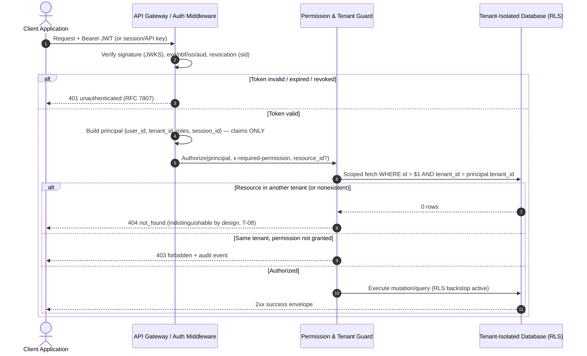

# Kelvin Security Platform — RBAC Matrix & Access Control

**Document Control**

| Field | Value |
| :--- | :--- |
| **Status** | Baseline — Peer Review Required (Security review mandatory) |
| **Milestone** | Phase 1 — Foundation & Core Architecture (`P1-12`) |
| **Depends On** | `docs/security/THREAT_MODEL.md` (`P1-03`), `docs/architecture/DATA_MODEL.md` (`P1-10`) |
| **Owner** | Product Security / Platform Engineering |
| **Review Cadence** | Quarterly, and on any role, permission, session, or endpoint change |
| **Related Docs** | `docs/api/API_STANDARDS.md` (§7 status semantics, §12 enforcement), `docs/security/ACCEPTABLE_USE.md` (§7 high-impact approvals), `docs/architecture/SYSTEM_ARCHITECTURE.md` (§8.2), `docs/architecture/decisions/ADR-0004.md` (role-scoped UI) |
| **Classification** | Internal — Engineering Specification (Security-Critical) |

---

## 1. Executive Summary

Kelvin's access-control architecture rests on three load-bearing pillars, each mapped to OWASP A01 (Broken Access Control) failure modes:

| Pillar | Rule | Failure it kills |
| :--- | :--- | :--- |
| **Server-side RBAC** | Every protected route declares a required permission; enforcement is a deny-by-default middleware guard. UI affordances are cosmetic (§8). | Curl-past-the-UI privilege escalation (T-15) |
| **Cryptographically signed sessions** | Short-lived ES256 JWT access tokens + rotating httpOnly refresh cookies; claims are the only source of principal identity. | Token tampering, role-claim spoofing, stolen sessions |
| **Tenant-bound data access** | Every query on tenant resources is anchored to `principal.tenant_id` — application predicate **and** PostgreSQL RLS (DATA_MODEL §9). Cross-tenant reads return `404`, indistinguishable from nonexistence. | BOLA/IDOR cross-tenant zero-day leakage (T-08) |

There is no configuration, feature flag, or "temporary" path that bypasses these pillars. Elevation happens only through the audited break-glass procedure (§7).

---

## 2. Roles

Four roles exist. Roles are **immutable strings stored on `users.role`** (DATA_MODEL §5.2); a user holds exactly one tenant role. Platform operators hold no tenant role.

| Role | Holder | Purpose | Grants |
| :--- | :--- | :--- | :--- |
| `PLATFORM_ADMIN` | Kelvin operations staff (employee accounts) | Operate the platform: tenants, fleet, break-glass | Control-plane operations; **no standing access to any tenant's findings/evidence** (§7) |
| `TENANT_ADMIN` | Customer org owner / compliance officer (ACCEPTABLE_USE §4) | Govern the tenant: members, keys, scope policy, high-impact approvals | Full tenant administration incl. `assessment:approve`, `scan_profile:approve`, `audit:read` |
| `SECURITY_ANALYST` | AppSec analyst (PERSONAS primary persona) | Day-to-day assessment & triage work | Assessments, findings, evidence, reports, assets — within the tenant |
| `READ_ONLY_AUDITOR` | Compliance auditor / external assessor | Evidence of what happened; change nothing | Read-only across tenant resources incl. audit log |

**Default posture:** deny-by-default. A permission not explicitly granted by §5 is denied. Roles are assigned at invite time by `TENANT_ADMIN` (or platform ops for `PLATFORM_ADMIN` accounts); self-elevation is structurally impossible (§4.3, `PRIV-*` tests).

> **Amendment note:** SYSTEM_ARCHITECTURE §8.2 originally listed three roles; `TENANT_ADMIN` is added here (and in DATA_MODEL §5.2) to separate customer administration from platform operation — the separation required by T-08/T-15 and ACCEPTABLE_USE §4's "platform administrators (tenant owners…)" wording.

---

## 3. Permission Vocabulary

Permissions are `<resource>:<action>` strings, stable across versions, matching the vocabulary already used in ACCEPTABLE_USE (`assessment:approve`) and PERSONAS (`finding:remediate`, `report:export`).

| Resource | Actions |
| :--- | :--- |
| `tenant` | `read`, `update`, `delete`, `suspend` |
| `user` | `read`, `invite`, `update`, `deactivate` |
| `session` | `revoke_own`, `revoke_tenant` |
| `api_key` | `read`, `create`, `revoke` |
| `project` | `read`, `create`, `update`, `delete` |
| `asset` | `read`, `create`, `update`, `verify`, `delete` |
| `scan_profile` | `read`, `create`, `update`, `approve` |
| `assessment` | `read`, `create`, `cancel`, `approve`, `override` |
| `finding` | `read`, `triage`, `remediate` |
| `evidence` | `read` |
| `report` | `read`, `create`, `export` |
| `audit` | `read` |
| `worker` | `read`, `manage` |
| `platform` | `administer` |
| `break_glass` | `request`, `approve` |

Every OpenAPI operation **MUST** declare `x-required-permission: <permission>` (or `x-required-permission: none` for `/health`); CI rejects operations without it (§9). The middleware maps the declaration to the central permission registry — never to ad-hoc `if role == ...` checks scattered through handlers.

---

## 4. Enforcement Architecture

### 4.1 Request Pipeline

### 4.2 Principal Rules (Non-Negotiable)

1. **Claims are the sole identity source.** `user_id`, `tenant_id`, `roles`, and `session_id` come exclusively from the verified JWT (or API-key record). They are **never** read from path params, query strings, headers, or body fields. Any client-supplied `tenant_id`/`role` is discarded before the handler runs.
2. **No tenant, no access.** Tenant-scoped routes require a non-null `tenant_id` claim; platform-only routes require the `PLATFORM_ADMIN` role *without* a tenant context (§7).
3. **Deny by default.** Unmatched permission → `403`. There is no fall-through "authenticated users may…" class.
4. **Central registry.** The permission registry (role → permission set) is a single reviewed table in code; handlers cannot grant themselves permissions.

### 4.3 BOLA/IDOR Prevention Patterns

| # | Pattern | Mandate |
| :--- | :--- | :--- |
| **B-1** | **Scoped fetch** | Every handler that takes a resource UUID loads it with `WHERE id = $1 AND tenant_id = $2` (`$2 = principal.tenant_id`). Loading by ID alone is a review-blocking defect. |
| **B-2** | **404 over 403 for cross-tenant** | A resource belonging to another tenant returns `404 not_found` — never `403` — so existence itself is not disclosed (API STANDARDS §7.2; DATA_MODEL §9). `403` is reserved for *same-tenant, insufficient role* (§4.4). |
| **B-3** | **Composite writes** | Inserts/updates carry `tenant_id` from the principal; composite tenant-safe FKs (DATA_MODEL §6.2) make cross-tenant parenting impossible at the database layer. |
| **B-4** | **RLS backstop** | Application predicates are defense-in-depth *on top of* mandatory RLS (DATA_MODEL §9). Neither layer is considered optional; both are tested (§9, `AC-BOLA-*`). |
| **B-5** | **Collection queries** | List endpoints never accept a tenant selector; result sets are inherently principal-scoped via RLS + query predicate. |
| **B-6** | **Platform admin data-plane ban** | Normal `PLATFORM_ADMIN` sessions cannot select tenant resources at all (their `tenant_id` claim is null and RLS admits no rows). Tenant data access requires break-glass (§7). |

### 4.4 Status-Code Semantics (contract with API STANDARDS §7)

| Condition | Status | Problem type |
| :--- | :--- | :--- |
| Missing/invalid/expired/revoked credentials | `401` | `urn:kelvin:problem:unauthenticated` |
| Authenticated; **cross-tenant or nonexistent** resource | `404` | `urn:kelvin:problem:not_found` |
| Authenticated; **same tenant**; permission not granted for this action | `403` | `urn:kelvin:problem:forbidden` |
| Permission granted; policy denies (scope violation, four-eyes pending) | `403` / `422` | `forbidden` / domain problem |

Every `403` and every cross-tenant `404` on a *known-existing* resource emits an audit event (`access.denied`) with principal, action, resource, correlation ID (SG-08).

---

## 5. Permission Matrix

Legend: **✓** granted · **✗** denied · **◐** conditional (rules in §6) · **◇** break-glass only (§7)

| Permission | PLATFORM_ADMIN | TENANT_ADMIN | SECURITY_ANALYST | READ_ONLY_AUDITOR |
| :--- | :---: | :---: | :---: | :---: |
| `tenant:read` (own tenant metadata) | ◇ | ✓ | ✓ | ✓ |
| `tenant:update` | ◇ | ✓ | ✗ | ✗ |
| `tenant:delete` / `tenant:suspend` | ✓ | ✗ | ✗ | ✗ |
| `user:read` (tenant directory) | ◇ | ✓ | ✓ | ✓ |
| `user:invite` / `user:update` / `user:deactivate` | ◇ | ✓ | ✗ | ✗ |
| `session:revoke_own` | ✓ | ✓ | ✓ | ✓ |
| `session:revoke_tenant` | ◇ | ✓ | ✗ | ✗ |
| `api_key:read` | ◇ | ✓ | ✗ | ✓ |
| `api_key:create` / `api_key:revoke` | ◇ | ✓ | ✗ | ✗ |
| `project:read` | ◇ | ✓ | ✓ | ✓ |
| `project:create` / `project:update` / `project:delete` | ◇ | ✓ | ✗ | ✗ |
| `asset:read` | ◇ | ✓ | ✓ | ✓ |
| `asset:create` / `asset:update` / `asset:verify` | ◇ | ✓ | ✓ | ✗ |
| `asset:delete` | ◇ | ✓ | ✗ | ✗ |
| `scan_profile:read` | ✓ (definitions) | ✓ | ✓ | ✓ |
| `scan_profile:create` / `scan_profile:update` | ✗ | ✓ | ✓ | ✗ |
| `scan_profile:approve` | ✗ | ◐ (four-eyes, §6.2) | ✗ | ✗ |
| `assessment:read` | ◇ | ✓ | ✓ | ✓ |
| `assessment:create` | ✗ | ✓ | ✓ | ✗ |
| `assessment:cancel` | ◇ | ✓ | ✓ | ✗ |
| `assessment:approve` (high-impact) | ✗ | ◐ (MFA + window, §6.1) | ✗ | ✗ |
| `assessment:override` (schedule/policy override) | ✗ | ◐ (§6.1) | ✗ | ✗ |
| `finding:read` | ◇ | ✓ | ✓ | ✓ |
| `finding:triage` | ◇ | ✓ | ✓ | ✗ |
| `finding:remediate` | ◇ | ✓ | ✓ | ✗ |
| `evidence:read` (redacted only) | ◇ | ✓ | ✓ | ✓ |
| `report:read` | ◇ | ✓ | ✓ | ✓ |
| `report:create` / `report:export` | ◇ | ✓ | ✓ | ✗ |
| `audit:read` | ◇ | ✓ | ✗ | ✓ |
| `worker:read` | ✓ | ✓ | ✓ | ✓ |
| `worker:manage` (drain/restart fleet) | ✓ | ✗ | ✗ | ✗ |
| `platform:administer` (tenants, quotas, fleet) | ✓ | ✗ | ✗ | ✗ |
| `break_glass:request` / `break_glass:approve` | ◐ (dual control, §7) | ✗ | ✗ | ✗ |

Notes:

* **◆ Column:** `PLATFORM_ADMIN`'s ◇ entries mean "operational metadata only, or break-glass for data-plane" — never standing tenant-data access (B-6).
* **`finding:remediate`** (ticket creation / fix tracking) follows PERSONAS §report journey; it is distinct from `finding:triage`.
* **`report:export`** is separately permissioned because T-15's escalation scenario is exactly an export endpoint; exports are audit-logged with report ID, assessment IDs, and row counts.
* Analysts can manage **assets** (add/verify targets) but not **projects** (scope boundaries define blast radius — TENANT_ADMIN policy ownership).

---

## 6. Conditional Grants & Separation of Duties

### 6.1 High-Impact Assessments (ACCEPTABLE_USE §7)

`assessment:approve` (and `assessment:override`) additionally require, enforced server-side at the orchestrator:

1. Session with `amr` including `mfa` (step-up; §3.4).
2. An approval record naming the scheduled window; execution outside the window auto-aborts (AUP §7).
3. Approver ≠ requester (separation of duties; recorded in `audit_log`).
4. Justification text (≥ 20 chars) persisted with the approval.

Destructive check categories remain schema-prohibited (SCAN_PROFILES §6) — no role can enable them.

### 6.2 Four-Eyes for Scan Profiles (T-03)

`scan_profile:update` on a previously approved profile, and `scan_profile:create`, produce a profile in `PENDING` state; `scan_profile:approve` by a **different** `TENANT_ADMIN` activates it. Creator ≠ approver is enforced by the approval service, not convention. Built-in profiles remain immutable.

### 6.3 Recertification

Role assignments are exported quarterly for tenant-admin review (T-15 mitigation: "periodic access recertification"); stale accounts (> 90 days inactive) are flagged for `user:deactivate`.

---

## 7. Privilege Separation & Break-Glass

### 7.1 Separation

* `PLATFORM_ADMIN` accounts are Kelvin-employee identities (SSO + hardware MFA); they are **never** members of customer tenants.
* Tenant personnel can never hold `PLATFORM_ADMIN`.
* The application role used for tenant data (`kelvin_app`, DATA_MODEL §9.2) is the same for all tenant roles — differentiation happens in the permission guard, not in database roles, so privilege cannot be escalated by acquiring a "better" DB credential.
* Routine platform-admin routes (tenant provisioning, fleet drain) are separate handlers from data-plane handlers; the latter accept **only** break-glass sessions (B-6).

### 7.2 Break-Glass Procedure

For incident response requiring a platform operator to touch tenant data:

1. **Request** — `break_glass:request` with a linked incident ticket ID, target tenant, and required scope (e.g., `finding:read`). MFA re-authentication mandatory.
2. **Dual approval** — a second, distinct `PLATFORM_ADMIN` approves (`break_glass:approve`). Self-approval is rejected (`AC-GLASS-02`).
3. **Elevation** — a dedicated break-glass session is minted: max TTL **60 minutes**, non-renewable, `roles: ["PLATFORM_ADMIN"]`, `bg: true`, target tenant in an isolated claim; auto-expiry enforced at token validation (`AC-GLASS-01`).
4. **Constrain** — the elevated session carries only the permissions listed in the request; all other permission checks still apply.
5. **Record** — every break-glass request, approval, and API call under the elevated session is written to the immutable audit log and streamed to the SIEM with a high-priority alert (T-05).
6. **Review** — post-hoc review within 5 business days; findings feed the incident record. Revocation is automatic at expiry and immediate on `session:revoke`.

Break-glass is the **only** path by which a platform operator reads tenant vulnerability data. There is no shared "superuser" database credential in application config.

---

## 8. Session & Token Management

### 8.1 Access Tokens (JWT)

| Property | Requirement |
| :--- | :--- |
| Algorithm | **ES256** (P-256); `alg: none` and all `HS*` algorithms hard-rejected before parsing |
| TTL | 15 minutes (no sliding refresh on the access token itself) |
| Issuer / audience | Single configured issuer; `aud` = `kelvin-api`; both verified |
| Key management | Asymmetric; public keys served at `/api/v1/.well-known/jwks.json` with `kid`; rotation with ≥ 24 h overlap |
| Claims | `sub` (user UUID), `tid` (tenant UUID; null for platform sessions), `roles[]`, `sid` (session UUID), `jti`, `auth_time`, `amr[]`, `bg` (break-glass flag, default false) |
| Validation | Signature, `exp` (skew ≤ 60 s), `nbf`, `iss`, `aud`, `sid` not revoked (§8.2), role set from **registry lookup by `sub` at high-risk actions** (stale-role revocation window ≤ access-TTL) |
| Transport | `Authorization: Bearer` (API STANDARDS §5.1); never in query strings |

Role/permission changes and user deactivation revoke all sessions immediately (§8.2) — the ≤ 15-minute staleness bound applies only to non-revoked sessions.

### 8.2 Refresh Sessions (`auth_sessions`, DATA_MODEL §5.13)

| Property | Requirement |
| :--- | :---|
| Token | Opaque 256-bit random; **SHA-256 hashed at rest**; never logged |
| Cookie | `kelvin_rt`: `HttpOnly; Secure; SameSite=Strict; Path=/api/v1/auth`; CSRF origin-check on cookie-authenticated mutations |
| Rotation | New refresh token + new access token on every use; old token invalidated |
| Reuse detection | Presentation of an already-rotated token invalidates the entire **token family**, revokes the session, and emits a security alert (stolen-token response) |
| Bounds | 30-day idle timeout; 90-day absolute lifetime |
| Revocation | Logout (`session:revoke_own`), admin revoke (`session:revoke_tenant`), role change, deactivation, break-glass expiry — all check `sid` server-side |
| Listing | Users/TENANT_ADMIN can list active sessions (device, last-used, IP) and revoke individually |

### 8.3 API Keys (CLI & automation)

* Format `kv_<key_id>_<secret>`; only the SHA-256 hash is stored; the prefix supports O(1) lookup and revocation.
* Bound to exactly one tenant and one role (the key impersonates a `SECURITY_ANALYST` or `TENANT_ADMIN` permission subset — never a superset of what the creating admin can grant).
* Shown once at creation; rotation supports an overlap window; revocation is immediate.
* Transmitted via `X-API-Key` only — never URLs, logs, or `Referer`-bearing contexts; optional mTLS binding (API STANDARDS §5.1).

### 8.4 Tampering Defenses

| Attack | Defense | Result |
| :--- | :--- | :--- |
| `alg: none` token | Allow-list ES256 only; reject before signature step | `401` (`AC-TOKEN-01`) |
| Payload edit (roles/tid) with original signature | Signature covers claims; mismatch fails verification | `401` (`AC-TOKEN-02`) |
| Expired token | `exp` check, 60 s max clock skew | `401` (`AC-TOKEN-03`) |
| Revoked session replay | `sid` checked against `auth_sessions` | `401` (`AC-TOKEN-04`) |
| HS256 key-confusion (sign with public key) | `HS*` rejected outright | `401` |
| Refresh-cookie theft | Rotation + family reuse detection (§8.2) | Family revoked + alert (`AC-TOKEN-06`) |
| Cross-tenant API key reuse | Key's tenant ≠ resource tenant → scoped fetch misses | `404` (`AC-TOKEN-07`) |

---

## 9. Automated Negative Test Specifications

CI-blocking suites (extend DATA_MODEL §9.3; THREAT_MODEL SG-04/SG-08/SG-10). Every case runs against a seeded two-tenant fixture (Tenant A analyst/admin/auditor, Tenant B resources).

### 9.1 BOLA / IDOR (`AC-BOLA-*`)

| ID | Case | Expected |
| :--- | :--- | :--- |
| AC-BOLA-01 | Tenant-A analyst `GET /findings/{id_B}` | `404 not_found`; no resource fields in body; `access.denied` audit event |
| AC-BOLA-02 | Tenant-A analyst `PATCH /findings/{id_B}` (triage) | `404`; zero rows updated (assert row state unchanged) |
| AC-BOLA-03 | Tenant-A analyst `DELETE /assessments/{id_B}` | `404`; assessment still present |
| AC-BOLA-04 | Tenant-A `GET /evidence/{id_B}/download` | `404`; object-store access not issued |
| AC-BOLA-05 | Tenant-A list `GET /findings?project={project_B}` | Empty page (RLS + predicate); never Tenant-B rows |
| AC-BOLA-06 | Tenant-A `POST /assessments` with `projectId: project_B` | `404` (composite tenant-safe FK / scoped project fetch) |

### 9.2 Role Boundaries (`AC-RBAC-*`)

| ID | Case | Expected |
| :--- | :--- | :--- |
| AC-RBAC-01 | Analyst `POST /users` (invite) | `403 forbidden` |
| AC-RBAC-02 | Analyst `POST /assessments/{id}/approvals` (high-impact) | `403` |
| AC-RBAC-03 | Auditor `POST /assessments` | `403` |
| AC-RBAC-04 | Auditor `PATCH /findings/{id}` (triage) | `403` |
| AC-RBAC-05 | TENANT_ADMIN `DELETE /tenants/{tid}` | `403` |
| AC-RBAC-06 | TENANT_ADMIN `POST /workers/{id}/drain` | `403` |
| AC-RBAC-07 | Analyst `GET /audit-log` | `403` |
| AC-RBAC-08 | Hidden UI control (analyst sees no export button) invoked via curl | `403` — proves §8 cosmetic-only rule |

### 9.3 Token & Session (`AC-TOKEN-*`)

| ID | Case | Expected |
| :--- | :--- | :--- |
| AC-TOKEN-01 | `alg: none` token | `401` |
| AC-TOKEN-02 | Valid-sig token with edited `roles` claim (re-signed with attacker key) | `401` |
| AC-TOKEN-03 | Expired access token | `401` |
| AC-TOKEN-04 | Valid token with revoked `sid` | `401` |
| AC-TOKEN-05 | Valid token, wrong `aud`/`iss` | `401` |
| AC-TOKEN-06 | Refresh token replay after rotation | `401`; family revoked; alert emitted |
| AC-TOKEN-07 | Tenant-B API key → Tenant-A resource | `404` |

### 9.4 Privilege & Break-Glass (`AC-PRIV-*`, `AC-GLASS-*`)

| ID | Case | Expected |
| :--- | :--- | :--- |
| AC-PRIV-01 | Analyst `PATCH /users/{self}` body `{"role":"TENANT_ADMIN"}` | `403` (role field immutable to non-platform, non-self-elevating paths) |
| AC-PRIV-02 | TENANT_ADMIN invites user as `PLATFORM_ADMIN` | `403` |
| AC-PRIV-03 | TENANT_ADMIN approves own high-impact request (separation of duties) | `403` |
| AC-GLASS-01 | Break-glass session used after 60-minute TTL | `401` |
| AC-GLASS-02 | Self-approval of break-glass request | `403` |
| AC-GLASS-03 | Break-glass `finding:read` session attempts `user:deactivate` | `403` (constrained scope) |
| AC-GLASS-04 | Normal PLATFORM_ADMIN `GET /findings/{id}` | `404`/`403` per B-6 — no tenant rows visible |

**Coverage gates (CI):** (a) every OpenAPI operation declares `x-required-permission`; (b) every permission in §5 has ≥ 1 negative test; (c) every state-changing endpoint has an audit-log assertion (SG-08); (d) RLS suite from DATA_MODEL §9.3 remains green.

---

## 10. Client-Side Permissions Are Cosmetic

The React dashboard (ADR-0004) receives the principal's permission set (from `/api/v1/me`) to hide/disable affordances and shape role-scoped navigation (PERSONAS §5.1). This is **user-experience only**:

1. No frontend branch is a security control. Every hidden button corresponds to a server-side `403`/`404` (`AC-RBAC-08` is the standing proof).
2. The client never receives permissions it "shouldn't see used" as a secrecy mechanism — the server enforces regardless of what the client knows.
3. Security reviews of frontend PRs check only UX consistency, never authorization soundness — authorization soundness is exclusively a server-side review item (SG-10 code owners).

---

## 11. Governance & Change Control

1. **This matrix is normative.** New endpoints cannot merge without: an `x-required-permission` declaration, a registry entry, and at least one negative test (§9 gates).
2. **Permission additions** require Product Security review; permission *removals or semantic changes* require an ADR and a deprecation window (API STANDARDS §3.2 alignment).
3. **Role model changes** (new role, split duties) require Product Security + Platform Engineering sign-off and a DATA_MODEL §5.2 migration.
4. **Break-glass procedure changes** require Product Security sign-off; the procedure is exercised in a game-day at least semi-annually.
5. **Review cadence:** quarterly, per T-15 recertification, and on any auth-stack change.

---

## 12. Traceability

| Artifact | Reference |
| :--- | :--- |
| Planning reference | `P1-12` |
| Milestone | Phase 1 — Foundation & Core Architecture |
| Blocked by | `P1-03` — `docs/security/THREAT_MODEL.md`; `P1-10` — `docs/architecture/DATA_MODEL.md` |
| Status-code contract | `docs/api/API_STANDARDS.md` §7.2 (401/403/404 semantics) |
| Enforcement pipeline | `docs/api/API_STANDARDS.md` §12.1; DATA_MODEL §9 (RLS), §6.2 (composite FKs), §5.13 (`auth_sessions`) |
| High-impact approvals | `docs/security/ACCEPTABLE_USE.md` §7; SCAN_PROFILES §6 (destructive checks prohibited) |
| Threat controls | THREAT_MODEL — T-02 (credential abuse), T-03 (four-eyes profiles), T-05 (audit), T-08 (BOLA/cross-tenant), T-15 (privilege escalation); SG-04, SG-08, SG-10; R-01 |
| UI affordances | `docs/architecture/decisions/ADR-0004.md`; `docs/product/PERSONAS.md` §5.1 |
| OpenAPI permission annotations | `apps/api/openapi/openapi.yaml` (`x-required-permission`) |
| Session persistence | `docs/architecture/DATA_MODEL.md` §5.13 |

---

*Kelvin Security Platform — Phase 1 Engineering Backlog*
