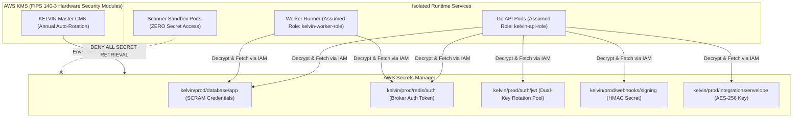

# KELVIN Secrets, Key and Cryptographic Material Management Specification

**Document Control**

| Field | Value |
| :--- | :--- |
| **Status** | Approved — Production Security Specification |
| **Milestone** | Phase 5 — Production Hardening, Deployment & Release (`P5-06`) |
| **Parent Roadmap** | [KELVIN Engineering Roadmap](../ISSUE-02_ENGINEERING_ROADMAP.md) |
| **Parent Issue** | Issue #362 (`P5-06`) |
| **Threat Model Reference** | [`docs/security/THREAT_MODEL.md`](THREAT_MODEL.md) |
| **Review Cadence** | Quarterly |
| **Classification** | Internal — Enterprise Security Baseline |

---

## 1. Secrets Management Architecture & KMS Hierarchy

KELVIN relies on a centralized, hardware-backed cryptographic architecture utilizing AWS Secrets Manager and AWS KMS Customer Managed Keys (CMK) with automated key rotation:

---

## 2. Cryptographic Secret Catalog & Lifecycles

| Secret Name | Purpose | Cryptographic Algorithm | Rotation Period | Access Scope |
| :--- | :--- | :--- | :--- | :--- |
| **`database/app`** | Routine PostgreSQL access | SCRAM-SHA-256 | 90 days (Automated Lambda) | API & Worker |
| **`database/migrator`** | DDL migration admin | SCRAM-SHA-256 | 90 days (Automated Lambda) | CI/CD Runner Only |
| **`redis/auth`** | Task broker queue auth | 48-char CSPRNG token | 90 days (Staged Rollover) | API & Worker |
| **`auth/jwt`** | Session & access tokens | HMAC-SHA256 / RSA-2048 | 90 days (Grace Rollover) | API Control Plane |
| **`webhooks/signing`** | Webhook delivery signatures | HMAC-SHA256 | 180 days | API Control Plane |
| **`integrations/envelope`** | 3rd-party Jira/Slack tokens | AES-256-GCM | 365 days (KMS CMK) | API Control Plane |

---

## 3. Key Rotation & Graceful Rollover Procedures

### 3.1 JWT Dual-Key Overlap Mechanism
During JWT signing key rotation:
1. A new primary key $K_{new}$ is generated in Secrets Manager with a new Key ID (`kid: 2026-Q4`).
2. API instances load $K_{new}$ for issuing new tokens while retaining previous key $K_{prev}$ in memory for signature verification during the 24-hour token validity window.
3. Once active tokens signed by $K_{prev}$ expire, $K_{prev}$ is permanently retired.

### 3.2 Database Password Zero-Downtime Rotation
1. Lambda rotator generates a secondary password and adds it to the database user.
2. Secrets Manager updates the current secret version.
3. API and Worker connection pools detect the credential rotation event and refresh connections gracefully.
4. Old password is revoked from PostgreSQL.

---

## 4. Leakage Prevention & Audit Logging

1. **Zero Logging Guarantee:**
   - Sensitive fields (`password`, `jwt_secret`, `token`, `secret_key`) are intercepted by Go logging middlewares and scrubbed with `[REDACTED]`.
2. **Memory Scrubbing:**
   - Secrets are held in heap memory as byte slices and scrubbed after use where supported.
3. **Auditability:**
   - Every `GetSecretValue` and `Decrypt` API call produces an immutable AWS CloudTrail event capturing principal ARN, client IP, timestamp, and accessed secret ARN.
