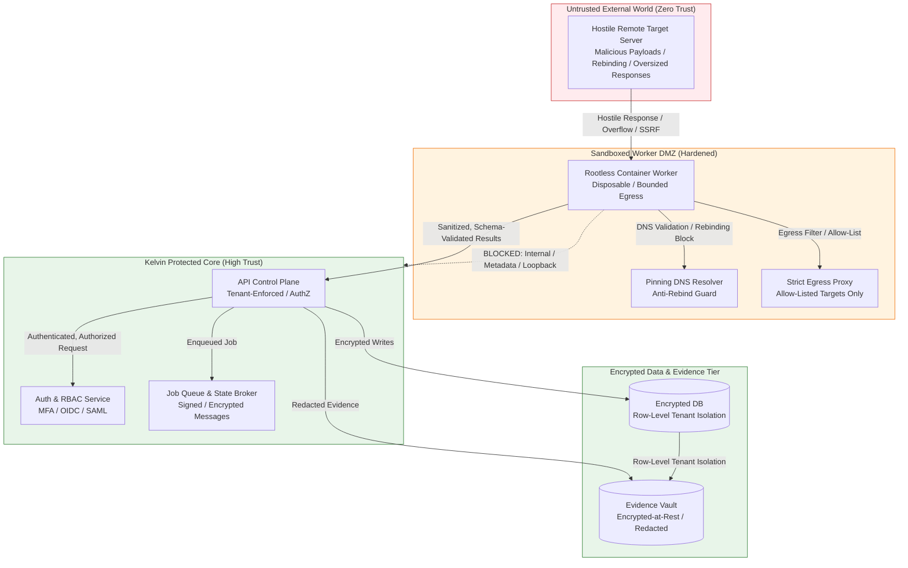

# Kelvin Security Platform — Threat Model (STRIDE)

**Document Control**

| Field | Value |
| :--- | :--- |
| **Status** | Baseline — Peer-Reviewed |
| **Milestone** | Phase 1 — Foundation & Core Architecture (`P1-03`) |
| **Depends On** | `docs/PRODUCT_VISION.md` (`P1-01`) |
| **Owner** | Product Security / Platform Engineering |
| **Review Cadence** | Quarterly, at every phase gate, and on any architecture change |
| **Related Docs** | `docs/PRODUCT_VISION.md`, `docs/ARCHITECTURE_AND_FEATURES.md`, `docs/MVP_AND_PHASE_BIFURCATION.md`, `docs/product/PERSONAS.md` |
| **Classification** | Internal — Security Sensitive |

---

## 1. Executive Summary

Kelvin is an inherently high-value attack surface: it accepts user-provided URLs/IPs, dispatches network requests, executes third-party scanner binaries, parses untrusted remote responses, and stores confidential vulnerability findings across tenant boundaries. Compromise of the platform can lead to cloud-infrastructure takeover (SSRF exfiltration of IAM metadata credentials), host-node compromise (container breakout / scanner RCE), and mass confidentiality breach (cross-tenant vulnerability-data leakage).

This threat model is the formal security baseline for Kelvin. It maps trust boundaries, classifies data flows, executes a STRIDE analysis across the platform, documents high-impact attack scenarios, and mandates defense-in-depth controls. Every subsequent architectural issue must be reviewed against this model before implementation.

---

## 2. Trust Boundaries & Data Flow Classification

### 2.1 Security Zones

The platform is partitioned into three security zones with explicit trust boundaries:

### 2.2 Trust Boundaries

| Boundary ID | Boundary | Trust Direction | Controls |
| :--- | :--- | :--- | :--- |
| **TB-01** | User → API Control Plane | Untrusted → High Trust | TLS 1.3, mutual auth for CLI, OIDC/SAML + MFA, RBAC, rate limiting |
| **TB-02** | API → Job Queue / Worker | High Trust → Hardened DMZ | Signed/encrypted job messages, scoped execution bounds, short-lived worker tokens |
| **TB-03** | Worker → Remote Target | Hardened DMZ → Untrusted | Rootless container, egress allow-list, pinned DNS, bounded timeouts, response size caps |
| **TB-04** | Worker → Internal Control Plane | Hardened DMZ → High Trust | Blocked by default (egress proxy denies RFC 1918/loopback/link-local/metadata) |
| **TB-05** | API → DB / Evidence Vault | High Trust → High Trust | Parameterized queries, row-level tenant isolation, encryption-at-rest, credential redaction pipeline |
| **TB-06** | Remote Target → Worker | Untrusted → Hardened DMZ | Response schema validation, size limits, MIME-type enforcement, header sanitization, timeout killswitch |

### 2.3 Data Flow Classification

| Data Flow ID | Description | Classification | Integrity | Confidentiality | Sanitization Required |
| :--- | :--- | :--- | :--- | :--- | :--- |
| **DF-01** | User-submitted target list & scope | Internal Confidential | Medium | High | Yes (scope validation) |
| **DF-02** | Scanner worker → raw remote response | Untrusted / Hostile | Low | Variable | Yes (schema + size + header validation) |
| **DF-03** | Normalized finding → findings service | Internal Confidential | High | High | Yes (credential redaction) |
| **DF-04** | Evidence payload → evidence vault | Internal Confidential | High | High | Yes (redact tokens/cookies/keys) |
| **DF-05** | Executive / technical report → export | Internal Confidential | High | High | Yes (tenant-scoped, no cross-tenant data) |
| **DF-06** | Job state message → queue / worker | Internal | High | Medium | Yes (signed, short-lived tokens) |
| **DF-07** | Audit log entry → immutable store | Confidential / Integrity-Critical | Critical | Medium | No (append-only, tamper-evident) |

---

## 3. STRIDE Threat Matrix

Each threat is rated with DREAD (Damage, Reproducibility, Exploitability, Affected Users, Discoverability) and CVSS v3.1 impact/likelihood. Severity: **Critical / High / Medium / Low**.

| ID | STRIDE | Threat | Attack Vector | Asset | DREAD | CVSS | Severity | Phase | Mitigation |
|:---|:---|:---|:---|:---|:---|:---|:---|:---|:---|
| **T-01** | Spoofing | Attacker spoofs target ownership (DNS TXT / HTTP challenge) to authorize scanning of third-party domains | Network | Authorization Register | 8.2 | 7.5 (High) | High | P1 | DNS TXT + HTTP dual-challenge verification; short-lived verification tokens; re-verification on scope change |
| **T-02** | Spoofing | Compromised analyst credentials used to create assessments against unauthorized targets | Credential theft | API Control Plane | 7.8 | 8.1 (High) | High | P1 | MFA enforcement, RBAC, session timeouts, device posture, impossible-travel detection |
| **T-03** | Tampering | Attacker modifies scan profile or egress rules to broaden blast radius | Insider / compromised engineer account | Scan Profile Builder | 7.5 | 7.2 (High) | High | P1 | Immutable profile versioning, four-eyes approval for profile changes, audit log on all policy mutations |
| **T-04** | Tampering | Worker returns forged/normalized findings that suppress real vulnerabilities | Malicious remote target / compromised worker | Findings Service | 8.0 | 6.8 (Medium) | Medium | P2 | Schema-validated results, cryptographic job attestation, cross-worker finding correlation |
| **T-05** | Repudiation | Analyst or engineer denies initiating an out-of-scope scan | Insider threat | Audit Trail | 7.0 | 5.9 (Medium) | Medium | P1 | Immutable append-only audit log, signed log entries, SIEM export, 12-month minimum retention |
| **T-06** | Information Disclosure | SSRF: attacker submits `169.254.169.254` or internal VPC IPs to exfiltrate IAM credentials / internal services | Remote target input | Worker / Control Plane | 9.2 | 9.1 (Critical) | Critical | P1 | Egress allow-list, RFC 1918/loopback/link-local/metadata blocklist, pinned DNS (anti-rebind), rootless worker, no outbound to control plane |
| **T-07** | Information Disclosure | DNS rebinding: worker resolves allow-listed domain to internal IP after initial check | Remote target | DNS Resolver | 8.8 | 8.2 (High) | Critical | P1 | Pinning DNS resolver with TTL=0 and re-resolution blocking; single-resolution binding |
| **T-08** | Information Disclosure | Cross-tenant leakage: flawed row-level isolation exposes Customer A's findings to Customer B | Multi-tenant flaw | DB / Evidence Vault | 9.0 | 8.8 (Critical) | Critical | P1 | Row-level security policies, separate encryption keys per tenant, tenant-context enforced at API gateway, quarterly tenant-isolation penetration tests |
| **T-09** | Information Disclosure | Unredacted credentials (tokens, cookies, API keys, private keys) persisted in evidence store | Scanner output | Evidence Vault | 8.4 | 7.7 (High) | High | P1 | Automated redaction pipeline (headers, cookies, keys) before persistence; regex + entropy-based secret detection; quarantine on detection failure |
| **T-10** | Denial of Service | Malicious target returns multi-gigabyte response or slowloris headers to exhaust worker memory/CPU | Remote target | Worker | 7.6 | 6.5 (Medium) | Medium | P1 | Response size caps (default 10 MB), read timeouts, connection limits, per-worker memory/CPU cgroups, circuit breaker |
| **T-11** | Denial of Service | Parser buffer overflow / malformed HTTP headers crash scanner worker | Remote target | Worker | 8.0 | 7.4 (High) | High | P1 | Rootless disposable container (crash containment), response schema validation, fuzz-tested scanner adapters, worker restart supervisor |
| **T-12** | Denial of Service | Unbounded scan queue exhausts broker memory / worker pool | Authenticated user | Job Queue | 6.8 | 5.3 (Medium) | Medium | P1 | Per-tenant job quotas, bounded queue depth, priority classes, backpressure, auto-scale with hard caps |
| **T-13** | Elevation of Privilege | Scanner binary vulnerability yields container breakout to host node | Malicious target / compromised scanner | Worker Host | 9.4 | 9.3 (Critical) | Critical | P2 | Rootless containers, non-root user, read-only root filesystem, seccomp/AppArmor profiles, no `--privileged`, user namespace remapping, host kernel hardening |
| **T-14** | Elevation of Privilege | Compromised worker escapes DMZ and reaches internal control plane | Compromised worker | Control Plane | 8.6 | 8.1 (High) | Critical | P1 | Egress proxy denies all traffic to control plane CIDRs (RFC 1918, loopback, link-local, metadata); one-way results return only via API ingress |
| **T-15** | Elevation of Privilege | Analyst escalates to admin via missing RBAC enforcement on report export | Insider / compromised account | RBAC | 7.4 | 6.9 (Medium) | High | P1 | Centralized RBAC engine, deny-by-default, least-privilege roles, periodic access recertification |
| **T-16** | Elevation of Privilege | Supply-chain: malicious scanner adapter image deployed to worker fleet | Compromised registry | Worker Fleet | 8.2 | 7.6 (High) | High | P2 | Signed container images (Cosign), image vulnerability scanning in CI, allow-listed adapter registry, SBOM verification |

---

## 4. Documented Attack Scenarios

### Scenario A — SSRF to Cloud Metadata (T-06)

**Attack flow:**
1. Attacker (or compromised analyst account) submits `http://169.254.169.254/latest/meta-data/iam/security-credentials/` as an assessment target.
2. Without controls, the worker resolves the metadata endpoint and exfiltrates the instance IAM role credentials.
3. Attacker uses credentials to assume broader cloud privileges, enumerate resources, or pivot into the VPC.

**Preconditions absent in Kelvin:**
* Egress proxy blocks `169.254.0.0/16` and all RFC 1918 / loopback / link-local ranges before any worker request.
* Target scope validation rejects prohibited IPs synchronously before job creation (TB-03, TB-06).
* Worker is rootless with no host credentials attached; even successful SSRF yields no IAM profile.

**Phase:** P1  
**Residual risk:** Low — defense-in-depth at scope validation, DNS, and egress layers.

---

### Scenario B — DNS Rebinding (T-07)

**Attack flow:**
1. Attacker controls `evil.example.com`, which initially resolves to an allow-listed public IP during scope verification.
2. After validation passes, the DNS record is rebound to `127.0.0.1` or an internal service IP.
3. The worker, using a cached or re-resolved address, sends scan traffic to an internal host, bypassing the initial allow-list.

**Mitigations (P1):**
* Pinning DNS resolver: single resolution at scope-validation time, bound to the worker process; TTL forced to 0; re-resolution blocked during job execution.
* Secondary egress allow-list check on every outbound connection (IP re-verified at connection time).
* Rebinding attempts logged as security events and trigger job termination.

---

### Scenario C — Parser Buffer Overflow / Oversized Response (T-10, T-11)

**Attack flow:**
1. Hostile target returns a multi-gigabyte HTTP response or malformed chunked-encoding headers.
2. Scanner adapter parser attempts to buffer the full response, exhausting worker memory (DoS) or triggering a buffer overflow (RCE).
3. Compromised worker is used to pivot or disrupt the scanning fleet.

**Mitigations (P1/P2):**
* Response size cap (default 10 MB, configurable per profile); oversized responses truncated and flagged.
* Read/connection timeouts and slowloris protections.
* Rootless disposable container: crash is contained; worker restarted by supervisor; no host access.
* seccomp/AppArmor profile restricting syscalls; non-root user; read-only root filesystem.
* Fuzz-tested scanner adapters before integration.

---

### Scenario D — Container Breakout / Host Compromise (T-13)

**Attack flow:**
1. Third-party scanner binary has a known vulnerability exploitable via malicious target response.
2. Attacker achieves RCE inside the worker container.
3. Without hardening, attacker escapes to the host node, steals host credentials, and pivots into the Kelvin control plane.

**Mitigations (P2):**
* Rootless containers with user namespace remapping (container UID ≠ host UID).
* Non-root user inside container; read-only root filesystem; `--read-only` tmpfs for /tmp and /run.
* seccomp profile blocking dangerous syscalls (mount, ptrace, reboot, module loading).
* AppArmor/profile restricting network egress to the allow-list only.
* No `--privileged`, no Docker socket mount, no host PID/IPC namespace sharing.
* Host kernel hardening (unprivileged user namespaces disabled where possible).

---

### Scenario E — Cross-Tenant Data Leakage (T-08)

**Attack flow:**
1. Multi-tenant deployment with Customers A and B.
2. Flawed query lacks tenant context, allowing Customer B's analyst to query Customer A's zero-day findings.
3. Mass confidentiality breach of enterprise vulnerability data; regulatory and contractual liability.

**Mitigations (P1):**
* Row-level security policies enforced at the database layer (tenant_id on every table).
* Tenant context injected at API gateway and immutable for the request lifetime.
* Separate encryption keys per tenant for evidence vault.
* Quarterly tenant-isolation penetration test as a phase-gate exit criterion.
* Audit-log alert on cross-tenant query patterns.

---

## 5. Defense-in-Depth Control Summary

| Control | Phase | Threats Addressed | Implementation Note |
| :--- | :--- | :--- | :--- |
| Rootless, disposable container workers | P2 | T-13, T-11 | Non-root user, read-only FS, seccomp/AppArmor, no host socket |
| Strict egress proxy / allow-list | P1 | T-06, T-07, T-14 | Blocks RFC 1918, loopback, link-local, `169.254.0.0/16`; one-way results return |
| Pinning DNS resolver (anti-rebind) | P1 | T-07 | Single resolution at validation; TTL=0; re-resolution blocked |
| Target scope & policy guard | P1 | T-01, T-06, T-07 | Rejects prohibited IPs before job queuing; ownership verification |
| Response size caps & timeouts | P1 | T-10, T-11 | 10 MB default cap; read/connection timeouts; circuit breaker |
| Credential redaction pipeline | P1 | T-09 | Strips auth headers, cookies, tokens, keys before persistence |
| Row-level tenant isolation | P1 | T-08 | DB RLS policies; tenant context at gateway; per-tenant keys |
| Immutable audit trail | P1 | T-05, T-08 | Append-only, signed entries, SIEM export, 12-month retention |
| MFA + RBAC + session limits | P1 | T-02, T-15 | OIDC/SAML, deny-by-default, access recertification |
| Signed container images + registry allow-list | P2 | T-16 | Cosign signing, CI image scanning, SBOM verification |
| Schema-validated worker results | P2 | T-04 | Reject malformed/oversized findings; cryptographic job attestation |

---

## 6. Residual Risk Register

| Risk ID | Residual Risk | Residual Severity | Accepted By | Review Date |
| :--- | :--- | :--- | :--- | :--- |
| R-01 | Zero-day scanner adapter vulnerability despite sandboxing | Medium | Platform Security | Quarterly |
| R-01 | Insider threat with valid admin credentials bypassing RBAC | Medium | Product Security | Quarterly |
| R-03 | Novel SSRF bypass via IPv6 or unusual DNS record types | Low | Platform Security | Per release |
| R-04 | Supply-chain compromise of a base image not caught by scanning | Medium | Platform Security | Per release |

All residual risks are accepted with compensating controls and re-reviewed at each phase gate.

---

## 7. Security Acceptance Gates for Pull Request Reviews

Every PR touching security-relevant code (scope engine, worker sandbox, auth/RBAC, DB layer, evidence pipeline, scanner adapters) must satisfy:

| Gate | Requirement | Verification |
| :--- | :--- | :--- |
| **SG-01** | No new outbound network path from worker to control plane CIDRs | Egress-proxy unit tests; network-policy review |
| **SG-02** | Scope validation rejects RFC 1918 / loopback / link-local / metadata | Negative test suite against blocked-IP list (100% pass) |
| **SG-03** | DNS rebinding protection present and tested | Rebinding scenario unit test; DNS pinning verification |
| **SG-04** | All new DB queries enforce tenant context | Row-level security test; tenant-context middleware test |
| **SG-05** | Credential redaction covers new evidence types | Secret-detection scan on evidence ingestion; redaction unit tests |
| **SG-06** | Scanner adapter runs rootless; no privileged flags | Dockerfile review; container security scan (Trivy/Grype) |
| **SG-07** | Signed images / SBOM for new or changed adapters | Cosign verification in CI; SBOM attached |
| **SG-08** | Audit-log entry for new state-changing endpoint | Audit-trail coverage test |
| **SG-09** | No raw secrets in logs, error messages, or responses | Secret-grep scan; error-message review |
| **SG-10** | Security review approval from code owner | 1 approved security review (SECURITY.md code owners) |

Failure of any gate blocks merge to `main`.

---

## 8. Review & Change Control

1. This threat model is reviewed quarterly and at every phase gate (P1 through P6).
2. New trust boundaries, data flows, or scanner adapters require threat-model amendment before implementation.
3. Severity changes (new Critical/High threats) require an out-of-cycle security review and stakeholder sign-off.
4. Changes are versioned in git with the associated milestone tag; the DREAD/CVSS ratings are re-validated on each review.

---

## 9. Traceability

| Artifact | Reference |
| :--- | :--- |
| Planning reference | `P1-03` |
| Milestone | Phase 1 — Foundation & Core Architecture |
| Blocked by | `P1-01` — `docs/PRODUCT_VISION.md` (Product Vision, Scope and Non-Goals) |
| Product vision & non-goals | `docs/PRODUCT_VISION.md` |
| System architecture | `docs/ARCHITECTURE_AND_FEATURES.md` |
| MVP & phase bifurcation | `docs/MVP_AND_PHASE_BIFURCATION.md` |
| User personas & journeys | `docs/product/PERSONAS.md` |
| Engineering roadmap | `docs/ROADMAP.md` |

---

*Kelvin Security Platform — Phase 1 Engineering Backlog*
