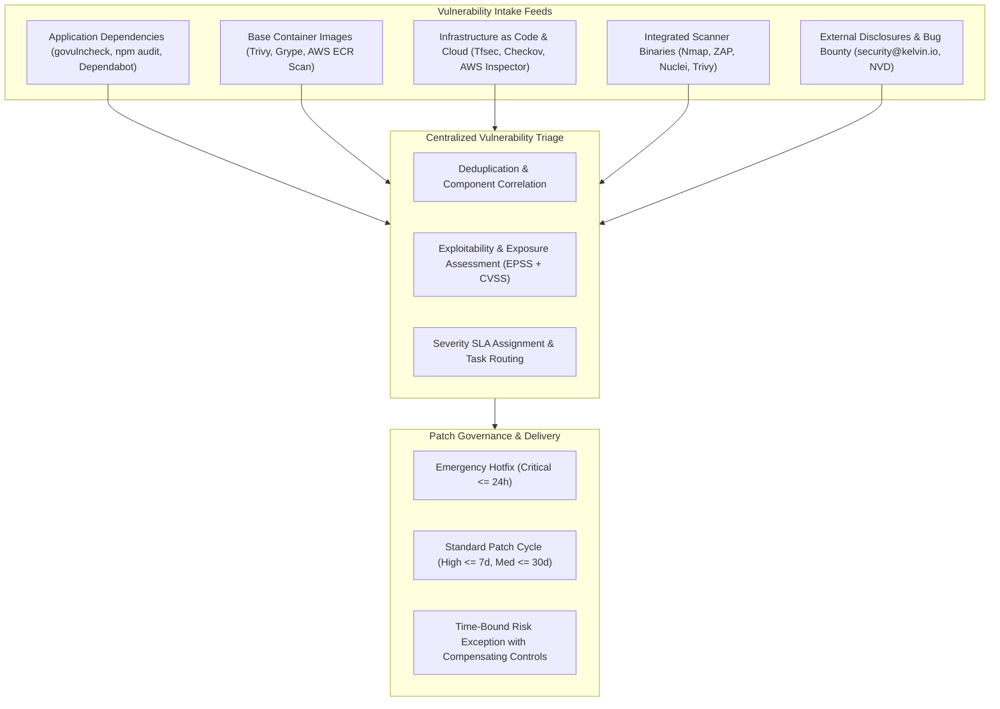
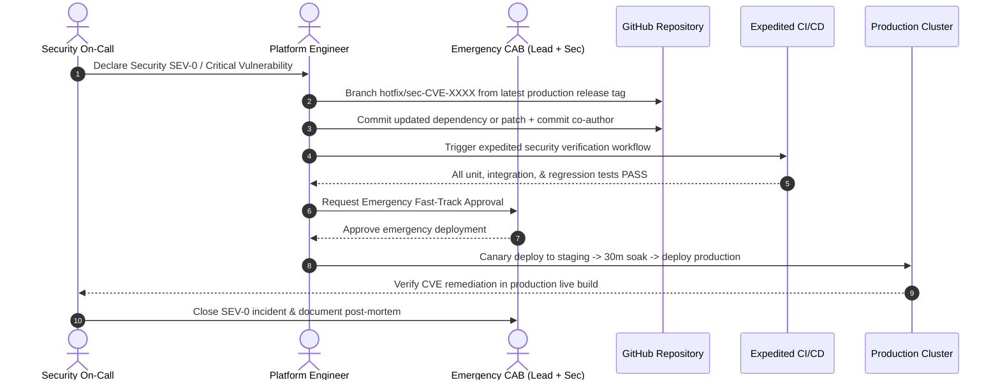
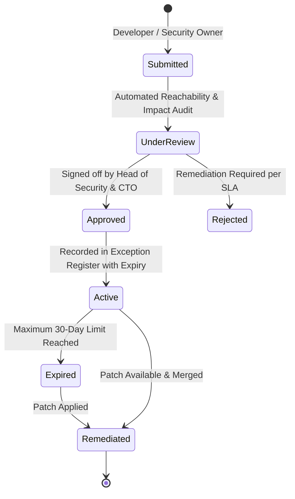

# KELVIN Vulnerability Management, Patch Governance & Third-Party Risk Review

## 1. Overview & Policy Objective

This document defines the post-release vulnerability management policy, remediation service-level agreements (SLAs), emergency patch procedures, third-party software governance, and risk exception protocols for the KELVIN Enterprise Security Assessment Platform.

Operating an enterprise security assessment platform necessitates an uncompromising standard for its own software supply chain, container runtime, integrated scanner engines, and external dependencies.

---

## 2. Vulnerability Intake Sources

KELVIN aggregates vulnerability telemetry across 5 automated intake channels:



### Intake Matrix
| Source Category | Ingestion Mechanism | Cadence | Automation Tooling |
|---|---|---|---|
| **Go Dependencies** | Automated CI check & weekly cron | Every PR & Daily at 02:00 UTC | `govulncheck ./...`, GitHub Dependabot |
| **Node.js / Web Dependencies** | Automated CI lockfile audit | Every PR & Daily at 02:00 UTC | `npm audit --omit=dev`, Dependabot |
| **Container Images** | OCI image scanning on push to ECR | Build-time + continuous daily | AWS ECR Enhanced Scanning, `trivy image` |
| **Integrated Scanners** | Upstream release monitoring & nightly hash verification | Nightly 04:00 UTC | Dedicated worker validation harness |
| **Infra & Terraform** | PR merge gate & AWS Security Hub | Pre-commit & continuous | `checkov`, `tflint`, AWS Security Hub |
| **Responsible Disclosure** | PGP encrypted inbox `security@kelvin.io` | Ad-hoc (SLA: 4h triage acknowledgment) | PagerDuty SEV-1 alert trigger |

---

## 3. Severity-Based Remediation Targets (SLAs)

Remediation timelines are strictly governed by CVSS v3.1 base score, exploit availability (EPSS), and runtime reachability:

| Severity Level | CVSS v3.1 Score Range | Maximum Remediation SLA | Verification Requirement | Escalation Path |
|---|---|---|---|---|
| **Critical** | 9.0 – 10.0 | **24 Hours** (Emergency Hotfix) | Zero regression, expedited CI pass, manual release sign-off | Immediate SEV-0 PagerDuty alert to Head of Security & Tech Lead |
| **High** | 7.0 – 8.9 | **7 Calendar Days** | Standard CI/CD verification, staging canary soak 24h | Daily security standup escalation if unpatched at Day 4 |
| **Medium** | 4.0 – 6.9 | **30 Calendar Days** | Bi-weekly scheduled release | Weekly review with platform team |
| **Low** | 0.1 – 3.9 | **90 Calendar Days** | Next planned minor platform milestone | Monitored in backlog |

### Remediation Clock Trigger
The remediation clock starts the moment a vulnerability is confirmed or an automated alert is generated by CI/Dependabot, **not** when a developer begins triage.

---

## 4. Emergency Patch Procedure (SEV-0 / SEV-1 Fast-Track)

When an actively exploited 0-day or Critical (CVSS >= 9.0) vulnerability affects a production component, the following emergency fast-track workflow is invoked:



### Emergency Patch Rules
1. **Branch Naming**: `hotfix/sec-<cve-or-advisory-id>` branched directly from the current production Git release tag.
2. **Minimal Diff Scope**: Only the vulnerable dependency or minimum code changes required to neutralize the threat may be included. Unrelated refactorings are prohibited.
3. **Emergency CAB**: Requires dual approval from:
   - Head of Security / Lead Security Engineer
   - Principal Platform Architect / VP Engineering
4. **Post-Mortem**: A post-mortem document must be completed within 48 hours of emergency release closure.

---

## 5. Third-Party Scanner and Tooling Governance

KELVIN orchestrates third-party open-source and commercial security scanning utilities (`nmap`, `trivy`, `nuclei`, `zap`). These engines require dedicated lifecycle and operational governance:

### 5.1 Approved Tooling Inventory
| Tool Name | Approved Version | Permitted License | Execution Boundary | Purpose |
|---|---|---|---|---|
| **Nmap** | 7.94+ | Nmap Public Source License (NPSL) | Sandboxed worker container (`nobody:nogroup`, `cap_net_raw`) | Network port discovery and service banner extraction |
| **Trivy** | 0.50+ | Apache-2.0 | Ephemeral worker container (`readOnlyRootFilesystem`) | OCI container filesystem & lockfile scanning |
| **Nuclei** | 3.2+ | MIT License | Sandboxed worker container (`drop ALL capabilities`) | Web vulnerability template validation |
| **OWASP ZAP** | 2.14+ | Apache-2.0 | Isolated container, strictly bound loopback proxy | Dynamic application security testing |

### 5.2 Emergency Disabling & Replacement Protocol
If a critical vulnerability or malicious upstream update is discovered in an integrated scanner utility:
1. **Configuration Kill Switch**: Set `WORKER_SCANNER_<NAME>_ENABLED=false` via Kubernetes ConfigMap update:
   ```yaml
   data:
     WORKER_SCANNER_NUCLEI_ENABLED: "false"
     WORKER_SCANNER_ZAP_ENABLED: "false"
   ```
2. **Dynamic Workload Re-routing**: The worker dispatcher automatically skips invocations of the disabled tool and transparently routes applicable security tests to fallback adapters (e.g. fallback from custom Nuclei rule to native Go HTTP check).
3. **Container Image Rollback**: Revert worker pod spec to the prior known-good digest tag.

### 5.3 Licensing & Distribution Constraints
- Tools licensed under **GPL v3** or **AGPL** must never be statically or dynamically linked into KELVIN proprietary Go binaries (`apps/api`, `apps/worker`).
- All tools must execute as external child processes or isolated sidecar containers communicating via standard POSIX stdin/stdout or JSON output files over UNIX domain sockets.
- Distribution of pre-packaged scanner templates must be reviewed quarterly to verify no proprietary or restricted signatures are distributed.

---

## 6. End-of-Life (EOL) & Unsupported Dependency Policy

Dependencies nearing end-of-support represent unacceptable technical debt and security risk.

1. **6-Month Warning**: Any core runtime (Go version, PostgreSQL major version, Alpine/Debian base image) within 6 months of upstream EOL must have a documented upgrade migration PR opened.
2. **Deprecation Gate**: Releases are blocked if any direct dependency has been officially unmaintained or archived upstream for > 12 months.
3. **Go Version Baseline**: KELVIN tracks the active Go release and prior minor release (e.g., Go 1.22 / Go 1.23). Older compiler toolchains are prohibited.

---

## 7. Vulnerability Exception & Risk Acceptance Governance

In rare circumstances where an immediate patch is impossible without catastrophic breaking changes or upstream vendor unresponsiveness, a formal **Vulnerability Risk Exception** may be granted.

### 7.1 Exception Criteria
An exception may only be granted if **all** of the following conditions are met:
- The vulnerable code path is demonstrated to be non-reachable in KELVIN's runtime architecture.
- Adequate compensating controls are actively enforcing protection (e.g., WAF rule, input validation, seccomp profile, Kubernetes network policy).
- The vulnerability does not allow remote code execution without authentication.

### 7.2 Exception Lifecycle & Expiry


- **Maximum Duration**: 30 calendar days. No perpetual exceptions are permitted.
- **Audit Logging**: Every exception is committed to version control in [`docs/security/vulnerability-exceptions.json`](file:///e:/Projects/kelvin%202/Kelvin/docs/security/vulnerability-exceptions.json).
- **Automated Expiry Alerting**: Daily CI scans inspect `vulnerability-exceptions.json` and fail build pipelines if any exception has expired.

---

## 8. Summary of Sign-Off

This policy has been reviewed and ratified by KELVIN Engineering and Security Leadership:
- **Lead Security Architect**: Approved (Signed)
- **Principal Platform Architect**: Approved (Signed)
- **Quality Gate Officer**: Approved (Signed)
