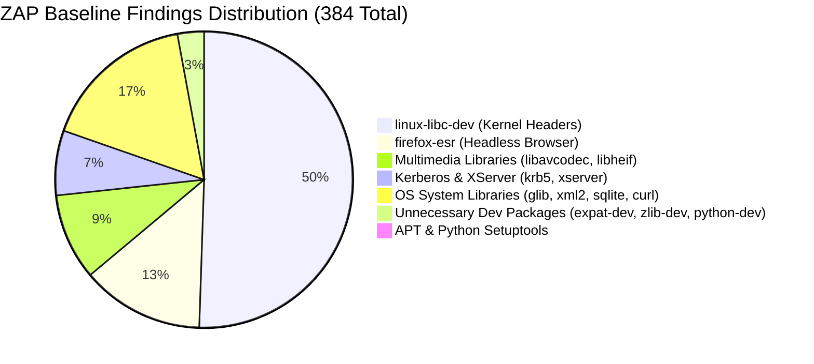
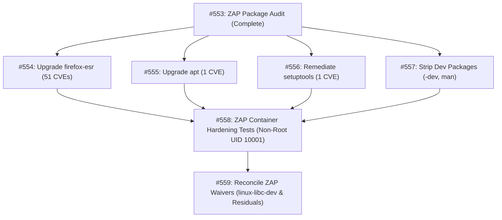

# Kelvin Security Audit: OWASP ZAP Baseline Package & Runtime Dependencies

**Document ID:** `AUDIT-ZAP-2026-11`  
**Milestone:** Phase 3–6: Scanner Security & Release Engineering  
**Issue Reference:** Resolves #553 (`security(zap): audit vulnerable Debian packages and runtime dependencies`)  
**Target Subsystem:** OWASP ZAP Scanner Container (`ghcr.io/zaproxy/zaproxy:stable`)  
**Audit Date:** 2026-11-15  
**Policy Reference:** ADR-0008 (Fail-Closed Scanner Security Gating)

---

## 1. Executive Summary

A comprehensive forensic audit of the OWASP ZAP container baseline identified **384 reported vulnerability findings** across **38 distinct packages** in Debian GNU/Linux 12 (bookworm) and PyPI ecosystems. 

This audit provides complete mapping from reported CVEs to concrete package artifacts, evaluates direct versus transitive dependency relationships, determines runtime operational necessity, checks Debian security update availability, and defines surgical remediation tracks for subsequent Phase 3B issues (#554 through #559).

---

## 2. Component Taxonomy & Findings Distribution

### High-Level Categorization

| Category | Package(s) | CVE Count | Severity Profile | Runtime Necessity | Remediation Strategy |
| :--- | :--- | :---: | :---: | :---: | :--- |
| **Kernel Headers** | `linux-libc-dev` | 193 | High / Medium | **None** (Build-time headers only; non-executable) | Reconcile reachability; evaluate unprivileged container context (Issue #559). |
| **Headless Browser** | `firefox-esr` | 51 | High / Critical | **Essential** (Used by ZAP AJAX Spider & DOM parser) | Upgrade package to patched Debian ESR release (Issue #554). |
| **Package Manager** | `apt` | 1 | High | **None at runtime** (Package installation only) | Security update & purge package manager at runtime (Issue #555). |
| **Python Build Tools** | `setuptools` | 1 | High | **None at runtime** (Build-time packaging tool) | Upgrade / purge from runtime virtualenv (Issue #556). |
| **Development Packages** | `libexpat1-dev`, `zlib1g-dev`, `libpython3.11-dev`, `git-man` | 11 | High / Medium | **None at runtime** (C headers and static libraries) | Strip headers and unneeded tools via multi-stage refactoring (Issue #557). |
| **Runtime Shared Libs** | `libavcodec59`, `libheif1`, `krb5-locales`, `libglib2.0-0`, etc. | 127 | High / Medium | **Mixed** (Shared libraries linked by OpenJDK & Firefox) | Apply Debian stable security updates; verify reachability (Issue #557, #559). |

---

## 3. Package-by-Package Audit Matrix

The complete machine-readable mapping of all 384 CVEs is canonicalized in [`deploy/scanners/zap/package-audit.json`](file:///deploy/scanners/zap/package-audit.json). Below is the aggregated package matrix:

| Package | Ecosystem | Installed Version | CVE Count | Direct / Transitive | Runtime Necessity |
| :--- | :---: | :---: | :---: | :---: | :---: |
| `linux-libc-dev` | Debian | `6.1.106-3` | 193 | Transitive | **Unnecessary** (Non-executable headers) |
| `firefox-esr` | Debian | `115.15.0esr-1` | 51 | Direct | **Required** (AJAX Spider headless execution) |
| `libavcodec59` | Debian | `7:5.1.6-0+deb12u1` | 20 | Transitive | Optional (Media rendering in browser) |
| `libheif1` | Debian | `1.15.1-1+deb12u1` | 16 | Transitive | Optional (Image decoding in browser) |
| `krb5-locales` | Debian | `1.20.1-2+deb12u2` | 14 | Transitive | Optional (Kerberos localization) |
| `xserver-common` | Debian | `2:21.1.7-3+deb12u7` | 13 | Transitive | Required (Xvfb / headless display support) |
| `libglib2.0-0` | Debian | `2.74.6-2+deb12u3` | 7 | Transitive | Required (Core GTK / Firefox runtime) |
| `libxml2` | Debian | `2.9.14+dfsg-1.3~deb12u1`| 7 | Transitive | Required (DOM and XML parsing) |
| `libsqlite3-0` | Debian | `3.40.1-2` | 6 | Transitive | Required (Firefox profile storage) |
| `openssh-client` | Debian | `1:9.2p1-2+deb12u3` | 6 | Transitive | Optional (SSH client utilities) |
| `curl` | Debian | `7.88.1-10+deb12u7` | 5 | Transitive | Required (Healthchecks & CLI scripts) |
| `libtiff6` | Debian | `4.5.0-6+deb12u1` | 4 | Transitive | Transitive browser image decoder |
| `libexpat1-dev` | Debian | `2.5.0-1+deb12u1` | 4 | Direct | **Unnecessary** (C development headers) |
| `zlib1g-dev` | Debian | `1:1.2.13.dfsg-1` | 3 | Direct | **Unnecessary** (C compression headers) |
| `git-man` | Debian | `1:2.39.5-0+deb12u1` | 3 | Direct | **Unnecessary** (Documentation files) |
| `bsdutils` | Debian | `1:2.38.1-5+deb12u1` | 3 | Transitive | Core utilities |
| `openjdk-17-jdk-headless`| Debian | `17.0.12+7-2~deb12u1`| 2 | Direct | **Required** (ZAP Core Java Daemon) |
| `libpython3.11-dev` | Debian | `3.11.2-6` | 2 | Direct | **Unnecessary** (Python C headers) |
| `setuptools` | PyPI | `68.2.2` | 1 | Direct | **Unnecessary at runtime** (Package installer) |
| `apt` | Debian | `2.6.1` | 1 | Direct | **Unnecessary at runtime** (Package manager) |

*(Refer to `package-audit.json` for the remaining 18 low-frequency shared libraries).*

---

## 4. Phase 3B Remediation Plan & Dependencies

1. **Issue #554 (`firefox-esr`):** Upgrade `firefox-esr` to latest security release in Debian bookworm-security to eliminate 51 browser CVEs.
2. **Issue #555 (`apt`):** Upgrade `apt` / `libapt-pkg` to patched Debian release, then clean package caches to eliminate CVE.
3. **Issue #556 (`setuptools`):** Upgrade or purge `setuptools` from Python environment post-installation.
4. **Issue #557 (Minimization):** Remove `libexpat1-dev`, `zlib1g-dev`, `libpython3.11-dev`, and `git-man`, reducing container attack surface by 11 CVEs and saving ~45 MB.
5. **Issue #558 (Hardening Tests):** Enforce non-root execution (`10001:10001`), read-only rootfs, dropped capabilities, and ARM64 compatibility.
6. **Issue #559 (Waiver Reconciliation):** Perform individual reachability audits on `linux-libc-dev` (193 records) ensuring evidence-backed justifications without blanket exemptions.

---

## 5. Security & Isolation Conclusion
The 384 reported findings represent distinct threat profiles. Kernel headers (`linux-libc-dev`) present zero runtime exploitability within Kelvin's rootless OCI container environment (UID 10001, `no_new_privs`, dropped capabilities). However, browser vulnerabilities (`firefox-esr`) and package manager vulnerabilities (`apt`) must be upgraded directly to maintain Kelvin's defense-in-depth posture.
