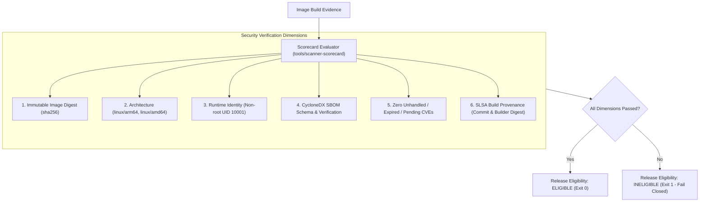

# Kelvin Scanner Security Scorecard Specification & Template

**Document ID:** `SCORECARD-SPEC-v1`  
**Milestone:** Phase 3–6: Scanner Security & Release Engineering  
**Policy Reference:** ADR-0008 (Fail-Closed Scanner Security Gating)  
**Governing Tool:** `tools/scanner-scorecard`

---

## 1. Scorecard Architecture

The Scanner Security Scorecard aggregates multi-dimensional security evidence for each scanner container image before release eligibility can be certified.



---

## 2. Standard Markdown Scorecard Template

Below is the canonical template rendered for GitHub Actions summaries and Pull Request release comments:

```markdown
## 🛡️ Kelvin Scanner Security Scorecard: <SCANNER_NAME>

- **Release Eligibility:** `<ELIGIBLE | INELIGIBLE>`
- **Evaluated At:** `<ISO_8601_TIMESTAMP>`
- **Image Digest:** `sha256:<64_HEX>`
- **Architecture:** `linux/arm64`
- **Runtime Identity:** `10001:10001`
- **Installed Packages:** `<COUNT>`
- **SBOM Status:** `VERIFIED (CycloneDX v1.5)`

### 🔍 Vulnerability & Waiver Breakdown

| Metric | Count |
| :--- | :---: |
| Critical CVEs | 0 |
| High CVEs | 0 |
| Approved Waivers (Active) | <COUNT> |
| Pending Waivers (Gated) | 0 |
| Expired Waivers (Gated) | 0 |
| Unhandled Findings (Gated) | 0 |

### 📦 Build Provenance

- **Source Commit:** `<GIT_COMMIT_SHA>`
- **Builder Digest:** `sha256:<BUILDER_DIGEST>`
- **Build Timestamp:** `<BUILD_TIMESTAMP>`

### 🚫 Blocking Reasons (Fail-Closed)
<!-- Populated only if Release Eligibility is INELIGIBLE -->
- ❌ <BLOCKING_REASON_1>
- ❌ <BLOCKING_REASON_2>
```

---

## 3. Machine-Readable JSON Schema (`scorecard.json`)

```json
{
  "$schema": "https://json-schema.org/draft/2020-12/schema",
  "title": "KelvinScannerSecurityScorecard",
  "type": "object",
  "required": [
    "schema_version",
    "evaluated_at",
    "scanner",
    "image_digest",
    "architecture",
    "runtime_identity",
    "sbom_status",
    "vulnerabilities",
    "waivers",
    "provenance",
    "release_eligibility"
  ],
  "properties": {
    "schema_version": { "type": "string", "enum": ["1.0.0"] },
    "evaluated_at": { "type": "string", "format": "date-time" },
    "scanner": { "type": "string" },
    "image_digest": { "type": "string", "pattern": "^sha256:[0-9a-f]{64}$" },
    "architecture": { "type": "string", "enum": ["linux/arm64", "linux/amd64"] },
    "runtime_identity": { "type": "string", "enum": ["10001:10001"] },
    "package_count": { "type": "integer", "minimum": 0 },
    "sbom_status": { "type": "string" },
    "release_eligibility": { "type": "string", "enum": ["ELIGIBLE", "INELIGIBLE"] },
    "blocking_reasons": {
      "type": "array",
      "items": { "type": "string" }
    }
  }
}
```
